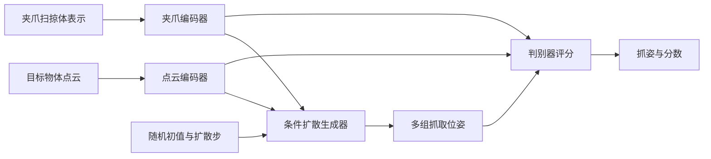
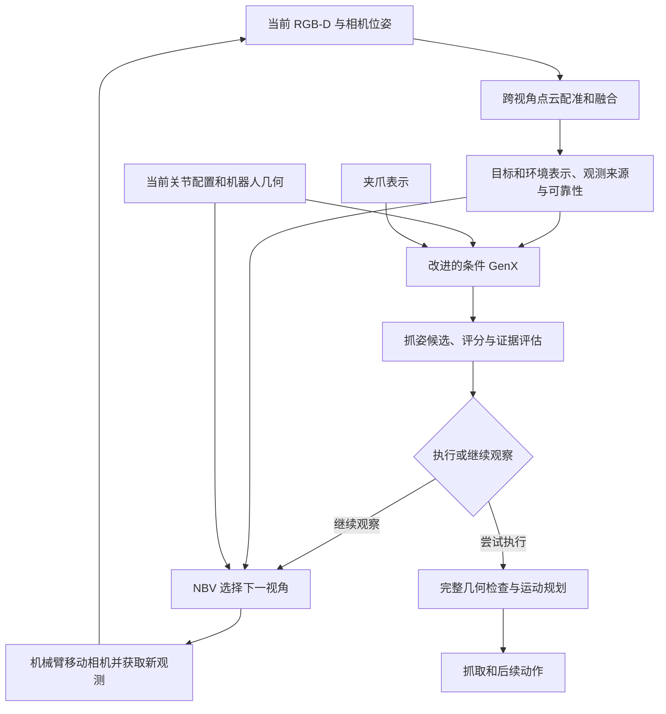

# 和老师讨论用：GenX 改网、NBV 与跨视角点云融合的逻辑

核对日期：2026-11-04。以下将本地已有实现和拟研究方案分开说明。拟研究网络尚未实现、训练或验证。

2026-11-05 更新：加入完整场景/状态条件并训练生成器的成本较高。根据时间紧的约束，当前实施优先级调整为冻结 GenX、离线规划监督的小评价网络，以及可选的推理侧引导；详见 [短期路线与新文献](GENX_PRACTICAL_LITERATURE_20261105.md)。下文完整改网结构保留为长期方案。

一句话：NBV 决定接下来从哪里看，融合整合已经看见的信息，抓取网络提出夹爪应该放在哪里及怎样朝向，运动规划器求机械臂怎样到达并完成后续动作。四者可以组成闭环。

**先分清四种“姿态/状态”**

| 名称 | 含义 | 例子 |
| --- | --- | --- |
| 相机位姿 | 相机在哪里、朝哪里看 | 下一次侧视观察的位置与朝向 |
| 抓取位姿 | 夹爪抓取时的位置和朝向 | 抓香蕉中段、夹指沿哪个方向闭合 |
| 机械臂关节配置 q | 各关节当前转到多少角度 | 当前腕部、肘部和其余关节配置 |
| 夹爪形态与闭合运动 | 手指形状、开口及闭合时经过的空间 | Nero 手指长度、最大开口、闭合扫掠体 |

GenX 的“跨 embodiment”重点是夹爪适配。其夹爪表示不等于整条机械臂的实时关节状态。GraspNet 的 300 个 view 是候选夹爪接近方向，不是相机要采集的 300 个观察视角，与 NBV 中的 view 含义不同。

**一、原版 GenX 在做什么**

模型主要分为物体编码器、夹爪编码器、扩散抓姿生成器和抓姿判别器。

点云编码器将形状转成网络可处理的特征向量。夹爪编码器将完全张开、半张开两种扫掠体的尺寸和中心位置编码成夹爪特征，原方法合计使用 12 维扫掠体参数。扩散生成器从带随机性的位姿表示出发，反复预测和去除噪声，生成多组可能的抓姿。判别器根据物体、夹爪和候选抓姿评估质量。[论文方法章节](https://arxiv.org/html/2606.00998v1)

本机 worker 读取 `release/gen` 的 diffusion 配置和 `release/dis` 的 discriminator 配置，不能只看 `scripts/config_xgrasp.yaml` 的模板默认值，也不能读取 gen 配置里未启用的 discriminator 块。

本地 release 的实际配置是：生成器和判别器均使用 `ptv3vanilla` 点云编码器、`sweep_volume_v2` 夹爪表示；物体和夹爪特征分别为 512 维。生成器配置 `attention=cat_attn`，训练/推理扩散步数配置为 20，位姿表示为 `r3_so3`。这些是本地权重的配置，不能推广为所有版本的 GenX 都只能使用这个结构。

面向调用者，当前输入是目标 Nx3 点云和指定夹爪资源，返回 K 个 4×4 抓取位姿矩阵以及 K 个分数；每个位姿表达 3D 位置和旋转。当前接口没有像本地 GraspNet 一样回归独立的连续开口宽度头，项目中的开口、推进和闭爪过程另行处理。随机初值和扩散步是模型采样过程中的量，不是额外传感器观测。

本地 `tools/run_graspgenx_worker.py` 将目标点云去中心化后调用 diffusion planner，再把中心加回生成姿态。其请求里虽然有 `T_base_camera`、桌面高度和预抓取距离，但这些值在网络推理后的桌面评估中使用，不是已经进入去噪器的网络条件。

官方 scene demo 会在分割的各个物体上推理，并过滤与场景冲突的候选；end2end 管线也包含运动规划。因此应准确地说当前核心生成调用缺少机械臂实时状态和显式障碍条件，不能说官方 GenX 系统从不考虑场景。[官方仓库](https://github.com/NVlabs/GraspGenX)

**二、它与本地 GraspNet 的区别**

| 项目 | 本地 GraspNet-baseline | 当前接入的 GenX |
| --- | --- | --- |
| 输入 | 当前入口主要是 XYZ 点云，原网络可处理场景点云，项目裁取目标作为提议输入 | 目标 XYZ 点云，加夹爪扫掠体条件 |
| 形状编码 | PointNet++ | 本地 release 使用 PointTransformerV3；代码有其他选择 |
| 生成方式 | 选种子点、预测接近方向、裁剪抓取局部区域，再预测角度/深度组合的质量及宽度 | 条件扩散反复去噪，采样抓取位姿，再用判别器评分 |
| 输出 | 多个抓姿、宽度、深度、质量分数等 | 多个抓姿及评分，当前适配层另行设置开口/推进 |
| 夹爪适配 | 原标注和预测参数围绕特定平行夹爪定义 | 显式编码夹爪，原工作重点之一是跨夹爪泛化 |
| 机械臂轨迹 | 需要另外求解 | 需要另外求解 |

本地 GraspNet 顺序为 `Pointnet2Backbone → ApproachNet → CloudCrop → OperationNet / ToleranceNet → pred_decode`；初始化的方向/角度/深度数为 300/12/4。这不是简单的一个“直接回归姿态”的单头网络。两者都能产生多个 6DoF 抓姿，区别在表示、监督、候选生成机制及夹爪条件。[GraspNet 官方实现](https://github.com/graspnet/graspnet-baseline)

**三、“加入关节状态和场景”究竟改哪里**

关节状态指抓取开始前机械臂各关节的当前角度。场景条件指桌面、邻近障碍、目标相对基座的位置等与执行有关的几何信息。它们要经过编码后作用于模型，不能只写进 JSON 请求文件。

原始形式可以概括为 `p(grasp | target, gripper)`，拟研究形式是 `p(grasp | target, scene, q_current, spatial_relation, gripper, observation_evidence)`。这里改变的是生成的条件分布，第一版输出仍是抓取位姿与评分，运动轨迹仍由规划器求解。

| 改动位置 | 具体做什么 | 为什么需要 |
| --- | --- | --- |
| 输入与编码分支 | 增加状态编码器；增加保留障碍空间结构的场景编码器 | 让网络获取执行所需条件 |
| 条件融合层与去噪器 | 将物体、夹爪、场景、状态特征融合，并在扩散步骤使用 | 从生成时偏向适合当前场景和机械臂配置的抓法 |
| 判别器 | 同步输入场景与状态，可分别预测夹持质量与可执行性 | 避免生成器提出新候选后，评分器仍只按旧目标排序 |
| 训练数据与目标 | 对不同 q、不同障碍布局提供对应的可行抓姿和代价监督 | 让新增条件有可学习的作用 |

这可以称为“条件编码与融合结构的修改，以及扩散生成/判别网络的条件化训练”。如果同时设计新的局部交互或条件注入机制，还会涉及内部结构改进。简单向量拼接是合理原型和实验基线，但其本身不保证创新性。

关节状态与目标几何必须处在可相互定位的表达中。当前目标点云去中心化后，还需输入目标相对基座的位置/位姿，或者把场景和机器人连杆转换到共同目标坐标系。相同居中形状在工作空间中不同位置可能有不同可达性，仅靠形状和 q 可能不足以确定答案。

同一场景，机械臂从不同起始配置出发，对同一抓姿的关节运动量、路径绕行和规划代价可能不同。场景里多放一个障碍，适合的接近方向也可能改变。网络希望学习这些条件对抓姿分布的影响。不能把“离当前末端近”直接等价为完整路径好，也不能由输入 q 推断已经保证全臂可执行。

**四、是不是把现在的后处理编进网络**

可以理解为把部分执行知识和偏好提前用于抓姿生成，但不会把现有后处理代码原样写进网络就得到可训练模型。

当前工程有三类操作，需要区别：

| 当前操作 | 新方案中如何处理 |
| --- | --- |
| 相机坐标转基座、夹爪坐标转 TCP、手眼变换 | 继续使用明确的几何计算；标定错误需要单独修复 |
| 候选姿态族、推进、居中搜索，以及接触/桌面排序 | 可提取训练监督，让网络直接提出更合适候选，研究能否减少搜索 |
| 完整 CAD 碰撞、IK、路径检查与运行反馈 | 继续验证网络结果；学习评分不会自动成为几何或执行保证 |

已有修正模块不是每次都改姿态：会先保留通过完整路线的原生候选；在没有原生可行路线时，才搜索姿态族和推进变体。新网络应与“原 GenX + 同样的修正与检查预算”比较，检验生成质量、可行候选覆盖、后处理工作量与总耗时。

如果只加入状态做最终排序，改的是评价网络；如果新增条件参与扩散去噪并改变候选采样，才是这里拟研究的条件生成器。二者可以同时做，并通过消融分开验证。

**五、NBV 和点云融合放在哪里**

NBV 输出下一次相机观察位姿或对应的观察动作；点云融合输出统一坐标下的目标与环境几何，并可携带来源和可靠性信息；条件 GenX 输出抓取位姿。它们各有任务。

这里有两层融合：几何融合负责把多帧点云对齐成可用的物理几何；特征融合负责让网络利用不同视角的信息。可以都研究，也可以先做一种；不能把当前 ICP/体素融合直接命名为新增 attention 网络，也不能因增加特征融合就忽略物理点云的配准质量。

本项目已经有 NBV 信息代理，包含 surface/contact/sweep/occlusion 等项和观察运动成本。其中接触区域主要是 PCA 代理，在正式抓取预测前使用。新 NBV 可以研究使用候选抓姿及其缺失证据来决定下一视角，但这属于拟新增闭环。

还需修正之前的一个前提：当前 `--active-restore-center` 默认启用，主流程检查观察恢复结果，多视角之后通常回到中心配置再进入抓取。因此“选了不同的最后视角，所以直接从不同 q 抓取”不是当前默认行为。

若保留回中心，NBV 仍可研究抓取相关信息收益和观察往返代价，条件 GenX 接收实际抓取前的中心 q。若未来研究从最后观察配置直接抓取，才需要把观察结束后的 q 和抓取代价一起优化，并重新设计、验证观察到抓取的过渡。这两个实验协议应明确区别，不能仅通过关闭一个参数声称已完成后者。

MGPC 可以作为补全先验接在目标表示中，也可以作为消融因素。它估计未见几何；跨视角融合整合真实观测；两者需要保留来源区别。

**六、为什么需要新的训练数据**

同一个物体点云，如果在不同 q 和障碍下总使用相同抓姿标签，网络没有充分理由学习新的条件。需要对同一场景采多个可行起始 q，改变障碍布局，用实际 Nero 模型生成候选的接触、碰撞、IK 和路线结果；规划超时应单列，不能直接充当物理不可达真值。

已有几何搜索可以产生弱监督，但它可能偏向现有规则，需要独立验证。GraspNet-1Billion 可提供公共抓取监督和多视角观测，不自带 Nero 从任意 q 到抓姿的路线代价标签。AP 用于离线抓姿质量，路径代价与真机保持成功需要另外评测。

建议由预训练 GenX 初始化，先训练新增条件分支并逐步微调相关网络，以减少对原有抓取能力的破坏。改输入不会自动带来增益，也不能从现有少量单物体记录推断已经具备足够训练数据。

**可直接向老师介绍的版本**

> 我目前的系统先做主动多视角采集和点云融合，再由 GraspNet 或 GenX 产生抓姿，最后通过几何修正和规划筛选获得可执行方案。我想研究三者的联系：NBV 获取抓取相关的新信息，跨视角融合形成带观测证据的目标和环境表示，再将场景几何、当前机械臂状态与夹爪表示共同输入改进的 GenX，使这些条件参与扩散抓姿生成和评分。希望在相同观察与规划预算下，提高可执行抓姿覆盖并减少后处理搜索。第一版保留完整运动规划，网络输出仍是抓姿。当前需要确定条件表达、变化条件下的训练标签，以及 NBV 是否保留回中心的执行协议。

以上是研究方案而非已经成立的新颖性结论。定题还需对照状态/场景条件生成、主动抓取、跨视角学习及抓取运动联合优化的相关工作。
