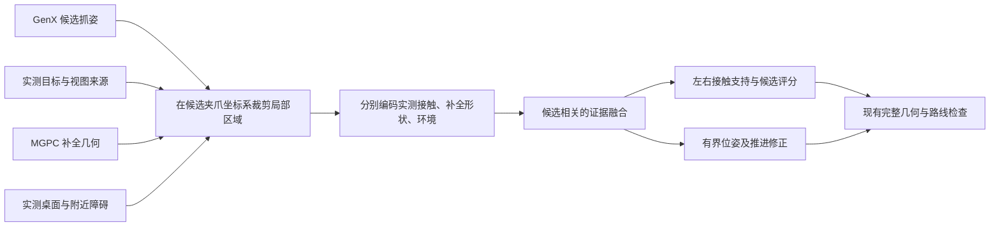

# whole-grasp：抓取网络文献与期刊创新路线

核对日期：2026-11-01。依据本地实现、当前八组实验表，以及作者论文、会议页面和官方代码仓库。本次完成文献和方案核对；下文的新网络是研究设计，尚无训练或效果验证。公开资源状态以本次查询为准。

2026-11-04 补充：原版网络、当前工程与拟改方案的逐层说明见 [讨论说明](GENX_NBV_DISCUSSION_20261104.md)。重新核对确认当前 `active_restore_center` 默认启用，因此下文“观察结束后的关节状态影响抓取”的联合优化应理解为未来改变执行协议后的研究设想；默认回中心时，应使用恢复后的实际 q，不能把最后侧视角 q 直接当作抓取初值。

2026-11-05 补充：根据工期限制，实施优先级改为“冻结 GenX + 小型执行评价网络 + NBV/融合闭环”，推理侧采样引导作为第二阶段。本次新增核对 GraRe、Steer2Grasp、V-GPS 等相近工作；不能把普通候选重排或奖励引导视为尚无先例。详见 [短期路线与文献](GENX_PRACTICAL_LITERATURE_20261105.md)。下文全条件生成器训练方案暂作为长期备选。

**判断**

目前值得推进有针对性的网络改进，但不能把“改过网络”当作期刊创新的充分条件。使用现有骨干是正常研究方式；论文需要一个明确问题、针对该问题的新增机制，以及能排除其他解释的实验。单纯把 GraspNet 换成另一个公开模型，或给现有模型增加通用 attention，贡献仍可能不足。

本项目的研究主线确定为：**NBV、跨视角点云融合，以及加入机械臂状态和场景条件的 GraspGen-X 网络改进。** 三者共同服务于有限观察预算下的可执行抓取。网络主方案明确修改 GenX 生成器的条件输入与去噪过程，并让判别器读取相应条件；跨视角模块和 NBV 与它构成闭环。使用预训练 GenX 初始化，新增条件训练与后续微调不等于把 GenX 仅作为固定黑盒。

接触证据、观测可靠性与补全先验可以用于构建这一共享状态。下文的判别器与修正方案保留为可选扩展。MGPC 先作为形状先验和消融因素，其去留由实验决定。

**本地实现揭示的问题**

| 已核对实现 | 对选题的意义 |
| --- | --- |
| `graspnet-baseline/models/graspnet.py`：PointNet++、ApproachNet、CloudCrop、OperationNet、ToleranceNet；主脚本初始化 `input_feature_dim=0` | 当前这一入口向 GraspNet 提供 XYZ，没有给网络明确的视图来源、实测/补全标记或观测可靠性通道 |
| `real_nero_grasp/pointcloud_fusion.py`：voxel/surfel 融合、跨视图支持统计、几何置信度，surfel 分支可返回 confidence | 不能把“增加置信度融合”写成项目原本没有的模块；可研究如何把已有观测信息保留到学习网络中 |
| `real_nero_grasp/active_view_scoring.py`：surface/contact/sweep/occlusion/motion 评分；信息代理注明选视角发生在抓取检测前，接触区使用 PCA 代理 | 可以研究候选抓姿条件的选视角与融合闭环，但“加入接触覆盖”本身已不是本项目缺失能力 |
| `real_nero_grasp/mgpc_completion.py`：以 MGPC 输出替换候选输入；接触、开口、环境和路径检查继续用实测数据 | 系统已经区分候选先验和执行证据；但抓取网络自身还没有显式学习两者的区别 |
| MGPC 配对一张参考 RGB/mask 和参考相机位姿，多视角点云先变换到该参考系 | 当前不能称为“多视角 RGB/点云联合学习网络” |
| `tools/run_graspgenx_worker.py`：向 GenX 传入居中的目标 Nx3，明确指定 `planner="diffusion"` | 当前是目标点云条件候选生成；附近障碍和机器人状态由后续流程检查，而非该调用的显式网络输入 |
| `third_party/GraspGenX/graspgenx/models/discriminator.py`：融合抓姿、物体与夹爪 embedding 后预测分数 | 可在此扩展候选相关的局部接触证据与场景编码分支 |
| `real_nero_grasp/nero_refinement.py`：姿态族、闭合方向等价变换、推进搜索，再做完整路线检查 | 已有修正教师与耗时记录；可研究学习修正，但单纯模仿既有搜索仍需证明方法贡献 |
| `real_nero_grasp/grasp_candidates.py`：手工加权的最终推荐分数 | 新评分网络的收益可能被旧评分掩盖；比较时需要固定或单独消融最终选择策略 |

当前 [group_summary.csv](artifacts/ablation_20261101/group_summary.csv) 每组只有 2 次。E/F 的保持成功为各 2/2，C/D 为各 0/2；这些只是探索性结果。比如 2/2 的 Wilson 95% 区间下界约为 34%，还不能据此宣布哪条路线更优。

[trials.csv](artifacts/ablation_20261101/trials.csv) 也记录了软件成功与实际保持不同、规划失败、途中掉落和大幅重定向。它们要求不同监督：接触质量、规划可行性、执行跟踪、持物稳定不能统一当成一个网络分数。闭合区有点、收到夹持反馈，也不等于实物已经提起并保持成功。

**值得优先读的 GraspNet 相关改进**

这些方法属于相近任务的技术路线，不应全部称为当前 GraspNet-baseline 的直接代码分支。

| 工作 | 已有贡献 | 对本项目的用法与资源状态 |
| --- | --- | --- |
| [Graspness / GSNet，ICCV 2021](https://openaccess.thecvf.com/content/ICCV2021/html/Wang_Graspness_Discovery_in_Clutters_for_Fast_and_Accurate_Grasp_Detection_ICCV_2021_paper.html) | 学习点级可抓取程度，把候选资源集中到可抓区域 | 作为比旧 GraspNet 更强的经典对照；“预测哪里好抓”本身已有充分先例 |
| [EconomicGrasp，ECCV 2024](https://arxiv.org/abs/2407.08366) | 经济监督选择、交互抓取头和复合评分 | 优先考虑的检测网络底座。[官方仓库](https://github.com/iSEE-Laboratory/EconomicGrasp) 有训练、测试和权重入口；仍需安装稀疏卷积和点云算子 |
| [Generalizing-Grasp，CVPR 2024](https://openaccess.thecvf.com/content/CVPR2024/html/Ma_Generalizing_6-DoF_Grasp_Detection_via_Domain_Prior_Knowledge_CVPR_2024_paper.html) | 训练阶段物理约束正则，以及基于接触图的抓姿优化 | 与本项目接触/修正最相关的对照。[代码](https://github.com/mahaoxiang822/Generalizing-Grasp) 基于 GraspNet-baseline；公开接触优化版本注明使用 GT mask。仅加入接触损失不能自动算新贡献 |
| [Cross-view Grasp，CVPR 2026](https://arxiv.org/abs/2606.06878) | 辅助视角、跨视角对比学习、抓取局部圆柱区域中的特征融合 | 对“把多视角融合做到网络里”的直接相关工作。[官方仓库](https://github.com/KJZhuAutomatic/Cross-view-Grasp) 本次仅见项目页面和说明，README 写明实现及资源待发布，不能承诺直接复现 |
| [TARGO / TARGO-Net，IJCV 2026](https://targo-benchmark.github.io/) | 目标补全、目标与场景特征交互，按遮挡程度评测目标抓取 | 对“MGPC + 抓取网络”最关键的相近方法。[代码](https://github.com/TARGO-benchmark/TARGO) 有训练/评测入口及模型资源；它使用 AdaPoinTr，完整迁移需适配场景表示和夹爪 |
| [ZeroGrasp，CVPR 2025](https://arxiv.org/abs/2504.10857) | 联合场景重建与抓姿预测，利用遮挡及物体间空间关系 | 说明“重建与抓取联合学习”已有先例；本次未进一步核实完整训练发布状态 |

首读建议是 EconomicGrasp、Generalizing-Grasp、Cross-view Grasp 和 TARGO-Net：分别解决可训练底座、接触物理先验、跨视角特征融合、补全与场景交互四个问题。

**GraspGen / GraspGen-X 的可改位置**

[GraspGen](https://arxiv.org/abs/2507.13097) 使用扩散生成器和判别器，并提出 on-generator 判别器训练；[官方仓库](https://github.com/NVlabs/GraspGen) 记录为 ICRA 2026。判别器应该面对生成器实际产生的候选分布，这一点对本项目的新评分器也适用。

[GraspGen-X，CVPR 2026](https://graspgenx.github.io/) 进一步把夹爪扫掠体表示加入生成与判别条件，重点研究跨夹爪泛化。[论文](https://arxiv.org/abs/2606.00998) 已评估向新夹爪微调。因此，添加 Nero 配置或普通微调属于适配，不能独立作为主要方法创新。

本地代码和[官方生成器](https://github.com/NVlabs/GraspGenX/blob/main/graspgenx/models/generator.py)、[判别器](https://github.com/NVlabs/GraspGenX/blob/main/graspgenx/models/discriminator.py) 都有 PointNet++ / PointTransformerV3 的相关实现选项。把 PointNet++ 换成 PointTransformer，不宜直接称为新的 GenX 结构贡献。

目前[官方仓库](https://github.com/NVlabs/GraspGenX) 还提供 GraspMoE，即扩散候选与 OBB 启发式候选组合并统一评分；本工程 worker 明确使用 diffusion。两者可以比较，但 GraspMoE 属于已有实现。官方完整训练数据仍列在待发布事项中，不应把从头训练 GenX 当作低成本路线。论文、更新后 checkpoint 和仓库默认 planner 也要区分，实验应固定版本。

本次未核实到一套可直接替换本工程、且专门解决“实测/补全证据区分”的成熟 GenX 衍生模型。这个查询结果不能作为不存在相关工作的证明。

**必须避开的已有贡献**

| 想做的改动 | 已有相近工作 | 需要进一步证明的区别 |
| --- | --- | --- |
| 用补全不确定性给抓姿重新排序 | [Measuring Uncertainty in Shape Completion to Improve Grasp Quality，2025 预印本](https://arxiv.org/abs/2504.16183) | 不能只用整体方差乘一个分数；需检验接触区域证据、实测/推测来源及局部修正的必要性 |
| 在可能形状上规划鲁棒抓取 | [Robust Grasp Planning Over Uncertain Shape Completions，2019](https://arxiv.org/abs/1903.00645) | “补全具有不确定性”不是新发现，应明确改变了哪种表示、学习目标或决策 |
| 基于抓取信息选择下一视角 | [ActiveNGF，NeurIPS 2024](https://proceedings.neurips.cc/paper_files/paper/2024/hash/4364fef031fdf7bfd9d1c9c56b287084-Abstract-Conference.html) | 抓取相关 NBV 已有先例，不能只改名为接触 NBV |
| 校准抓取分布并用信息增益选视角 | [ActiveGrasp，CVPR 2026](https://arxiv.org/abs/2511.12795) | 校准置信度、SE(3) 多模态分布和信息增益也已有研究；如做主动扩展，必须针对相近任务比较 |

以下方案只是一条需要验证的研究假设。上述工作仍需在定题时逐节对照，不能据本报告声称“首次”。

**优先方案：状态和场景条件 GenX，与 NBV、跨视角融合构成闭环**

目标是用更少的有效观察，使融合表示获得抓取所需的接触和接近区域证据。应分别回答“接下来应该观察哪里”“不同视角的信息怎样保留与交互”“什么时候已有足够信息执行抓取”。

建议研究结构：每个视角单独编码点云和相机位姿，再用带观测来源与可靠性信息的融合网络产生共享表示。将融合表示、附近障碍编码及机械臂状态编码引入 GenX 的扩散去噪网络和判别器。共享表示与当前候选抓姿还用于估计下一视角的价值及停止条件。初期固定部分预训练编码器用于稳定训练，随后按消融结果微调去噪器和判别器。

当前工程的 GenX 调用以居中的目标点云生成候选，桌面和后续规划在网络外检查。不能因此笼统声称官方 GenX 系统完全不处理场景：官方 scene demo 已有场景碰撞过滤，end2end 也有运动规划。需要比较的是“生成后过滤/规划”与“生成时显式条件化”。夹爪扫掠体描述手指闭合运动，不等于输入整条机械臂的实时关节配置。

拟建模的条件分布为：

```text
p(grasp | fused_target, observed_scene, view_evidence,
          current_arm_configuration, target_pose_in_base, gripper)
```

状态编码建议包括当前关节角的周期表示、关节限位余量，以及 FK 得到的末端/连杆几何；初版面向静止采集，不必为了增加输入而加入无用状态量。场景编码应保留局部空间信息并区分目标、桌面与障碍。各条件通过条件适配层或候选抓姿相关的 attention 进入去噪步骤，改变生成分布；简单向量拼接是需要比较的基础版本。判别器可分别学习抓取质量、局部碰撞与条件可执行性。

所有空间条件必须可相互定位：若目标点云被去中心化，还需保留其相对机器人基座的位姿，或者把机器人连杆与场景统一变换到目标坐标系。否则相同居中形状与相同关节角可能对应不同的实际可达性，网络缺少确定答案所需的信息。

训练的关键不是多加几个输入，而是提供会随输入变化的监督。同一场景应从多个可行起始关节状态测试候选；同一物体应改变附近障碍分布。由实际机器人模型与规划器生成接近、闭合和任务所需抬升/搬运阶段的结果与代价。规划超时、预算用尽与确认的几何冲突应分开记录，不能把搜索失败当成不可达真值。

已有物体抓取数据可提供形状与夹持质量先验，GraspNet-1Billion 的标注本身不提供 Nero 从任意起始关节状态到候选抓姿的完整路线结果；这一部分需要另外构造。若所有训练样本都保持同一关节初值，模型可能忽略状态条件。判别器还应覆盖新生成器实际产生的候选，避免只在教师候选上训练后遇到分布偏移。

三个模块的关键联系是：腕部相机 NBV 会同时改变观测和机械臂关节状态。下一视角应权衡信息收益、观察运动代价，以及观察结束时新状态下的后续抓取可执行性。对未来观察的判断只能使用当前信息及预测，不能在测试时读取尚未获取的真实深度。这个联系提供了统一研究假设，但并不直接证明新颖性或效果。

相关工作还应增加 [SE(3)-DiffusionFields](https://arxiv.org/abs/2209.03855)、[SceneDiffuser](https://arxiv.org/abs/2301.06015) 及 [Grounding Generative Policies in Physics，2026 预印本](https://arxiv.org/abs/2606.24208)：它们分别涉及抓取与运动联合优化、场景条件扩散、可达性与碰撞约束下的扩散引导。需明确本方案相对“已生成候选的规划筛选”和“推理时优化引导”的区别，不能以“首次考虑机器人状态或场景”表述贡献。

这不是把一个新特征张量直接传给已有权重就能完成。适配接口要匹配原模型维度与特征分布，并有相应监督；扩散采样、候选选择及官方 AP 也不能假定全部可微。NBV 可先使用可解释的目标函数，再考虑通过额外视角带来的质量改善构造学习监督。

本地已有 PCA 接触覆盖和 surfel 可靠性，因此具体研究假设应放在：候选相关的观测证据怎样影响跨视角信息融合，以及同一表示怎样反馈下一次观察。其有效性和新颖性仍需与 ActiveNGF、ActiveGrasp、Cross-view Grasp 等明确比较；“NBV + 融合 + GenX”这个模块组合本身不足以证明贡献。

先固定原版 GenX，验证 NBV 与融合的四组消融：

| 组别 | 视角选择 | 跨视角处理 |
| --- | --- | --- |
| A | 固定策略 | 当前几何融合 |
| B | 新 NBV | 当前几何融合 |
| C | 固定策略 | 新融合网络 |
| D | 新 NBV | 新融合网络 |

比较 B/A 观察 NBV 的作用，C/A 观察融合的作用，D 与其余三组比较整体收益及交互作用。再把 GenX 原版/条件版作为第三个因素，形成八组实验，验证网络改变与感知模块的交互。这与现有“生成器 × 多视角 × MGPC”的八组实验是不同的设计。运行时间包括相机移动、采集、融合、网络和规划；不能只比较网络前向耗时。

网络比较至少包括：原 GenX 加场景碰撞和关节状态驱动的规划筛选、相同数据普通微调、简单拼接状态/场景条件、所提条件化结构。基线应同样有机会在后处理中使用场景和状态，防止把额外信息优势误写成结构优势。普通 AP 不能评价起始关节配置带来的路径差异，应另报等预算规划通过率、路径/时间代价、观察次数及实际保持成功。

**GraspNet-1Billion、训练、AP 与强基线的含义**

GraspNet-1Billion 是公开数据集与评价基准，GraspNet-baseline 是一种抓取网络，GraspGen-X、GSNet、EconomicGrasp 是其他抓取方法。选择同一数据集不要求选择同名网络。[数据集官方说明](https://graspnet.net/)

“在数据集上训练”指用训练划分中的观测、相机位姿和相应监督学习参数。对本方案，可以训练新增跨视角模块与适配接口，不必把整个 GenX 从头训练。NBV 的动作价值监督需要额外设计，不能只凭有多视角数据就认为策略训练已解决。

“AP 评测”指模型输出带排序的抓姿，官方评价器在物体模型上检查几何碰撞与力闭合条件，对不同 Top-k 和摩擦条件下的精度汇总。它是离线抓姿质量评价，并非 Nero 实物保持成功率。[官方评测定义](https://graspnet.net/evaluation.html)

官方划分包括训练集和 Seen / Similar / Novel 测试集，用于区分对已见、相似未见及新物体的泛化。多视角方法需要另行明确可用视图数、初始观察和选择规则；不能把获取额外测试视角后的 AP 直接混同于标准单视角结果。采用官方 AP 的质量判定也不等于已经采用相同输入协议。

NBV 在录制数据上可以比较选择已有视角后的结果，但不能证明 Nero 能以同样代价到达这些位置。训练、标签构建可用额外视角；测试策略只能看到已经获得的观测。真实的可达性、观察移动时间与完整任务收益仍需仿真或真机补充。

GSNet、EconomicGrasp 是额外对比方法，用来检查效果是否只超过早期 GraspNet。可以先使用公开权重评测，不意味着必须全部从头训练或全部接入真机。对 NBV 和融合的主要消融应优先固定抓取骨干，而非同时更换多个模块。标准夹爪 AP 与 Nero 特定夹爪实验也应分别报告。

**可选扩展：改 GenX 判别器和局部修正头**

核心问题：同一抓姿在补全几何上看起来合理，但左右夹指实际接触、附近障碍和当前观测的证据强度可能不同。全局物体 embedding 加一个质量分数，是否足以表达这些差异？

建议先冻结扩散生成器，搭建候选相关的可训练分支：



输入需要保留：实测/补全来源、多视角支持、观测残差或可靠性、相对夹指/接近扫掠体的位置。来源标记不是几何真假标签：单视角实测也可能有噪声，补全也可能正确。

结构上的重点是**候选坐标系下的左右接触证据**，以及它与补全先验的交互。补全分支提供形状假设，实测分支提供接触支持；环境分支估计局部冲突。可使用小型 PointNet 或局部 attention 编码，模块选择服从消融结果，不预设越复杂越好。

第一阶段只训练接触支持和评分，第二阶段才加入残差修正。修正可以先限制在现有搜索验证过的推进、横向居中和姿态族范围，输出多个小修正候选，以现有完整检查筛选。单个确定性回归容易把多种有效抓法平均成无效姿态，宜与离散修正族或多假设预测比较。

若需要预测完整路线可行性，还必须提供当前关节状态、持物目标和相关障碍信息；仅靠目标局部点云无法确定全臂 IK 与后续搬运路线。建议第一版先学习局部接触与修正，完整规划仍调用既有流程。

拟训练目标可分为接触支持损失、候选排序损失和有界修正损失。实际保持成功只能由相应实物结果监督，不能由几何门限“通过”替代。训练时直接调用现有过滤器不会自动得到可微物理损失；若使用 SDF/占据场代理，需要单独实现并检验其误差。

这条路线的贡献需要通过实验落在：在相同生成和规划预算下，更有效地利用观测证据，改善未见物体上的可执行候选选择或修正，并减少无效几何搜索。普通 MLP 重排、蒸馏手工规则或微调 GenX 都应作为对照，而非默认算作方法创新。

评分无法补救候选池中根本不存在的抓法。应先测候选池的可行抓姿覆盖：如果原始候选已有可行抓法却没选中，优先改评分；如果只有局部修正后可行，研究修正；如果两者都没有，再考虑改生成器条件、采样或候选表示。

**可选抓取底座：在 EconomicGrasp 上改观测与补全特征交互**

如果希望论文的核心是抓取感知网络，可使用两条分支：实测点云及观测信息分支、补全几何分支，在抓取局部邻域进行融合，联合预测 graspness、方向/宽度/深度及接触支持。

与当前工程相比，这会让观测来源进入网络，并让监督直接作用于抓姿预测。应在 GraspNet-1Billion 的标准划分上建立强基线，再补充目标遮挡和 Nero 真机实验。

这条路线与 Cross-view Grasp、TARGO-Net 更接近，创新边界也更窄。必须比较直接拼点、直接拼特征、通用 cross-attention 和显式证据融合。仅有两分支加 attention 的结构图还不够。其训练标签、数据加载、点特征传播和 checkpoint 兼容都需要实际工作，不能只修改 `input_feature_dim` 就沿用原权重获得新增能力。

**MGPC 暂不作为第一处大改的原因**

[MGPC 论文](https://arxiv.org/abs/2601.03660) 的目标是多模态几何补全；本地 `models/MGPC.py` 的训练损失对多个分辨率使用几何距离。[官方仓库](https://github.com/L-J-Yuan/MGPC) 本次仍注明先公开测试代码和数据，训练代码与训练数据待发布。模型源码内有 `get_loss`，并不等于完整训练配方已公开。

如果后续主攻补全，应考虑可见表面保持、与深度射线一致性、接触区域几何监督及可靠性估计，并验证这些目标确实改善抓取。仅降低整体 Chamfer Distance，无法直接证明左右接触和持物稳定改善。初版更适合冻结 MGPC，使网络贡献和数据需求可控；MGPC 也应允许通过实验被移除，不必强行成为最终方法的必选模块。

**数据与评测应先解决什么**

1. 导出已有候选、修正前后位姿、原始分数、实测点云、逐项拒绝原因和耗时，先测生成、选择、修正各自的瓶颈。当前 16 次实机记录适合做失败分类，不能承担具有泛化能力的几何网络训练。
2. 用多物体 CAD/仿真生成部分观测、遮挡、传感噪声和轻微外参扰动，并使用实际 Nero 夹爪生成相应接触/碰撞监督。GraspNet 自带夹爪标注不能未经适配直接视为 Nero 真值。
3. 保留独立视图检查补全表面，保留几何教师和规划器用于弱监督。教师通过只说明满足该教师条件；规划超时或预算用尽应单列，不能直接标成物理不可达。未执行候选没有真实抓取成败标签。
4. 按物体实例、场景及采集会话划分训练/验证/测试；同一物体或同一帧的不同视图、不同采样不能泄漏到不同集合。
5. 最小消融包括：原 GenX+现有流程、普通微调、仅几何统计的 MLP、仅实测分支、无来源标记、无接触辅助监督、无修正头、完整方法，以及无 MGPC 的完整方法。检测路线另加 EconomicGrasp，并视复现可用性加入 TARGO-Net 和跨视角方法。
6. 离线比较使用相同实测输入、相同可用视图、多个种子及相同候选/规划预算。方法间除等候选数外，还要报告等总时间预算结果。真机采用成对布置、随机化方法顺序；单/多视角比较计入观察运动和融合时间。
7. 指标包括实物提起及预先约定时长的保持成功、掉落率、可执行候选比例、修正救回率、搜索耗时和总周期。标准检测网络另报 AP；评分器报排序效果及校准误差。AP、规划通过和保持成功应分开解释。
8. 180° 变化要结合夹爪对称性与真实运动检查：对称抓姿不一定代表接触错误；机器人关节绕行、线缆和完整 CAD 又可能不对称。不要仅用旋转矩阵角差作为“不合理抓法”的标签。

实验样本量需要根据探索阶段的差异和方差确定，不能给所有方法规定一个任意次数就保证统计充分。真机应覆盖未参与训练的多个物体实例、形状与遮挡条件，并给出置信区间。

**建议的实施顺序**

先建立当前 NBV、融合与原 GenX 的基准，构造包含不同关节初值和场景障碍的条件训练样本。由预训练权重初始化，增加场景和状态条件分支并训练，验证条件是否真正改变生成结果；再结合跨视角融合和 NBV 进行完整闭环消融。公共数据上的离线抓姿评测和真实观察运动实验分别提供质量与任务代价证据。

主线建议表述为“机器人状态与场景条件驱动的主动多视角抓取生成”。它是一项结合现有工程可以开展验证的选题；能否形成期刊贡献，取决于条件化结构、监督设计及感知闭环相对已有方法的明确差异，以及跨物体、跨起始配置的实验结果。
