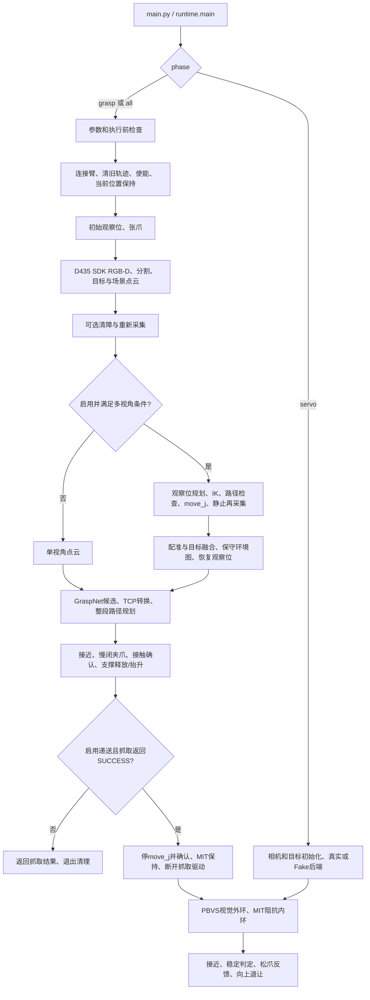

# STEP4：whole-grasp 当前代码执行导读

核对日期：2026-09-16。以当前工作区源码为准；行号是本次核对的代码位置，修改源码后可能变化。链接使用仓库相对路径与行号锚点；若编辑器不能跳到锚点，按表内函数名搜索。本文只解释代码，不是实机验收通过证明。第1节解释入口，第1A节从 `def main(argv=None):` 按执行顺序追踪调用、数据和状态，第2～12节进一步解释各模块原理。

## 0. 先建立正确的整体认识

当前用 D435i/D435IF **腕部相机**，Gemini330 暂不参与。抓取与递送共用这一相机设备，但分阶段释放/重新打开采集会话。抓取不是一边实时看视频一边每帧追踪末端：主要是“到观察位—静止采集—规划—移动—再采集”。递送才是持续视觉反馈修正目标的控制阶段。

`runtime.py` 大量函数是转发封装，实际算法分散在 `perception.py`、`active_view.py`、`grasp_workflow.py` 等模块。Hooks 是把函数作为参数传入的接线方式，不是另外一个 ROS 节点，也不是新的控制线程。看代码时从 workflow 看顺序，再沿 runtime 的 hook 找实际实现。



**关键风险：当前抓取的 `--execute` 不是全程序硬件隔离门。** `workflow.run_single_grasp` 无条件进入机械臂上下文，`arm.__enter__` 会使能、发保持命令，初始运动与张爪也发生在最终抓取的 execute 检查之前。因此不加 execute 的 grasp/all 不能被视为纯离线。本文不提供当前主程序实机启动快捷命令；详见 STEP3 新增风险。

## 1. 从哪个文件启动，配置怎样传下去

`python main.py` 与 `python -m real_nero_grasp` **只是同一程序的两种启动方式，进入同一个 `real_nero_grasp.runtime.main()`，不是两套流程**。前者执行根目录的 [main.py](main.py)，后者由 Python 执行包内的 [real_nero_grasp/__main__.py](real_nero_grasp/__main__.py)。两个入口都用 `raise SystemExit(main())` 一类写法把主函数返回值交给操作系统作为退出码。

```text
bash scripts/run_grasp_safe.sh [参数]
  → scripts/run_grasp_safe.sh：用户参数后追加速度、保护、验证模式等参数
  → scripts/run_grasp.sh：选用 $CONDA_PREFIX/bin/python，切到工程根目录
  → python main.py [最终参数] ────────────┐
                                       ├→ real_nero_grasp.runtime.main(argv=None)
python -m real_nero_grasp [参数]          │
  → real_nero_grasp/__main__.py ─────────┘
```

这里的“相同”指调用同一套实现；要得到相同的运行行为，还需要相同的 Python 环境、参数和配置。直接执行 `main.py` 或 `python -m` 不会自动附带安全启动脚本的参数。旧入口 [real_nero_single_grasp_runner.py](real_nero_single_grasp_runner.py) 也转发到同一 runtime。名字含 `three_views` 的大文件直接启动时创建 MuJoCo 环境，和这里的真机入口不同；真机只复用其中的网络等函数。

`main` 先解析参数：phase=servo 直接进入递送；grasp/all 进入抓取。all **不会自动启用递送**，还需 enable_servo_delivery。只有显式传 `--config` 才读取 pipeline.yaml；CLI 覆盖 YAML，YAML 相对标定路径以 config 文件目录为基准。当前 YAML 加载器只映射列出的相机、标定和少量 servo 字段，并不会把任意 YAML 键自动变成抓取参数。

实现细节：CLI 帮助把 `--enable-servo-delivery` 描述为用于 `phase=all`，但 `_workflow_hooks(args)` 实际只检查 `enable_servo_delivery`，没有再检查 phase。因此当前 `--phase grasp --enable-servo-delivery` 也会注入递送 hook；不要根据帮助文字推断这个组合必然只抓取。

安全启动脚本把许多参数放在用户参数之后，重复参数可能由后面的脚本值覆盖；其默认 validation-mode/validation-first 会影响最终抬升、放置的行为，不能只看 main 的默认值。

| 定位（函数起始行） | 作用 |
|---|---|
| [`real_nero_grasp/runtime.py:3042 · main`](real_nero_grasp/runtime.py#L3042) | phase分流、抓取前检查、退出码 |
| [`real_nero_grasp/cli.py:18 · parse_args`](real_nero_grasp/cli.py#L18) | 全抓取参数与共享servo参数解析 |
| [`cameras/options.py:16 · apply_pipeline_defaults`](cameras/options.py#L16) | YAML到args字段映射 |
| [`cameras/preflight.py:6 · grasp_preflight`](cameras/preflight.py#L6) | 仅execute时检查标定、权重、CUDA、IK及GraspNet导入 |
| [`real_nero_grasp/runtime.py:3011 · _workflow_hooks`](real_nero_grasp/runtime.py#L3011) | 装配依赖；按开关注入抓取后递送hook |
| [`real_nero_grasp/workflow.py:67 · run_single_grasp`](real_nero_grasp/workflow.py#L67) | 抓取会话的真实顶层顺序 |

## 1A. 从 `def main(argv=None):` 按实际执行顺序跟读

以下以真机抓取分支为主线；可选清障、多视角、递送在发生的位置展开。表中的“输出”既包括函数返回值，也包括写入对象的状态。它们是在同一个 Python 进程中传递的对象，并不是通过 ROS topic 在多个节点间发送。

### 1A.1 解析启动参数，得到全流程共用的 `args`

跳转：[runtime.main](real_nero_grasp/runtime.py#L3042) → [cli.parse_args](real_nero_grasp/cli.py#L18) → [cameras.options.apply_pipeline_defaults](cameras/options.py#L16) → 回到 `main`。

- **输入**：终端参数；若指定 `--config`，还包括该 YAML。
- **方法**：先定义 argparse 参数和默认值，探测配置路径，读取支持的 YAML 字段作为默认值，再解析显式命令行参数。`main(argv=None)` 正常使用 `sys.argv`；传入 `argv` 列表时，临时替换 `sys.argv` 完成解析，随后恢复。
- **输出**：`argparse.Namespace`，即 `args`。其中包含相机、手眼、机械臂、分割、主动视角、抓取、运动保护、递送等设置。缺少对应阶段必需的标定参数时，解析器直接退出。
- **下一步**：`main` 根据 `args.phase` 分流。`servo` 跳到1A.14；`grasp/all` 继续1A.2。

不要把 `args` 当成一直不变的配置：后续代码还会在它上面写 `_last_*` 感知缓存、`_workflow_motion_sent`、运行时碰撞上下文等。理解这些副作用，才能看懂为什么有些数据没有出现在函数返回值里。

### 1A.2 在连接机械臂之前做执行前检查

跳转：`main` → [cameras.preflight.grasp_preflight](cameras/preflight.py#L6) → 返回 `main`。

**输入**是 `args`；`execute=False` 时本函数立即返回。执行检查时，读取手眼矩阵并检查有限性，检查 YOLO 权重、IK URDF、GraspNet checkpoint，确认 CUDA 可用，初始化 IK 求解器，导入 GraspNet helper。方法是提前验证后面必需的文件和运行依赖；它不会求出本次抓取路线，也不代表模型/标定已通过实机验证。

**输出**没有专门结果对象：正常返回表示这些检查没有报错；缺文件、导入失败、CUDA 不可用等直接抛异常，后续臂上下文尚未进入。`execute=False` 跳过此检查后仍会进入下面的机械臂启动流程。

### 1A.3 接好模块依赖，进入抓取会话

跳转：`main` → [runtime.run_single_grasp](real_nero_grasp/runtime.py#L3034) → `runtime._workflow_hooks(args)` → [workflow.run_single_grasp](real_nero_grasp/workflow.py#L67)。

`_workflow_hooks` 把机械臂工厂、采集、初始位、多视角、抓取规划等函数装进 `WorkflowHooks`。例如：

```text
workflow 调用 hooks.run_optional_active_view(...)
  → runtime.run_optional_active_view(...)
  → active_view.run_optional_active_view(..., hooks=runtime._active_view_hooks())

workflow 调用 hooks.plan_and_maybe_execute_grasp(...)
  → runtime.plan_and_maybe_execute_grasp(...)
  → grasp_workflow.plan_and_maybe_execute_grasp(..., hooks=runtime._grasp_workflow_hooks())
```

**基本作用**：workflow 决定先做什么、失败后是否继续；runtime 负责把实际函数接上；各算法模块完成计算。hook 保存的是函数引用，调用时仍然是普通函数调用。`runtime.run_single_grasp` 外层有 `finally: cameras.realsense.close_all()`，确保抓取会话返回或异常退出时释放相机。

### 1A.4 连接臂、建立保持，再处理测试分支

跳转：`workflow.run_single_grasp` → `configure_amodal_clear_model(args)` → `with RealNeroGraspArm(...) as arm` → [arm.__enter__](real_nero_grasp/arm.py#L98)。

**输入**：CAN 接口/通道/波特率、固件类型、使能超时、速度比例、夹爪硬件上限。**方法**：连接 SDK → 清旧轨迹 → 使能 → 速度设零 → 再清轨迹 → 读取静止关节 → 发当前位置 `move_j` 保持 → 恢复配置速度。随后 workflow 设置 `tcp_offset`。

**输出**：在线 `arm` 对象，可读关节/法兰/TCP/夹爪反馈，也可发送控制。此时未发送配置中的初始位目标，但已经有硬件控制写操作。

随后有两个提前返回分支：

| 条件 | 执行内容 | 返回给上层 |
|---|---|---|
| `ik_test_current` | 当前反馈位姿 → IK → FK 与反馈对照 | `SUCCESS / ik_test_complete` |
| `gripper_test` | open、close 或 status | `SUCCESS / gripper_test_complete` |

这些分支都发生在 `__enter__` 之后；例如 IK 测试返回的 `motion_sent=False` 不表示整个启动过程从未向控制器发送保持命令。

### 1A.5 去初始观察位并打开夹爪

跳转：workflow → runtime 包装 → [session_control.prepare_initial_pose_for_capture](real_nero_grasp/session_control.py#L239) → [move_initial](real_nero_grasp/session_control.py#L70)。

**输入**：`arm`、`args.initial_joints_deg`、桌面检查与到位容差。**方法**：角度转弧度 → 检查当前到初始关节目标的建模路径 → 等待初始运动确认 → `arm.move_j(joints)` → 轮询关节到位 → 打开夹爪并确认开口反馈。

**输出/交接**：函数正常返回后，workflow 记录流程已发生动作，并把此刻实测七关节保存为 `args._empty_grasp_recovery_joints`，供后续空抓恢复使用，然后进入采集。

两个容易误读的分支：`skip_initial_move` 只跳过初始移动，仍张爪；在初始位确认处选择取消，`move_initial` 返回 `None`，调用者会警告并继续张爪/采集，不等于退出整个程序。路径检查失败会返回 `PLANNING_FAILED`；到位/张爪失败则按相应异常退出或停止。

### 1A.6 从相机获得当前目标和场景

跳转：workflow → [perception.capture_target_cloud_with_retries](real_nero_grasp/perception.py#L1632) → [capture_target_cloud](real_nero_grasp/perception.py#L1556)。内部顺序为：

```text
apply_target_prompt
  → capture_rgbd_xyz_frame
      → cameras.realsense.capture_rgbd / camera_for / read
      → 对齐米制深度反投影为 XYZ
  → select_target_mask（YOLO 实例分割和目标选择）
  → 近场过滤 / 目标 mask 内深度修补
  → cloud_from_mask / scene_cloud_from_xyz / obstacle_cloud_from_non_target_mask
```

**输入**：相机设置、YOLO 权重和类别、深度范围、点云过滤参数。**原理**：彩深对齐使 RGB 的目标 mask 能索引对应深度；内参将深度转换成三维点；mask 内形成目标云，整个有效深度形成场景云，mask 外形成非目标障碍云。

**返回六元组**：`captured = (bgr, target_cloud, scene_cloud, out_dir, inst, intr)`。BGR 是原图，两个 cloud 是当前相机系 Open3D 点云，`out_dir` 是诊断目录，`inst` 是被选实例字典，`intr` 是当前彩色内参。障碍云另写入 `args._last_obstacle_cloud`；XYZ、mask 等写入 `args._last_capture_*` / `_last_target_*`。

workflow 解包结果并按配置预览。重试包装若最终返回 `None`，workflow 返回 `CAPTURE_FAILED`，不会进入本次目标的抓取规划。预览窗口本身不生成新的运动目标。

### 1A.7 建立坐标变换，处理可选清障

跳转：workflow → [runtime.T_base_camera_from_flange](real_nero_grasp/runtime.py#L1362)；随后 → `runtime.maybe_clear_obstacles_before_active` → [clear_policy.maybe_clear_obstacles_before_active](real_nero_grasp/clear_policy.py#L676)。

**输入/方法**：实测 `T_base_flange` 与标定 `T_flange_camera` 相乘，得到 `T_base_camera`。目标云仍在相机系；这个 4×4 矩阵用于将它的位置、方向变到基座系。

清障关闭时直接返回原 `captured`。开启时，根据可见/完整物体掩码和深度几何评估遮挡物，对可行动的障碍候选复用抓取规划与执行，再重新采集并关联原目标；策略也可能要求后续必须获得有效多视角。这里可能发生实际清障动作。

**输出/交接**：新的或原有的 `captured`；返回 `None` 表示清障前提未满足，workflow 返回 `CLEAR_FAILED`。成功时重新解包，并再次读取 `T_base_camera`，避免在臂已经移动后继续沿用旧变换。

### 1A.8 进入可选多视角分支：观察位规划、移动、再采集

跳转：workflow → `runtime.run_optional_active_view` → [active_view.run_optional_active_view](real_nero_grasp/active_view.py#L2111)。

**输入**：`arm, args, target_cloud, scene_cloud, T_base_camera, inst, out_dir`，以及 `args` 内缓存的非目标障碍云等。**作用**是从多个经过检查的观察位补充同一目标表面，不是连续保存同一位置的多帧。

| 执行顺序 | 实际方法/模块 | 中间输出 → 下一步 |
|---|---|---|
| 判断是否观察 | `_should_use_active_multiview`，结合启用开关、强制多视角状态和信息需求 | 不需要时返回单视角结果；需要时生成观察目标 |
| 定位目标中心 | `_target_center_base_from_cloud`，把目标点变到 base 系后估计中心 | 基座系中心 → 相机观察几何 |
| 默认先居中 | `_target_center_overhead_flange_pose_candidates`、look-at 与等效 roll 搜索 | 相机目标经手眼逆变换得到法兰目标 → IK |
| 找可执行观察路线 | `active_motion.plan_active_direct_route`，按配置尝试抬高越障路线；不可达中心也可尝试光轴小倾斜或球面备用位置 | 检查通过的关节阶段 → 执行器 |
| 到中心并采集 | `execution.execute_prevalidated_stages` → `capture_active_projected_target_cloud` | 新 RGB-D、同目标 mask、目标/场景/障碍云和采集位变换 |
| 选择侧视角 | `_build_active_view_candidates`、`active_view_scoring.py`、`_active_side_selection_order` | 按信息增益/遮挡、可达性和运动代价等筛选候选；后续视角考虑已有观察 |
| 逐站移动采集 | 路径预检、确认、执行、停稳、同目标关联与重叠检查 | 有效视角列表 → 配准融合 |

look-at 的含义是让相机光轴指向目标；roll 搜索在保持观察方向的同时改变绕光轴的旋转，以寻找机械臂更容易达到的姿态。NBV（下一最佳视角）评估增加观察后能补充多少信息，而不是仅按左右固定角度机械移动。

`--active-view` 开启该分支，`--no-active-multiview-gate` 跳过是否需要更多视角的门控，仍不跳过 IK/路径检查、执行开关和确认。成功保留几个视角取决于实际规划、采集和质量判定。关闭主动观察也可能构建单视角环境图；日志里出现 `active_single_view_environment` 不代表已经移动到多个观察位。

### 1A.9 融合与恢复：把多视角结果交回 workflow

跳转：active_view → [pointcloud_fusion.register_active_fusion_views](real_nero_grasp/pointcloud_fusion.py#L1328)、`active_view._fuse_active_target_clouds`、动态环境融合 → 返回 [ActiveViewResult](real_nero_grasp/types.py#L238)。

**方法**：每站点云先用该站手眼/反馈变换到共同基座系；对目标做受限配准、重叠质量判定与融合，剔除不可靠视角。运动环境另外保留保守几何和地图来源。默认中心优先路径从居中后的目标云开始融合，初始图主要用于定位目标。按配置恢复观察位并核对实际状态；输出点云与其 `T_base_camera` 必须配套。

| 返回字段 | 含义及下一步用途 |
|---|---|
| `target_cloud, scene_cloud, T_base_camera` | 替换 workflow 原变量，送入 GraspNet/TCP 转换 |
| `motion_scene_cloud, motion_environment_cloud` | 给整段运动规划的场景/非目标障碍几何；不要与网络附近裁剪云混淆 |
| `motion_environment_map` | 基座系体素环境图，包含 map_id/generation、确定与不确定观测等，供规划与执行追踪同一份地图 |
| `used_multiview, kept_view_count, reason` | 是否实际保留了多视角及原因；如 `fused`、`center_view_only` |
| `motion_sent, restore_ok` | 是否发生观察动作、返回的观察配置是否经验证 |

workflow 在交给抓取前检查：强制要求多视角却未获得至少两有效视角 → `CLEAR_FAILED`；发生观察运动但 `restore_ok=False` → `EXECUTION_FAILED`。普通可选多视角失败在允许的分支会退回单视角，不能只看启动参数认定融合成功。

### 1A.10 生成抓取候选并附加物理/可执行性信息

跳转：workflow → `runtime.plan_and_maybe_execute_grasp` → [grasp_workflow.plan_and_maybe_execute_grasp](real_nero_grasp/grasp_workflow.py#L485)。

**输入**：在线臂、参数、目标/场景点云及匹配坐标变换、原图与内参、日志目录、实例信息，外加运动环境云/地图。先检查执行配置，包括夹爪接触判定和保护模式等，不兼容配置返回 `CONFIGURATION_FAILED`。

之后实际调用顺序：

1. `visualization.get_graspnet_helpers()` 导入大文件中的两个网络 helper；导入不会执行该文件的 `if __name__ == '__main__'` 仿真流程。
2. `_prepare_graspnet_target_cloud` 清理网络输入目标云；`make_end_points_from_o3d_cloud` 采样/补足到 `grasp_num_points`，形成 CUDA 网络输入。
3. `generate_grasps` 执行网络预测与解码，结合场景点云做抓取碰撞初筛、角度等过滤与排序，返回 `gg`（GraspGroup）和 `rows`（候选记录列表）。网络输出的抓取位姿在输入点云坐标系中。
4. `annotate_grasp_candidate_physical_aperture` 检查真实夹爪开口与目标几何；`annotate_grasp_candidate_reachability` 附加可达性信息。
5. [grasp_planner.annotate_grasp_candidate_workflow_preflight](real_nero_grasp/grasp_planner.py#L1734) 为候选规划当前模式所需路线，把结果、原因及可复用计划写回 `rows`。
6. 预览候选，再进入选择。

这里的 `rows` 已不只是神经网络分数，还带有候选编号、宽度适配、方向变体、可达性、路线预检等数据。网络阶段失败可返回 `PLANNING_FAILED` 或 `INTERNAL_ERROR`；失败时展示的诊断候选不会因此变成可执行候选。

### 1A.11 自动推荐或人工选择，确定一个计划

跳转：[grasp_workflow 的选择分支](real_nero_grasp/grasp_workflow.py#L799) → [grasp_candidates.choose_default_grasp_candidate](real_nero_grasp/grasp_candidates.py#L2026) 或 `select_grasp_candidate`。

默认过滤掉不满足开口、桌面、相应 IK/工作流要求的候选，再调用 [recommend_grasp_candidate](real_nero_grasp/grasp_candidates.py#L84)。优先使用符合方向、网络置信度、接触点支持和手指桌面余量等质量门槛的候选；该池为空时会标注低置信度回退。在选定质量池中优先正常夹爪方向，然后比较综合分：方向30%、网络分25%、点云支持15%、宽度匹配10%、竖直对齐10%、原优先级10%。这仍受前面的可执行性过滤约束。

`--select-grasp-candidate` 进入人工选择；`--grasp-candidate-index` 指定本次候选编号。输出为 `(grasp, selected_grasp_row)`。编号15只是候选ID，不是“机械臂已经尝试15次”，也不会因为预览出现很多姿态就依次执行所有姿态。

选定后，`grasp_geometry.grasp_to_tcp_poses` 根据候选、`T_base_camera`、工具轴映射与偏移产生 base 系 `pre_tcp / grasp_tcp / lift_tcp`。优先复用让该候选通过预检的路线，必要时按允许的位姿/夹爪方向备选重新规划，保存选中姿态和运动计划。不能只凭一个网络抓取位姿直接发送机器人运动。

### 1A.12 从 TCP 路线变为可执行关节阶段

这一步的计算实际发生在候选预检及选中计划构建内部，不是选完候选后才第一次求 IK。

```text
grasp_planner：构造预接近、接近、支撑释放/抬升、可选放置/退让路线
  → motion_planning._plan_tcp_motion_stage_options
      → TCP目标按工具偏移转换为法兰目标
      → ik_solver._ranked_ik_solution_records_for_flange_pose
          → kinematic_trac_ik.Kinematic / TRAC-IK：多种子七关节逆解
      → collision.validate_motion_joint_path：关节路径采样检查
  → motion_planning._plan_tcp_stage_sequence_beam：保留多个跨阶段解组合
  → GraspMotionPlan
```

**原理**：同一 TCP 位姿可能有多个关节解；只选择当前最近的一个解，可能让后续抬升无解。beam search 保留有限数量的跨阶段组合，结合当前策略的直接、越障或备用路线，寻找能连起来的动作序列。初始支撑释放针对物体起初与桌面/支撑面接触的情况进行局部建模，不意味着取消所有碰撞检查。

**输出对象**见 [types.py](real_nero_grasp/types.py)：`PlannedJointStage` 包含阶段标签、TCP/法兰位姿、七关节目标和阶段语义；`GraspMotionPlan` 包含 `start_joints`、`before_close`、`after_close`、`after_release`、`empty_recovery`，以及环境、被夹物几何和 `validation_only`。`MotionSafetyScene` / `MotionCollisionContext` 保存用于当前阶段检查的基座系几何和接触策略。

`run_grasp_safe.sh` 默认开启验证优先/验证模式，可能接受仅闭爪与短支撑释放的计划。因此“完整工作流预检通过”指**当前所选模式要求的路线**，不保证已规划完整抬升、放置、递送；验证优先也可能在找到短验证计划后不再尝试完整路线。

### 1A.13 确认执行、逐阶段运动、闭爪及结果返回

回到 [grasp_workflow 的执行门](real_nero_grasp/grasp_workflow.py#L1354)：`execute=False` 返回 `PLANNED_ONLY`；否则按 `args.yes` 决定是否等待最终抓取确认，取消则返回 `DECLINED`。这两个结果只说明本次目标执行阶段未开始，不撤销前面初始位或观察动作。

执行顺序：打开夹爪并确认 → `before_close` → 闭爪前位姿确认 → 慢闭/普通闭爪 → 接触/空抓判定 → `after_close` → 如有放置且不是验证模式，松爪确认并执行 `after_release`。

每个运动阶段沿下面的链调用：

```text
execution.execute_prevalidated_stages
  → execute_prevalidated_stage
      读取实际起始关节，与计划起点比较
      从实际起点到计划终点重新做路径检查
      在 args 上安装当前阶段的运行时碰撞/扭矩上下文
  → arm_execution.move_flange_pose / move_flange_pose_ik_joint
      复用计划关节目标并校验
  → _send_joint_target_with_start_retry → arm.move_j → pyAgxArm
  → wait_until_joints_reached：反馈、超时、碰撞/扭矩等监测
  → 返回到执行器，进入下一个阶段
```

Python 发离散路点并等待反馈；固件负责接收目标后的底层运动。关节路径采样检查与控制器实际时间插值不是一回事。日志中的 clearance 是模型/点云计算结果，不是直接测得的物理间隙。

慢闭返回的 `GripperCloseResult` 包含接触状态、停止原因、接触宽度/力等；`session_control.assert_grasp_detected` 据此决定是否允许携物运动。空抓会跳过正常抬升/放置，尝试已检查的恢复路线；恢复是否真正到初始观察位还会另作验证。碰撞、扭矩、超时等走对应停止/恢复分支，通常返回 `EXECUTION_FAILED`；未被转换为结果的异常继续向上抛出。

**返回**：`GraspAttemptResult(status, motion_sent, detail, empty_grasp_recovered_to_initial)`。验证短抬成功、完整抬升成功、完成配置中的放置，都可能返回 `SUCCESS / executed`。必须结合计划的 `validation_only` 和阶段日志理解完成到了哪里。当前验证成功日志中的“full lift/place were not executable”不能单独证明完整路线全部尝试过。

### 1A.14 可选递送：另一个控制阶段，仍由当前主入口分流

两条进入路径：`main` 中 `phase=servo` 直接调用 `run_servo_delivery(args, backend=None)`；或 workflow 在抓取返回 `SUCCESS` 且 `after_grasp_lifted` hook 存在时调用它，此时抓取臂仍处于 `with` 内。

抓取后的路径：`runtime._servo_delivery_after_grasp` → [handoff.delivery_after_grasp](handoff/grasp_to_servo_handoff.py#L129) → 校验参数、关闭抓取相机 → `handoff`（停止 move_j 并核对反馈 → 创建 MIT 保持后端 → 断开抓取驱动）→ [servo_delivery.run_servo_delivery](servo_delivery.py#L492)。当前 hook 条件只检查抓取 `SUCCESS`，没有额外排除短验证成功或已经放置成功。

`run_servo_delivery` 的**输入**为 `args` 和可选后端；创建模型、解析标定、建立目标检测器、启动 D435 会话。直接 servo 模式未提供后端时，`execute=True` 创建真实后端，否则使用 FakeBackend。随后构造 `ServoDeliveryNode`，进入 `cameras.sdk_loop.spin`。

| 模块/回调 | 输入与方法 | 输出与下一步 |
|---|---|---|
| SDK 相机回调 | 新 RGB-D、内参，更新节点缓存 | `_detect_latest` 读取新帧 |
| `targets` 检测器 | ArUco 或手部检测，结合手眼和当前 FK | 基座系目标中心/法向/切向 |
| `ServoDeliveryNode._on_timer` | 当前关节/速度、新鲜度、内环故障、目标状态 | 进入状态分支或调用视觉伺服 |
| `servo.pbvs_pose_servo.update` | 当前关节与目标几何，计算位姿误差，用 Jacobian/阻尼最小二乘等产生更新 | 误差与伺服输出 → safety 判定 → `_refresh` |
| `_refresh` / `set_cartesian_impedance` | 将视觉更新限制并转换为阻抗配置 | MIT 内环使用新的目标、刚度/阻尼等配置 |
| `control_backends` | 周期性关节反馈、模型、阻抗目标与限幅 | SDK MIT 控制命令；反馈给下一轮视觉/控制检查 |

状态顺序是 `HOLD_LIFTED → TRACK_HAND → APPROACH → HANDOVER → RELEASE → RETREAT`。目标误差与稳定帧数满足条件才转移；丢目标时保持最后阻抗目标。RELEASE 按开口反馈连续样本确认；RETREAT 向 base 的 +Z 退让，不是回初始观察位。MIT 目标循环频率与相机帧率不同。

**返回语义也需注意**：状态机的 `_shutdown(exit_code)` 会抛出 `SystemExit`，正常完成用0，`_fail_closed` 用1；它经过 `finally` 清理后继续向外退出，通常不会再回到 workflow 打印抓取 `[session]`。如果 spin 普通返回，`run_servo_delivery` 才返回0；它捕获 Ctrl+C 时返回130。抓取 workflow 调用递送 hook 后并未用普通返回值改写 `target_result`。因此需要结合递送状态日志、异常/退出码理解结束原因，不能只凭抓取 `SUCCESS` 认定递送完成。

### 1A.15 汇总状态、退出上下文、返回终端

没有递送或递送调用返回后，workflow 用 `with_workflow_motion` 把本次目标结果与此前初始位、清障、主动观察的动作标记合并，打印 `[result]`，返回结果。`motion_sent` 是代码的流程记录，不是所有 CAN 写操作的完整审计；启动保持等不一定逐项计入。它也不等于“抓取成功”。

返回/异常离开 `with` → [arm.__exit__](real_nero_grasp/arm.py#L336) 检查已有停止状态，否则执行退出停止处理，再调用父类断连 → runtime 外层 `finally` 关闭相机 → `main` 打印 `[session]` 并决定退出码 → 入口 `SystemExit` 结束进程。

| 状态/异常 | 在此调用链的含义 | `main` 的处理 |
|---|---|---|
| `SUCCESS` | 当前分支报告成功；可能只是测试或短抓取验证 | 结果分支退出码0 |
| `PLANNED_ONLY` | 本次目标计划生成，最终执行未开启 | 结果分支退出码0 |
| `CONFIGURATION_FAILED` | 抓取配置不符合执行前提 | 结果分支退出码2 |
| `CAPTURE_FAILED / CLEAR_FAILED` | 感知或清障/强制多视角前提未满足 | 结果分支退出码2 |
| `PLANNING_FAILED / INTERNAL_ERROR` | 没有可执行计划或候选生成内部错误 | 结果分支退出码2 |
| `DECLINED / EXECUTION_FAILED` | 最终执行被取消，或执行/恢复没有完成 | 结果分支退出码2 |
| 冒泡至 main 的 `ControlledMotionStopTriggered` | 普通轨迹停止异常分支 | 退出码2 |
| 冒泡至 main 的 `SafetyStopTriggered` | 保护异常分支 | 退出码3；是否实际急停还需看具体停止分支记录 |
| 冒泡至 main 的 `KeyboardInterrupt` | Ctrl+C | 退出码130；若执行层已转成失败结果，则走该结果的退出码 |
| 其他未捕获异常 | 例如导入/文件/未知运行错误 | 保留 traceback，非统一的 `GraspAttemptResult` |

由此，日志中“本次目标没有运动”与最终 `motion_sent=True` 可以同时成立：前者描述目标抓取阶段，后者包含此前观察/初始动作。排查时沿 `captured → ActiveViewResult → rows/GraspMotionPlan → GraspAttemptResult` 追踪，而不要只看最后一个 success 或单个候选编号。

## 2. 初始观察前，机械臂已经做了什么

进入 RealNeroGraspArm 上下文后：连接 SDK、发送普通轨迹终止、使能、设零速度、再次清轨迹、读取静止关节并发送当前位置 move_j 保持，再恢复配置速度。随后设置 TCP 偏移，处理可选夹爪/IK测试，去初始关节位并张爪。

初始位来自 args.initial_joints_deg，不是相机或GraspNet生成。保存当时关节供空抓恢复。`skip_initial_move` 仅跳过初始移动，仍会张爪，也不跳过臂上下文的使能。

| 定位（函数起始行） | 作用 |
|---|---|
| [`real_nero_grasp/arm.py:98 · __enter__`](real_nero_grasp/arm.py#L98) | SDK启动握手，有硬件写操作 |
| [`real_nero_grasp/session_control.py:239 · prepare_initial_pose_for_capture`](real_nero_grasp/session_control.py#L239) | 初始运动/张爪/反馈检查 |
| [`real_nero_grasp/session_control.py:70 · move_initial`](real_nero_grasp/session_control.py#L70) | 初始关节目标→arm.move_j→等待到位 |
| [`tools/real_nero_point_test.py:45 · NeroArm`](tools/real_nero_point_test.py#L45) | 底层pyAgxArm适配；不要误当只读工具 |
| [`real_nero_grasp/arm.py:336 · __exit__`](real_nero_grasp/arm.py#L336) | 退出时轨迹终止与断连处理 |

## 3. 相机→RGB-D→有组织XYZ

首次采集才懒启动相机。RealSense SDK选择设备，打开彩色BGR8与深度Z16，预热，并将深度对齐到彩色。深度乘设备depth_scale转为米。camera_for按参数缓存会话，后续静止视角复用，避免每帧重开USB流。

默认宽640、高480：BGR uint8为(480,640,3)，深度float32为(480,640)，XYZ为(480,640,3)。XYZ按像素反投影：X=(u-cx)Z/fx，Y=(v-cy)Z/fy。坐标在彩色光学坐标系，X右、Y下、Z前。640×480=307200是像素槽位，不保证都有有效深度。

capture_rgbd可对静止连续深度帧做有效值中值合并；这是降噪，不是机械臂多视角。保存color.png、depth_m.npy、capture_meta.json。use_registered_points分支仍存在，但当前经SDK生成兼容结构、由纯Python解码；函数名里的ros/PointCloud2不代表真的订阅ROS。当前非零彩色畸变系数会被拒绝，尚未自动去畸变。

| 定位（函数起始行） | 作用 |
|---|---|
| [`cameras/realsense.py:104 · camera_for`](cameras/realsense.py#L104) | 按设备/分辨率等设置复用会话 |
| [`cameras/realsense.py:35 · start`](cameras/realsense.py#L35) | 打开设备、对齐器、预热 |
| [`cameras/realsense.py:64 · read`](cameras/realsense.py#L64) | 同一frameset的彩色与对齐深度、内参和时间字段 |
| [`cameras/realsense.py:129 · capture_rgbd`](cameras/realsense.py#L129) | 静止帧聚合与落盘 |
| [`real_nero_grasp/perception.py:1502 · capture_rgbd_xyz_frame`](real_nero_grasp/perception.py#L1502) | SDK采集分支→XYZ→相机自遮挡处理 |
| [`real_nero_grasp/depth_processing.py:56 · depth_to_xyz_image`](real_nero_grasp/depth_processing.py#L56) | 米制深度反投影 |

## 4. YOLO→选定目标→目标/场景/障碍点云

YOLO输入整张BGR，imgsz控制网络推理尺寸，不等于最终点云尺寸。返回实例列表：label、score、xyxy、mask、center、is_box_only。mask被缩放到原图H×W，按目标类别/置信度过滤，再根据选择策略选目标。没有分割mask时存在检测框退化分支，应查看is_box_only，不能把框中背景当作可靠目标表面。

选中mask后做近场过滤和可选深度孔洞修补；目标点云取mask内有限且满足min_depth/max_depth的XYZ。颜色从BGR转RGB并归一化到0..1，再体素降采样、统计离群过滤。目标输出Open3D点云，points为(N,3)、colors为(N,3)，N随视角和过滤变化。场景点云保留全部有效场景；非目标障碍云由mask外区域形成，用于运动安全。

capture_target_cloud返回六项：(bgr, target_cloud, scene_cloud, out_dir, inst, intr)。另外args._last_*缓存XYZ、mask等，args._last_obstacle_cloud保存障碍云；后续多视角/清障会读取这些状态。目标点云太少会抛错，重试包装决定重新采集还是失败退出。

| 定位（函数起始行） | 作用 |
|---|---|
| [`real_nero_grasp/perception.py:106 · infer_yolo_instances`](real_nero_grasp/perception.py#L106) | 加载模型、predict、实例结构 |
| [`real_nero_grasp/perception.py:569 · select_target_mask`](real_nero_grasp/perception.py#L569) | 自动/交互目标选择 |
| [`real_nero_grasp/perception.py:1556 · capture_target_cloud`](real_nero_grasp/perception.py#L1556) | 单次完整感知流水线 |
| [`real_nero_grasp/perception.py:850 · cloud_from_mask`](real_nero_grasp/perception.py#L850) | 目标XYZ筛选、体素和离群处理 |
| [`real_nero_grasp/perception.py:883 · scene_cloud_from_xyz`](real_nero_grasp/perception.py#L883) | 场景云 |
| [`real_nero_grasp/perception.py:906 · obstacle_cloud_from_non_target_mask`](real_nero_grasp/perception.py#L906) | 非目标障碍云 |
| [`real_nero_grasp/perception.py:1632 · capture_target_cloud_with_retries`](real_nero_grasp/perception.py#L1632) | 采集失败重试 |

## 5. 标定怎样参与；为什么腕部相机移动后还能融合

T_A_B表示把B坐标点变到A。每个静止视角使用：

`T_base_camera = T_base_flange × T_flange_camera`

前者来自SDK法兰反馈，后者来自腕部手眼JSON。它们必须是同一法兰定义、正确单位和旋转顺序。TCP偏移描述法兰到抓取工具，不能代替相机手眼外参。抓取候选、背景云和多视角都依赖这个变换。

当前相机曝光和机械臂反馈不是硬同步；必须停稳采集。内参来自当前SDK帧；你需要替换的是手眼外参路径，不是把旧330内参直接给D435。

| 定位（函数起始行） | 作用 |
|---|---|
| [`real_nero_grasp/runtime.py:1362 · T_base_camera_from_flange`](real_nero_grasp/runtime.py#L1362) | 读取当前反馈并组合手眼变换 |
| [`tools/real_nero_point_test.py:117 · handeye_transform`](tools/real_nero_point_test.py#L117) | 解释JSON/四元数约定与方向 |
| [`real_nero_grasp/pointcloud_fusion.py:76 · transform_cloud`](real_nero_grasp/pointcloud_fusion.py#L76) | 实际把点云变换到另一坐标系 |

## 6. 如何让机械臂产生多视角：逐站移动而不是视频帧堆叠

run_optional_active_view由主workflow调用。默认active_view关闭；打开后仍受信息需求门控、IK可达性、碰撞、路径、确认和execute条件约束，所以不是“开关开了必有三张”。侧视角数量以成功采集且质量检查通过的结果为准。

默认中心优先路径的大致顺序：初始图用于选目标和估计基座系目标中心→生成目标中心观察姿态→手眼逆变换得到法兰目标→搜索等效roll和IK解→规划/检查关节路径→执行到中心视角→重新识别同一目标→选择侧视候选→逐个移动、停稳、采集→恢复经过验证的观察配置。

候选考虑绕目标观察的几何、光轴朝向、遮挡/信息增益、机械臂可达性和运动代价。不是让用户手动输每一站关节角；用户配置策略/范围/确认，程序求解。侧视重新识别用投影目标中心等约束，不能任意抓另一只同类瓶子。

**默认中心优先路径中，初始观察的目标云不加入目标融合**：它用于选目标和定位；融合从重新居中的center云开始，再加入保留的side云。初始场景可参与保守环境安全信息。失败时可能回退单视角，但若强制多视角要求不满足、或移动后恢复未确认，workflow阻止继续抓取。

| 定位（函数起始行） | 作用 |
|---|---|
| [`real_nero_grasp/active_view.py:2111 · run_optional_active_view`](real_nero_grasp/active_view.py#L2111) | 多视角总控，移动与采集实际发生在这里 |
| [`real_nero_grasp/active_view.py:687 · _should_use_active_multiview`](real_nero_grasp/active_view.py#L687) | 信息需求门控 |
| [`real_nero_grasp/active_view.py:1031 · _build_active_view_candidates`](real_nero_grasp/active_view.py#L1031) | 生成并筛选观察候选 |
| [`real_nero_grasp/active_view.py:359 · _look_at_camera_pose`](real_nero_grasp/active_view.py#L359) | 使光轴面向目标 |
| [`real_nero_grasp/active_view.py:489 · _rank_active_lookat_roll_solutions`](real_nero_grasp/active_view.py#L489) | 姿态roll与IK候选排序 |
| [`real_nero_grasp/active_motion.py:193 · plan_active_direct_route`](real_nero_grasp/active_motion.py#L193) | 观察位直接路线及路径检查 |
| [`real_nero_grasp/active_motion.py:445 · plan_active_up_and_over_route`](real_nero_grasp/active_motion.py#L445) | 抬高越障路线 |
| [`real_nero_grasp/execution.py:225 · execute_prevalidated_stages`](real_nero_grasp/execution.py#L225) | 逐阶段执行观察运动 |
| [`real_nero_grasp/perception.py:1773 · capture_active_projected_target_cloud`](real_nero_grasp/perception.py#L1773) | 新视角采集与同一目标关联 |

## 7. 多视角融合的输出，怎样交给GraspNet

各有效视角先通过各自T_base_camera变到base系，再进行目标重叠判断、保守配准、融合。目标表面允许受限修正；用于机器人运动的环境云保持保守并集，不能把目标ICP修正一并套到桌面或篮子上，避免挪动真实障碍。

ActiveViewResult封装target_cloud、scene_cloud、对应T_base_camera、motion_scene_cloud/motion_environment_cloud、可选环境地图，以及used_multiview、kept_view_count、motion_sent、restore_ok、reason。返回给GraspNet的点云和T_base_camera必须成对使用：不要把基座系点云直接塞进声明为相机系的网络入口。

该接口仍输出可变N×3，而非固定宽高的XYZ图。融合补充被遮挡表面，不保证完整重建背面、底面或透明区域。

| 定位（函数起始行） | 作用 |
|---|---|
| [`real_nero_grasp/active_view.py:257 · _fuse_active_target_clouds`](real_nero_grasp/active_view.py#L257) | 多视角目标融合接线 |
| [`real_nero_grasp/pointcloud_fusion.py:1328 · register_active_fusion_views`](real_nero_grasp/pointcloud_fusion.py#L1328) | 配准与保留视角判定 |
| [`real_nero_grasp/pointcloud_fusion.py:133 · fuse_target_clouds`](real_nero_grasp/pointcloud_fusion.py#L133) | 目标表面融合 |
| [`real_nero_grasp/pointcloud_fusion.py:477 · fuse_dynamic_environment_clouds`](real_nero_grasp/pointcloud_fusion.py#L477) | 供运动检查的环境融合 |
| [`real_nero_grasp/types.py:238 · ActiveViewResult`](real_nero_grasp/types.py#L238) | 多视角返回结构 |

## 8. GraspNet到底吃什么，输出怎样变为抓取姿态

grasp_workflow先准备目标云，随后调用旧大文件中的两个实际网络helper。不要被旧文件名字里three_views/clear误导：主workflow只导入需要的函数，不等于执行它的旧main。

默认grasp_num_points=3000。目标N≥3000时随机不放回采样；不足时保留已有点并重复采样补足。网络point_clouds为float32 CUDA张量(1,3000,3)，cloud_colors同形状；这与相机640×480无关。重复采样不会生成新的几何。该路径明确要求CUDA，CPU不可运行pointnet2算子。

generate_grasps加载checkpoint并推理/解码、筛选候选，返回GraspGroup和候选rows。候选包含相机系位置、旋转、宽度、分数等；之后执行夹爪物理开口、方向约定、桌面、IK可达性和完整路线预检。最高网络分数不一定成为最终选择。

grasp_to_tcp_poses把候选变到base系，再按夹爪轴映射和TCP几何生成pre_tcp、grasp_tcp、lift_tcp（米、RPY弧度）。候选选择、运动规划还可能采用预接近距离/抬升姿态等备选值。

| 定位（函数起始行） | 作用 |
|---|---|
| [`real_nero_grasp/grasp_workflow.py:485 · plan_and_maybe_execute_grasp`](real_nero_grasp/grasp_workflow.py#L485) | 候选生成到执行的主函数 |
| [`real_nero_grasp/grasp_workflow.py:93 · _prepare_graspnet_target_cloud`](real_nero_grasp/grasp_workflow.py#L93) | 网络前目标云准备 |
| [`real_nero_grasp/visualization.py:75 · get_graspnet_helpers`](real_nero_grasp/visualization.py#L75) | 定位旧网络实现 |
| [`grasp_active_three_views_sceneaware_asymmetric_clear_nbv_obstacle_yolo26seg.py:8849 · make_end_points_from_o3d_cloud`](grasp_active_three_views_sceneaware_asymmetric_clear_nbv_obstacle_yolo26seg.py#L8849) | 固定点数采样与CUDA张量 |
| [`grasp_active_three_views_sceneaware_asymmetric_clear_nbv_obstacle_yolo26seg.py:8887 · generate_grasps`](grasp_active_three_views_sceneaware_asymmetric_clear_nbv_obstacle_yolo26seg.py#L8887) | 网络推理与候选过滤 |
| [`real_nero_grasp/grasp_geometry.py:196 · grasp_to_tcp_poses`](real_nero_grasp/grasp_geometry.py#L196) | 相机抓取→基座TCP三阶段位姿 |
| [`real_nero_grasp/grasp_planner.py:1734 · annotate_grasp_candidate_workflow_preflight`](real_nero_grasp/grasp_planner.py#L1734) | 候选的完整路线可执行性预检 |

## 9. IK、插值、规划和move_j到底是什么关系

默认motion_mode=ik_joint。规划器为各阶段目标TCP计算法兰目标，通过TRAC-IK在多种关节种子下求7关节解，考虑限位、跳变、碰撞和阶段间连续性；beam search保留多个阶段组合，避免只贪心选一个端点解。

**抓取不是每个相机帧做IK实时追踪。** 通常先计算阶段/路点关节目标；执行阶段如果已有planned_joint_target则复用，否则调用IK。Python顺序发送move_j并检查反馈到位，再进入下一阶段。部分路线会细分关节插值路点，碰撞检查也会沿关节路径采样；这些不等于每帧重新视觉规划。

SDK收到move_j目标后的底层时间轨迹由控制器实现。本仓库能确认发了哪些离散目标、等待/监测逻辑和规划采样，不能仅凭这些代码断言固件采用哪种速度曲线。cartesian/move_p分支存在，但当前真实抓取检查要求ik_joint和运动保护。

递送不同：视觉目标持续变化，PBVS外环用当前FK/Jacobian及阻尼最小二乘形成更新；MIT内环执行阻抗。这不是把抓取TRAC-IK改成200Hz调用。

| 定位（函数起始行） | 作用 |
|---|---|
| [`real_nero_grasp/ik_solver.py:52 · _get_ik_solver`](real_nero_grasp/ik_solver.py#L52) | 创建缓存TRAC-IK封装和模型链 |
| [`real_nero_grasp/ik_solver.py:216 · _ranked_ik_solution_records_for_flange_pose`](real_nero_grasp/ik_solver.py#L216) | 多种子IK候选及排序 |
| [`kinematic_trac_ik.py:14 · Kinematic`](kinematic_trac_ik.py#L14) | 外部trac_ik包的FK/IK封装 |
| [`real_nero_grasp/motion_planning.py:145 · _plan_tcp_motion_stage_options`](real_nero_grasp/motion_planning.py#L145) | 目标阶段→IK→路径检查 |
| [`real_nero_grasp/motion_planning.py:421 · _plan_tcp_stage_sequence_beam`](real_nero_grasp/motion_planning.py#L421) | 跨阶段候选组合 |
| [`real_nero_grasp/active_motion.py:119 · _subdivide_active_direct_stage`](real_nero_grasp/active_motion.py#L119) | 部分观察路线关节路点细分 |
| [`real_nero_grasp/execution.py:104 · execute_prevalidated_stage`](real_nero_grasp/execution.py#L104) | 复核并执行一个阶段 |
| [`real_nero_grasp/arm_execution.py:600 · move_flange_pose_ik_joint`](real_nero_grasp/arm_execution.py#L600) | 复用规划关节或解IK→发送→等待 |
| [`real_nero_grasp/arm_execution.py:419 · _send_joint_target_with_start_retry`](real_nero_grasp/arm_execution.py#L419) | 发送move_j、启动检查/受控重试 |
| [`real_nero_grasp/arm_execution.py:514 · wait_until_joints_reached`](real_nero_grasp/arm_execution.py#L514) | 到位、超时和运行时保护 |
| [`real_nero_grasp/arm.py:159 · move_j`](real_nero_grasp/arm.py#L159) | 臂适配器的运动锁存检查与SDK调用 |

## 10. 夹爪确认、抬升与清障分支

预接近/接近到位并校验闭爪位姿后，按配置慢闭或普通闭爪。close_status结合实际开口、接触/力等逻辑，assert_grasp_detected决定抓取成立；不是只看close命令返回成功。空抓走恢复分支，力矩/运动故障走相应停止处理。

验证优先模式可能只执行闭爪加短支撑释放，而非完整抬升运输；无place目标时保持夹爪闭合，有place目标会走放置和返回。这是旧抓取工作流功能，必须和递送的“抓住并抬升后交接”区分。

清障入口在多视角之前，按配置/遮挡判定抓走障碍，再重新识别原目标。它也可能产生真实机械臂动作，不是单纯从点云里删掉障碍。本文的主示例没有要求启用清障。

| 定位（函数起始行） | 作用 |
|---|---|
| [`real_nero_grasp/grasp_workflow.py:407 · wait_until_grasp_close_pose_ready`](real_nero_grasp/grasp_workflow.py#L407) | 闭爪前位姿反馈确认 |
| [`real_nero_grasp/arm.py:485 · close_gripper_slow`](real_nero_grasp/arm.py#L485) | 渐进闭合及接触/开口判定 |
| [`real_nero_grasp/session_control.py:314 · assert_grasp_detected`](real_nero_grasp/session_control.py#L314) | 判定是否抓到 |
| [`real_nero_grasp/session_control.py:99 · recover_after_empty_grasp`](real_nero_grasp/session_control.py#L99) | 空抓恢复 |
| [`real_nero_grasp/runtime.py:2990 · maybe_clear_obstacles_before_active`](real_nero_grasp/runtime.py#L2990) | 清障模块接线 |

## 11. 抓取到递送的交接，以及递送状态机

workflow仅在hook存在且target_result.status==SUCCESS时调用after_grasp_lifted，仍在arm的with块内。当前判定没有额外验证“成功具体是完整抬升还是验证短抬/已放置”，这是需解决的语义风险。

交接：确认普通move_j停止→新MIT后端连接并建立保持→断开抓取driver。抓取相机会话先关闭，递送再打开同一D435设备；并非切到330。停稳确认不等于固件保持接管无掉高，仍需空载验证。

递送run_servo_delivery初始化模型/标定/相机后，独立servo执行时创建真实后端或FakeBackend；FakeBackend不驱动臂，但仍需要相机和有效目标，不是自动合成目标的全离线动画。

状态顺序：HOLD_LIFTED→TRACK_HAND→APPROACH→HANDOVER→RELEASE→RETREAT。ArUco得到相机系标记位姿，手眼与当前FK转到base系目标中心/法向/切向，PBVS更新误差与目标，安全器判定，_refresh更新阻抗配置。MediaPipe分支已接入_latest_depth，旧文档“尚无深度订阅”不再描述当前实现，但还没有实机验收。

内环目标200Hz并不表示相机200fps，也不是Linux硬实时保证。丢失目标会保持最后阻抗目标；松爪以宽度反馈连续样本确认。当前RETREAT为当前TCP向基座+Z退让0.15m，**不是完整规划回初始观察位**。

| 定位（函数起始行） | 作用 |
|---|---|
| [`handoff/grasp_to_servo_handoff.py:129 · delivery_after_grasp`](handoff/grasp_to_servo_handoff.py#L129) | 校验参数、关闭抓取相机、交接、启动递送 |
| [`handoff/grasp_to_servo_handoff.py:28 · stop_grasp_control`](handoff/grasp_to_servo_handoff.py#L28) | 终止轨迹与反馈确认 |
| [`handoff/grasp_to_servo_handoff.py:111 · handoff`](handoff/grasp_to_servo_handoff.py#L111) | 严格排列控制权交接 |
| [`servo_delivery.py:492 · run_servo_delivery`](servo_delivery.py#L492) | 递送初始化和资源清理 |
| [`servo_delivery.py:357 · _on_timer`](servo_delivery.py#L357) | 实际递送状态机 |
| [`servo_delivery.py:208 · _detect_latest`](servo_delivery.py#L208) | 目标检测与新鲜帧处理 |
| [`servo_delivery.py:284 · _refresh`](servo_delivery.py#L284) | PBVS结果→阻抗目标 |
| [`cameras/sdk_loop.py:40 · Node`](cameras/sdk_loop.py#L40) | 本地SDK回调适配，不是rclpy.Node |
| [`targets/aruco_eye_in_hand_target.py:220 · detect`](targets/aruco_eye_in_hand_target.py#L220) | ArUco检测与坐标变换 |
| [`servo/pbvs_pose_servo.py:284 · update`](servo/pbvs_pose_servo.py#L284) | 视觉外环更新 |
| [`control_backends/sdk_force_ctrl_backend.py:245 · set_cartesian_impedance`](control_backends/sdk_force_ctrl_backend.py#L245) | 给MIT内环更新阻抗配置 |

## 12. 输入输出速查与替换算法时的边界

| 模块 | 输入 | 输出/约定 |
|---|---|---|
| D435 SDK | 序列号、宽高fps | BGR H×W×3、米深度H×W、K/D、帧序号时间 |
| 反投影 | 对齐深度与内参 | 相机系XYZ H×W×3，米 |
| YOLO | BGR、权重、阈值 | 实例列表及H×W mask |
| 点云筛选 | XYZ、mask、BGR、深度阈值 | 相机系Open3D N×3点与颜色 |
| 手眼/反馈 | T_flange_camera、当前法兰 | T_base_camera 4×4 |
| 多视角 | 目标/环境、反馈、手眼、参数 | 融合点云、匹配变换、环境图、恢复状态 |
| GraspNet | 默认1×3000×3 CUDA点和颜色 | 多个抓取位姿、宽度、分数 |
| TCP几何转换 | 候选、坐标变换、工具轴/偏移 | base系pre/grasp/lift TCP位姿 |
| IK与路径规划 | TCP目标、起始7关节、模型与场景 | 有序阶段、7关节目标、路径检查结果 |
| SDK抓取执行 | 已验证阶段/关节目标 | move_j、到位状态、故障状态 |
| 夹爪 | 目标宽度/力/渐进策略 | 实际状态与抓取确认 |
| 视觉递送 | 新相机图、手眼、当前关节 | base系目标与PBVS误差/更新 |
| MIT阻抗 | 当前q/dq、阻抗目标、模型 | 周期性关节MIT控制命令 |

要替换YOLO，保持实例字段、mask分辨率和目标身份逻辑；要替换相机，保持彩深对齐、米单位、当前内参、光学坐标和时间语义；要替换GraspNet，保持位姿轴定义/宽度单位及后续候选预检接口。不能只保证数组shape相同。

## 13. 建议阅读顺序与当前结论

1. 先看workflow.run_single_grasp，理解顺序和可选分支。
2. 看perception.capture_target_cloud和cameras/realsense，明确一帧与目标点云。
3. 看active_view.run_optional_active_view，用本文件第6节索引定位移动和采集。
4. 看grasp_workflow.plan_and_maybe_execute_grasp，再追grasp_planner、execution、arm_execution。
5. 最后看handoff、servo_delivery._on_timer、PBVS与阻抗后端。

截至本次文档核对，用户已提供 D435 实际目标云保存、GraspNet 推理、当前位姿 IK/FK 对照、真机初始运动及抓取验证短抬的日志。它们分别支持对应阶段已经运行过，不能外推为所有观察位、完整抬升/放置或递送已经验收。此前“标定未配置、仅感知测试通过”的描述已不适用于这些新日志。当前代码仍需按本文所列的实际执行门、交接条件和结果语义理解；本次文档核对没有重新连接或运行硬件。

## 2026-09-15 D435i 真实目标云保存工具

`scripts/test_D435i.py` 新增 `--save-dir`（默认 `captures/d435i_graspnet`）。运行实时窗口后，把目标完整放入画面；只有当前帧存在有效分割目标、深度点满足阈值且不是 box-only 检测时，按 **S** 才会保存。Q/Esc退出。

每次保存先写入时间戳 `.partial` 目录，成功后原子改名为正式目录，避免半截数据被误读。内容包括 `color.png`、`overlay.png`、`target_mask.png`、`depth_m.npy`、`target_raw.ply`、`target.ply` 和 `capture_meta.json`。PLY为彩色光学坐标系、米、RGB；深度与彩色已对齐；元数据包含内参、序列号、帧号/时间戳、检测框/分数、点数和过滤参数。

示例：

```bash
python scripts/test_D435i.py --weights models/yolo26m-seg.pt --target-class bottle --yolo-conf 0.05 --max-depth 3.0 --save-dir captures/d435i_graspnet
```

终端会打印实际保存目录。保存工具只连接D435 SDK，不连接CAN、不使能或移动机械臂。当前不自动调用GraspNet；下一步离线推理应读取 `target.ply` 并保持相机坐标/米单位。
