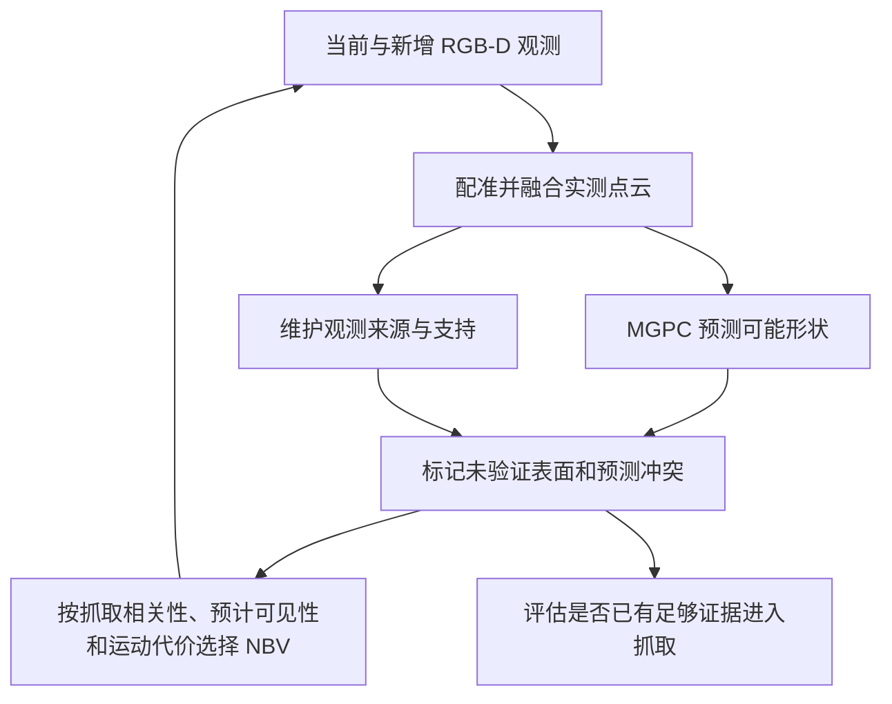

# T01：NBV、跨视角点云融合与 MGPC 补全

更新时间：2026-11-09。[返回总入口](../RESEARCH_STATUS.md)。

## 目标与当前阶段

研究如何以有限观察代价获得对抓取有用的信息，并可靠融合多视角目标与环境点云。MGPC 作为形状假设来源，与 NBV、融合在同一会话研究：预测哪些表面可能存在、哪些尚无观测支持、下一次应该观察哪里。原 T03 已并入本专题，模型诊断细节保留在 [MGPC 子模块](MGPC.md)。

已完成首轮机制与历史数据核查，见 [2026-11-05 核查报告](ACTIVE_PERCEPTION_AUDIT_20261105.md)。2026-11-09 已按用户授权接入 `--active-grasp-feedback` 可选闭环，默认旧分支仍保留。已补做真实模型推理与三路输入对照，**当前首版未显示改善**；尚无真机抓取收益结论。实现与边界见 [实现记录](ACTIVE_PERCEPTION_IMPLEMENTATION_20261109.md)。

## 最新现场结果与提速（2026-11-09，17:22轮）

用户实跑358.59秒；两次侧采集均因外侧黑像素守卫拒绝，无有效补看，第二次回中心途中因多路反馈老化触发MIT保护，尚未抓取。主要计算浪费是：第一次无新捕获后重复旧候选/模型/修正约159.37秒；MGPC工作进程本身每次约8秒，Nero修正每轮约70秒，NBV候选36.86秒。

已跳过无新增捕获的重复更新（新原始障碍视图仍会触发重评），并将观察试算改为最多6个昂贵预检、1个有效路线目标、15秒Nero预算；最终抓取沿用原完整预算/门限。固定本轮真实模型输出与场景的离线试算61.93→18.99秒，169项＋5子测试通过。尚未验证新总真机耗时或修复MIT故障；侧视外侧黑背景守卫仍待处理。见 [完整耗时/故障/验证记录](../artifacts/active_grasp_feedback_timing_20261109_1722/README.md)。

## 后续实际模型测试（2026-11-09）

在沙箱外 RTX 4060 上完成 4 次 MGPC／28 次 GenX 新推理。两份中心场景×种子 42/43/44，纯实测、原全预测＋focus、新混合分别有 1/6、3/6、1/6 组找到同一候选通过路线与接触证据；是中心候选分析，不是执行许可或成功率。新混合原生 CAD/桌面通过数 6/240，原流程为 27/240。补充 P 裁剪诊断为不裁剪 14、原裁剪 27，故输入准备是已见影响因素，但不能单独解释混合退化。

先前“CUDA 不可用”只反映沙箱内设备不可见，现已纠正；新生成候选确已测过。新推理的一次额外观测反馈回放两例仍未放行，实际 NBV 选角和完整两次实采预算未验证。下一步定位局部选择/采样及路线预算与接触资格的衔接，不把当前混合直接视为有效升级。见 [真实推理结果及图](../artifacts/active_grasp_feedback_live_20261109/README.md)。

## 最新实现与离线结果（2026-11-09）

- 新模式保留实测输入 XYZ，预测重复/冲突筛选、来源记录与限量采样；来源标签用于外部检查，不改 GenX 网络。
- 中心候选进入规划分析后强制第一次补看，最多两次尝试；每次回中心更新实测，再复核旧候选。新旧候选以最新场景重检，必要时才重新请求模型。侧视角按新增接触区域证据重排，仍受原往返路径保护。
- 相关软件回归 **165 项＋5 个子测试通过**。离线使用 G1/G2 中心-only 模型输出，随后揭示同轮 initial 的目标/深度作为额外视图；两例配准/融合通过，但均没有同一候选同时满足当前接触证据与完整路径，未放行。结果不是成功率提升证据。
- 该次回放只复用既有预测/网络姿态池，不能声称已测新模型输入或新 NBV 实采；后续新推理结果见上节。各阶段均未操作相机/机械臂或改运行外参/相机 YAML。
- [保存输出回放](../artifacts/active_grasp_feedback_20261109/README.md)、[回放入口](../tools/replay_active_grasp_feedback.py)、[新输入对照工具](../tools/compare_genx_proposal_inputs.py)、[完整实现/参数/边界](ACTIVE_PERCEPTION_IMPLEMENTATION_20261109.md)。

## 最新确认：至少补看一次（2026-11-09）

用户明确要求不能只看中心就抓取。方案改为：**中心之后至少获得一次有效侧视观测，最多两次侧视运动/采集尝试**。失败、深度无效或配准拒绝也消耗尝试预算，但不计作已完成有效补看；两次后仍没有有效侧视观测，不进入抓取。

中心帧先用于预测/生成候选和选择第一补看位置；即便中心已有看似可执行抓法，也要先补看。首次优先验证候选接触区/预测部位，必要时按独立覆盖选择可行视角。第一次有效补看后才判断是否结束；证据和完整检查足够就抓，否则预算内再补看第二次。新观测先复核旧候选，必要时才重新运行 MGPC/GenX。

这覆盖此前“中心足够即可直接抓”和“在线首版只尝试一次”的建议。新协议已接到 CLI/工作流可选分支，默认旧行为不变。用户已实机尝试两次侧视，但采集均拒绝且回程保护停止；完整两次预算的有效观测及抓取收益仍待验证。

## 本轮结论与最小目标（2026-11-05）

本节记录 11 月 5 日审计时的旧机制与待办；11 月 9 日可选分支的实现及验证范围见顶部更新。

- 用户确认主要问题是 11 月 1 日香蕉八组对照。多视角组实际均保留 center＋side1；不能将失败归因于没有侧视角。该批是旧 D435 数据，不能直接代表当前奥比。
- 当前 NBV 为球面候选＋表面/PCA 接触/接近方向等代理评分＋IK/路径检查。默认 16 方位×4 极角，侧视角顺序在中心采集后排定；第二侧视角按第一视角的预计覆盖重算，尚未用新增目标观测/MGPC 重建决策状态。11 月 1 日多视角组仅要一个侧视角。
- MGPC 当前用全部预测点替换抓姿生成输入，实测点另外用于支持/开口/碰撞/路径。不是保留实测表面、仅补缺失背面的融合，也没有实测候选独立保底分支。
- CPU 复核 8 份 M/P：实测→预测 p95 为 1.579–2.380 mm，输入归一化及修正后的参考相机链一致；没有证据将旧坐标基准故障认定为这批退化主因。隐藏形状仍未独立验证；超过 6 mm 无邻近实测的预测点占 7.8%–16.2%，是未验证比例，不能当误差率。
- 失败须分层：C1 跟踪停止、C2 提起后掉落；D1 规划失败、D2 人工中止；G1/H2 规划失败。当前优先核查候选可执行性和实物保持，不能只优化整物体重建指标。
- 最小下一步：在同帧 M/P、同抓取器和预算下定位逐阶段候选损失，再试“实测优先，预测用于救援或请求观测”。NBV 首个验收是新增真实侧视角能否验证抓取关键待验证区域并改变候选证据。直接用已含侧视角的 P 做该侧的留出验证会泄漏；需重新生成 P(center)。详细对照、预算和边界见核查报告 §8。

本轮新增 [CPU 审计工具](../tools/audit_t01_saved_evidence.py) 与 [16 轮/8 份补全证据](../artifacts/active_perception_audit_20261105/evidence.json)，已有软件测试 41 项＋5 个子测试通过。未重新推理模型/路径，未修改公共运行代码、配置或执行硬件；最小候选原型和补全反馈 NBV 仍待实现。

## 候选证据反馈与厚度约束方案讨论（2026-11-05）

用户已确认保留实测表面、预测补充未见区域并记录来源的表示目标；进一步提出候选拒绝后补看预测部位、利用其他视角参考厚度。设计演进见 [方案讨论](ACTIVE_PERCEPTION_DESIGN_20261105.md)；11 月 9 日已实现外部证据层及有限闭环，效果验证边界以上方最新记录为准。

- 拒绝不等于预测变厚。当前 GenX 宽度字段是夹爪资产固定开口；实际厚度需在候选接触区域、沿闭合方向另算。接触支持不足、碰桌、IK/路线失败和预算未检查必须分别处理。
- 补看位置优先考虑“有希望的抓法，其关键接触/接近区域缺少证据，且观测可能改变决策”；未被拒绝但依赖预测的候选也需检查。按 11 月 9 日要求，首次补看必需，是否继续第二次才按证据/收益判断。
- 跨视角可约束同一处几何，材质相同不能推出各处厚度或刚度相同。只比较共同坐标下、同局部截面及同开合方向的外形跨度；邻近截面的连续性/对称性仅作有条件软约束。
- 先实现外部来源/支持/深度冲突表示，再构造实测优先、去重且限制预测采样占比的混合输入。现成 GenX 输入 XYZ，不会自动理解另存的可信度标签；原样拼接 M/P 仍可能造成双层与预测点主导。
- 离线首个机制试点先回放一次侧视：验证局部假设，更新实测与预测状态，再决定抓取/换抓法；在线方案以顶部 11 月 9 日至少一次有效补看、最多两次尝试为准。预测被可靠证据否定后不能为让候选通过而强行缩薄。
- 后续候选比较/停止讨论见方案 §7：新观测先复核本次针对的旧抓姿；至少一次有效补看后，证据足够且完整路线通过就结束，未必重跑 GenX；需要时合并新旧候选，在同一最新场景下重检。按 TCP/方向/接触区域匹配而非候选序号，旧通过标志和路径不直接沿用。无效采集也占两次预算，新候选出现不能延长预算。

## 已核对的基础

- [active_view.py](../real_nero_grasp/active_view.py)：观察候选、实际采集、视图保留、融合及恢复流程。
- [active_view_scoring.py](../real_nero_grasp/active_view_scoring.py)：表面覆盖、PCA 接触代理、接近区域可观测性代理、遮挡和运动代价等评分。
- [pointcloud_fusion.py](../real_nero_grasp/pointcloud_fusion.py)：配准、voxel/surfel 融合、跨视图支持及相关可靠性处理。
- [multiview_archive.py](../real_nero_grasp/multiview_archive.py)：融合前的单视图存档。存档已经过单视图处理，不等于完全未经处理的传感器原始点。
- [workflow.py](../real_nero_grasp/workflow.py) 与 [cli.py](../real_nero_grasp/cli.py)：观察恢复和抓取衔接；`active_restore_center` 默认启用。
- [mgpc_completion.py](../real_nero_grasp/mgpc_completion.py) 与 [模型定义](../third_party/MGPC/models/MGPC.py)：默认先主动采集/融合、再补全候选输入；新可选分支在中心/侧视更新后插入规划分析。`predict` 输出多分辨率点云，不提供校准的逐点不确定性或缺失真值图。
- 当前奥比运行配置与单独试验外参的区别见[总入口](../RESEARCH_STATUS.md)，开始前核对实际命令覆盖项。

这些是源码存在性与流程语义的核对，不表示所有分支在当前硬件上均已验证。

## 首轮需要回答的问题

1. 当前实际运行了哪种 NBV 分支、保留几个视图、使用哪种融合和配准？
2. 抓取问题首先来自观测缺失、配准重影、深度质量、候选生成，还是观察代价？
3. 新 NBV 是根据真实候选抓姿、当前 PCA 代理，还是别的状态估计视角价值？
4. 拟改的是几何点云融合、网络特征融合，还是两者？新增机制与现有 surfel/可靠性处理有何区别？
5. 保留回中心时，如何计算观察往返代价和后续抓取收益？改变为最后观察位直接抓取属于另一个待验证协议。
6. 补全的假设表面哪些已被实测支持、哪些未被观察、哪些与观测冲突？它们怎样影响候选视角，而非只增加点数？
7. 能否先用可见性、观测支持和抓取区域权重建立低成本闭环，不先重训 MGPC 或额外学习多步策略？

## 补全怎样影响下一视角

需要区分三件事：实测点云没有覆盖某表面、补全网络预测了但尚未验证的表面、真实物体的表面到底是什么。第三项通常需要新观测或独立真值才能确定。补全结果点数多、看上去完整，不代表表面可靠；预测里点少，也不直接证明真实物体存在洞或该位置值得观察。

状态至少保留：

| 区域/状态 | 含义 | 对 NBV 的作用 |
| --- | --- | --- |
| 已观测且有支持 | 有真实 RGB-D 表面证据及对应视图记录 | 避免重复观察，必要时检查冲突 |
| 预测但未验证 | MGPC 假设存在的表面，当前缺少实测支持 | 作为可能值得验证的目标，结合候选视角可见性和遮挡 |
| 冲突或仍不确定 | 观测不一致、预测与有效深度不符，或信息不足 | 优先验证会改变抓取决策的部分；未知不等于自由空间 |

例如香蕉背面尚未看过，MGPC 即便已经补出背面，该处仍标记为“预测但未验证”。若抓姿依赖该侧接触，NBV 可偏向能真正看到该区域且运动可行的视角。预测表面本身不应被计入“已观察覆盖”。

拟研究流程：



第一版可计算预测表面与实测表面的距离/法向支持，结合已记录相机视点与深度遮挡，估计候选视角能新增验证哪些表面。评分侧重抓取接触区与接近区域，再减去观察运动和冗余成本。这些量属于观测支持/可见性代理，不自动等于校准的模型不确定性。仅改随机种子不一定让 MGPC 产生有效的独立形状样本，不能直接用重复输出方差冒充可信度。

更新预测时保留并输入累计实测数据，继续区分预测来源；新 RGB-D 用于验证并修正先前假设。不能把上一轮预测当成新增实测证据回灌。若预测明显不合理，保留独立于它的观测覆盖信息作为回退，避免相机持续追逐虚构表面。是否每次观察都运行补全，由效果与总耗时决定。

预测辅助 NBV 已有先例，例如 [Pred-NBV，IROS 2023](https://arxiv.org/abs/2304.11465) 利用形状预测与信息/控制代价选视角。本专题需要具体比较抓取相关证据、真实观测反馈和既有方法，不把“补全 + NBV”组合本身认定为新增贡献。

## 第一轮交付结果

- 基于当前入口的流程图和关键参数表，注明实际启用条件。
- 选定一组有完整存档的场景，保存各视图独立颜色、配准残差、保留/拒绝原因及融合结果。
- 列出最主要瓶颈，并提出一个最小对照；候选包括固定视角、现有 NBV、随机可行视角及新策略，具体集合按问题决定。
- 记录指标：实际保留视图、接触区域观测支持、对齐误差、抓取/规划结果、观察运动与总耗时。
- 至少区分“无补全的现有 NBV”“补全仅用于候选生成”“补全反馈 NBV”；固定其他条件与观察预算，计入补全推理时间。
- 用保存的后续独立视图检查未验证区域的判断；未采集视角的真实深度不能提前提供给测试策略。

## 依赖与更新边界

使用相同传感器配置、相同场景输入和明确观察预算比较。候选条件 NBV 与 T04 共享候选/评价信息；补全先验的输入、误差和改网细节在本专题下的 [MGPC 子模块](MGPC.md) 记录。视图间一致不等于几何真值，缺点不等于自由空间。

优先在本专题记录算法和回放结果；涉及 `cli.py`、主流程、相机或外参时，核对其他会话的新改动并同步总入口。

参考：[专项研读](../FUSION_AND_GRASP_REVIEW_2026.md)、[已有文献综述](../LITERATURE_REVIEW_TOP10.md)、[测试命令](../HRI_TEST_COMMANDS.md)。旧报告是参考，使用前重新核实对应代码和文献状态。

## 新会话开场模板

```text
这是 /home/yx/yx/panda_ws/src/whole-grasp 论文项目的 T01“NBV、跨视角点云融合与 MGPC 补全”专题。
请先阅读 RESEARCH_STATUS.md、research/ACTIVE_PERCEPTION.md 和 research/MGPC.md，再核对当前实际入口、配置和代码。
总体约束是工期紧、分阶段推进。我希望联合研究补全、融合与选视角：区分实测表面和未验证预测，利用抓取相关的缺失观测/预测冲突决定下一视角。
2026-11-09 已实现 --active-grasp-feedback 可选分支；默认旧机制保留，没有校准逐点不确定性。先阅读 research/ACTIVE_PERCEPTION_IMPLEMENTATION_20261109.md 与 artifacts/active_grasp_feedback_20261109/README.md，区分实现、软件测试、缓存回放和真机证据。
当前最小闭环：保留实测、筛选/标记预测、接触证据引导补看、回中心更新，先复核旧候选再按需生成；中心后至少一次有效侧视、最多两次尝试。软件测试 165 项＋5 子测试通过；后续真实模型测试见 artifacts/active_grasp_feedback_live_20261109/README.md。
沙箱外 GPU 正常，已经实跑混合输入 MGPC/GenX；三路输入小样本对照未显示首版改善，应先定位 focus/采样及联合筛选。NBV 自选视角、完整两次实采预算和当前奥比实物效果仍未验证；11 月 1 日八组是旧 D435 历史诊断。
每个阶段完成后更新本专题；跨模块决定同步 RESEARCH_STATUS.md。涉及公共文件先查看最新改动。
```

## 接续记录

| 日期 | 事项 | 证据与结论 | 下一步 |
| --- | --- | --- | --- |
| 2026-11-05 | 专题建档 | 已列源码入口；未新增算法或运行实验 | 在专题会话还原当前启用机制并选择诊断数据 |
| 2026-11-05 | 合并原 T03 MGPC | 按用户意见共同研究补全/融合/NBV；补全反馈闭环仍待实现 | 建立实测/未验证/冲突表示与最小对照 |
| 2026-11-05 | 完成首轮机制、11 月 1 日八组与 M/P 软件链核查 | 球面启发式 NBV；MGPC 替换候选输入；8 轮未见整体坐标链异常，局部形状未验证；41 项＋5 子测试通过，见 [核查报告](ACTIVE_PERCEPTION_AUDIT_20261105.md) | 同帧当前流程候选损失分析→实测优先原型→单步预测证据 NBV 验证 |
| 2026-11-05 | 讨论候选拒绝反馈与其他视角厚度约束 | 用户确认保留实测/标记预测目标；拒绝不能直接证明预测错误，材质相同不能推出厚度相同；形成 [方案讨论](ACTIVE_PERCEPTION_DESIGN_20261105.md)，未实现/运行新实验 | 外部证据表示、拒绝分类和局部截面验证；先做单次新增观察 |
| 2026-11-05 | 讨论新旧候选比较与停止条件 | 新观测先复核旧抓法，必要时才新增 GenX 候选；候选和观测区域记忆避免重复追逐；同场景重检、成功/无收益/预算退出，见方案 §7。未实现/运行新测试 | 首版一次新增观察尝试，验证旧抓姿证据变化与停止逻辑 |
| 2026-11-09 | 用户明确至少补看一次 | 中心后至少一次有效侧视，最多两次尝试；第一次后才允许证据充分早停，无效采集占预算，两次仍无有效侧视则不抓。覆盖此前零补看/在线只试一次建议；仅更新文档 | 先用中心→隐藏侧帧离线验证一次更新，再准备完整预算试点 |
| 2026-11-09 | 实现实测优先/候选证据反馈并做流程回放 | 新增可选开关与证据、记忆、规划分析、动态侧视重排；165 项＋5 子测试通过，2 份缓存输出回放完成但均未满足放行条件。当时仅沙箱内 CUDA 不可见；真实模型测试见下一条 | 后续已补跑新模型输入，不将本条流程检查当作效果验证 |
| 2026-11-09 | 用户要求实际测试新输入，完成 GPU 新推理 | 沙箱外 RTX 4060 正常；4 次 MGPC／28 次 GenX。两场景×三种子，M/P/混合的联合资格组数 1/6、3/6、1/6，首版未显示改善；P 裁剪诊断 14→27 个原生通过候选。未改生产参数/默认值或操作硬件 | 优先定位输入局部选择/采样与接触/路线预算衔接；见新结果目录；NBV 自选视角仍待实采 |
| 2026-11-09 | 按用户要求准备真机试跑命令 | 新增 `scripts/test_active_grasp_feedback.sh`，用当前奥比/sept01/V112/MIT8°组合启用新 MGPC/NBV，至少一次有效侧视、最多两次尝试；通过检查后真正闭爪/抬升/到持物位。shell 完整转发与生产解析核对通过；只读确认奥比 USB 5000M，助手未启动硬件 | 用户运行独立 T01 入口后核查实际选角、视图证据及实物保持；命令见 HRI_TEST_COMMANDS.md 顶部 |
| 2026-11-09 | 修复17:10首次采集的旧遮罩配置遗漏 | 用户实机到初始位/张爪后旧遮罩拒绝，尚未 MGPC/GenX/NBV。T01 入口改为显式复用当天 T02 已建立的固定参考版；同失败图原门限通过，core/silhouette/outer=1.000/0.998/0.029，已检查香蕉/电线区域不遮。入口转发/CLI/模式开口检查通过；不改 YAML/外参/阈值，助手未重启硬件 | 原 T01 命令重试；记录新姿态逐帧校验与实际补看结果，见 artifacts/t01_self_mask_20261109_1710/README.md |
| 2026-11-09 | 17:22真机耗时/反馈保护审计与提速 | 358.59秒，侧采集两次outer拒绝，回中心反馈老化触发电子急停；无有效侧视或抓取。去掉无新捕获后的约159秒重复更新，观察小预算试算同场景61.93→18.99秒；169项＋5子测试通过，最终抓取与保护门限保留 | 新真机总时长待复测，先分离外侧黑背景守卫与MIT/CAN调度问题；见耗时记录，不把提速当控制故障修复 |
