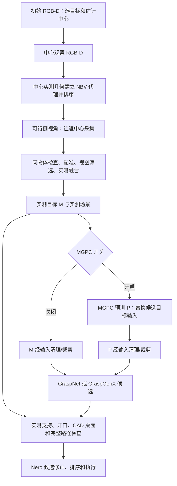

# T01 首轮核查：NBV 实际机制、融合和 MGPC 抓取退化

日期：2026-11-05。用户确认主要问题来自 **11 月 1 日香蕉八组对照**。本轮完成源码核查、保存数据的 CPU 审计与现有软件测试；未重新推理模型、未执行相机或机械臂动作，未修改公共运行代码、外参或参数。

## 1. 回答当前问题

**目前的 NBV 是带运动约束的几何启发式评分。MGPC 尚未参与选视角。MGPC 打开后，也不是简单地在可靠实测表面外加一些背面点：它用整份预测点云替换候选生成输入。**

因此，“预测更完整”不必然带来更好的抓姿。预测会改变局部表面、密度、法向、输入裁剪及生成器的候选分布；候选最后还须适合真实 Nero 夹爪、桌面、障碍和机械臂。当前保留实测安全检查是必要边界，但通过这些检查也不等于实物夹持稳定。

11 月 1 日证据尚不能断言“MGPC 整体预测错了”。本轮未见明显整体坐标或尺度错乱；更直接的系统瓶颈是**新增预测没有转化成更可靠、可执行的候选，且部分运行的候选修正/规划代价较大**。背面和实际接触区域是否预测准确，仍缺少独立观测验证。各组每组仅 2 次，不能推断总体成功率或单一因果。

## 2. 当前实际入口与数据流

入口：`scripts/run_grasp_safe.sh → scripts/run_grasp.sh → main.py → real_nero_grasp.runtime.main → workflow.run_single_grasp`。`real_nero_single_grasp_runner.py` 是兼容入口，导向相同 runtime。不能按根目录旧长脚本或 `new/` 下的同名模块推断当前行为。



图中没有 `P → N` 边，这是当前确实未实现的部分。观察结束后还可应用独立的绝对桌面参考修正；MGPC 使用对应修正后的中心参考相机，不能把配准后的虚拟参考坐标与原始 RGB 相机直接混用。

## 3. NBV 到底怎样选视角

主分支位于 [active_view.py](../real_nero_grasp/active_view.py)，数值评分位于 [active_view_scoring.py](../real_nero_grasp/active_view_scoring.py)，方位候选与障碍代理位于 [nbv_geometry.py](../real_nero_grasp/nbv_geometry.py)。

1. **是否观察。** `--active-view` 才进入主动观察；默认障碍门控在目标附近 55 mm 内至少有 80 个非目标障碍点时触发。它没有用“背面是否缺失”或“抓姿是否足够好”触发。`--no-active-multiview-gate` 绕过该门控。
2. **先移到目标上方。** `active_center_first=True`。初始帧主要选目标/估计中心；主分支用于目标重建的是重新拍摄的中心和通过筛选的侧视角。初始帧仍参与保守运动环境。中心不可达时还有受检查的倾斜/球面回退。
3. **建立球面候选。** 默认方位角每 22.5° 一个，共 16 个方向；极角为距世界 +Z 的 20/30/35/45°，与中心观察使用同一目标距离，光轴朝目标。一般产生 64 个位置，再为位置尝试等价相机 roll。它们不是 64 次采集，也不是把水平角简单转 ±45°。
4. **计算预期收益。** 用 512 个上部/侧面包络方向近似表面；法向/径向和当前视线给出覆盖代理。PCA 主/次轴在夹爪宽度范围内形成双侧接触代理；偏好两侧覆盖均衡，另有接近区域方向代理、遮挡、成像质量和冗余项。
5. **有限预算内检查可行性。** 先廉价计算三维信息分数，各极角层前置少量候选；先查 8 个位置的少量 roll/IK 种子，未凑够默认 8 个有效位置时再有限扩展，默认最多检查前 32 个位置。深度、视野、相机间隙、关节摆动、观察角差等是硬条件；选中后还须通过完整往返路径检查。不是对全部球面姿态求全局最优。
6. **执行与保留。** 候选排序后逐一尝试，默认最多 3 次侧视角运动/采集尝试。每次从已保存中心关节出发并返回同一中心。新帧要重识别同一目标、通过重叠和配准检查，才计入接受的侧视角数量。

核心默认分数为：

```text
S(v) = 0.35 × 新表面覆盖
     + 0.30 × 双侧接触代理增益
     + 0.15 × 接近区域方向增益
     + 0.10 × 遮挡质量/改善
     + 0.10 × 成像质量
     - 0.10 × 冗余
     - 0.10 × 运动代价代理
```

运动项含关节最大/L2 变化、视线弧度、轨迹占用与相机占用，不是精确计时的往返运动或完整抓取代价。分数是启发式，不是校准的信息熵、接触成功概率或网络不确定性。`sweep_gain_mode=directional_proxy_no_free_space` 明确表示没有由此证明接近区自由。

配置还有两个易混点：默认要求候选与观察锚点视线至少相差 30°，所以理想正上方中心下的 20° 层会被拒绝；“配置了某层”不等于它可执行。方位预筛中的 `0.8 × clearance + 0.2 × PCA 方向偏好` 只作初筛提示，不额外加到最终三维信息分数中。

**第二侧视角不是新观测驱动的再次决策。** `_active_side_selection_order` 在采集侧视角前计算顺序：一般按第一视角的预计可见方向重算第二视角边际收益，细长物体增加对侧奖励，圆形物体可用联合覆盖配对。新侧帧能更新安全环境和接受/拒绝状态，但这里没有再次构建累计目标代理、运行 MGPC 并重排全部 NBV。11 月 1 日多视角组仅要求一个侧视角，也不会使用这个双侧选择分支。

## 4. 默认、11 月 1 日实验与当前奥比要分开

| 项目 | 代码默认/当前 YAML | 11 月 1 日纳入八组的运行 | 11 月 5 日 16:30 完成的奥比例子 |
| --- | --- | --- | --- |
| 相机/手眼 | 传 `pipeline_orbbec.yaml` 才选奥比；YAML 默认独立 trial 外参 | D435、`2026-10-22_charuco_handeye.json`，来自档案快照 | 奥比；命令显式覆盖为 `orbbec_handeye_20261103_all_data_trial.json` |
| 主动开关/门控 | active 默认关；gate 默认开 | active 开，gate 关 | active 开，gate 关 |
| NBV 模式 | `scene_aware` | 未显式改模式 | 未显式改模式，但侧视角数量为 0，跳过侧视角 NBV |
| 侧视角数量 | 2 | A/C/E/G 为 0；B/D/F/H 为 1 | 0 |
| 实际保留视图 | 以返回结果为准 | 单视角组 1；多视角组均为 center + side1，共 2 | 1，`center_view_only` |
| 目标融合 | `voxel`、2.5 mm；surfel 可选 | 未显式切换 surfel；多视角组启用 rigid ICP | 单中心视图，不能据此评价跨视角融合 |
| 观察后回中心 | 开 | 没有关闭；当前主分支每次侧采集也返回中心 | 回到/确认中心 |
| 抓取器/MGPC | 默认 GraspNet、MGPC 关 | A–D GraspNet，E–H GenX；C/D/G/H 开 MGPC | GenX、MGPC 关 |

奥比 YAML 核对时的自遮罩为 `orbbec_self_mask_20261105_100mm_threeframe_trial.json`，不是建档时记录的 11 月 3 日文件。YAML 未定义 NBV 评分权重/融合模式，它们来自 CLI 默认与显式参数。16:30 例子是读取已存在日志，不是本轮新增真机验证；软件结果 `success` 仍须与实物保持标签区分。

## 5. 融合已有的内容与不足

[pointcloud_fusion.py](../real_nero_grasp/pointcloud_fusion.py) 已有：跨视图桌面参考/静态背景修正、目标平移校准、可选 rigid ICP、互相重叠配对残差和视图筛选；默认目标 voxel 融合让每视图每体素至多投一票，避免稠密单帧支配结果。单视图新表面不会全部删除，主要去除单视图且局部孤立的点。

surfel 是已有可选分支，带法向、邻域密度和观察角相关的几何权重。它们都不是校准的模型置信度。目标融合内部虽统计 `support`，默认对外仍是普通 Open3D 点云和汇总统计，未将逐点视图来源/支持一路传到 MGPC、候选和 NBV。

运动环境另有保守占用：即便某帧目标不用于融合，其实测障碍仍可保留。不能把去掉目标重影与删除运动障碍混为一项处理，也不能靠增大体素掩盖系统位姿误差。

## 6. MGPC 实际做了什么

[mgpc_completion.py](../real_nero_grasp/mgpc_completion.py) 将累计实测目标变换到配对中心 RGB 的相机坐标，确定性 FPS 到 2048 点，以样本均值平移、包围盒对角线归一化，结合遮罩 RGB crop 和类别文本送独立进程。输出 8192 点反归一化并转回当前规划坐标。模型 `predict` 返回 8192/2048/512 点云，没有逐点方差/可信度输出。

当前只检查输出形状/有限值及 **实测点 → 预测点 p95 ≤25 mm** 的粗门槛，未检查完整背面准确性，也未建立有效深度前方的自由空间冲突图。这个单向门槛不能阻止贴着可见表面、却把背面补错的输出。

[grasp_workflow.py](../real_nero_grasp/grasp_workflow.py) 中 `proposal_cloud = complete_graspnet_target(...)` 将候选输入替换成 P；M 单独作为实测支持。后面还经过主连通体清理及高度/细长轴 focus，MGPC 与无 MGPC 的裁剪可能不同。函数名和 CLI help 仍有 “GraspNet” 旧字样，当前实际也服务 GenX。模型以点特征生成全部坐标，没有硬性把原始 M 的坐标保留在输出中。

当前没有同时保留 `候选(M)` 与 `候选(P)` 两条生成分支的保底策略。实测支持/实际开口/桌面/CAD/路径虽能拒绝部分不良预测候选，不能补回生成器没提出的好姿态，也不能测出接触摩擦或持物稳定性。

## 7. 11 月 1 日证据：失败发生在哪一层

来源：[trials.csv](../artifacts/ablation_20261101/trials.csv)，本轮重新核对每轮 `experiment_result.json` 和逐视图状态。下表“保持”按现场标签，分母均为 2；仅作故障分析。

| 基线 → 加 MGPC | 实物保持 | 加 MGPC 两轮实际结果 | 平均抓取阶段墙钟时间（含补全/修正等） |
| --- | --- | --- | --- |
| A → C，单视角 GraspNet | 1/2 → 0/2 | C1 接近段跟踪停止；C2 提起后掉落 | 13.82 → 38.03 s |
| B → D，多视角 GraspNet | 1/2 → 0/2 | D1 规划失败；D2 预抓取途中人工中止 | 82.28 → 63.15 s |
| E → G，单视角 GenX | 2/2 → 1/2 | G1 规划失败；G2 保持但现场记深度不足 | 50.20 → 84.19 s |
| F → H，多视角 GenX | 2/2 → 1/2 | H1 保持；H2 规划失败 | 46.50 → 73.75 s |

C1/D2 记录了接近 180° 的姿态重定向；B1 无 MGPC 也有类似问题。不能归为 MGPC 独有，也不能不区分夹爪对称与整臂路径。C2 软件显示成功而现场掉落；A2 软件成功却没有提起，不能直接用 `software_success` 算真实成功率。

本轮 CPU 读取 8 份保存的 M/P，结果见 [evidence.json](../artifacts/active_perception_audit_20261105/evidence.json)：

- 实测 → 预测 p95 为 **1.579–2.380 mm**；保存的 `prediction_base` 与其相机变换完全一致，归一化输入往返最大坐标差小于 **8.6×10⁻⁹ m**；8 轮中心 RGB 参考均与各自已保存桌面修正一致。这些验证软件链一致性，不是外参真实精度。
- 预测中距任何实测点超过 6 mm 的点占 **7.8%–16.2%**；同时保存了 3/10 mm 的敏感性结果。这些点是待验证区域，可能是真背面，也可能是错误，不能称为误差率或模型不确定性。
- D1 相对保存的确认桌面，预测有 59 点低于 −5 mm，实测本身也有 7 点低于该位置；其他轮次预测为 0–3 点。不能仅由少量低点认定全部失败来自预测穿桌。
- 8 轮的相机坐标包围盒尺寸接近，但局部接触形状/法向/密度仍可能变化；尺寸接近和低单向距离都不能验证隐藏表面。

**历史证据单独引用。** 10 月 28 日同帧同种子的 GraspNet 回放，C/D 的实测输入各有 1 个候选通过“开口＋完整夹爪桌面”，MGPC 均为 0；禁用 focus 后 C 仍为 1 对 0，D 两者为 0。说明 focus 可能参与但不是唯一解释。见 [原 focus](../artifacts/banana_planning_diagnosis/contact_20261028/mgpc_CD_same_capture/comparison.json)、[无 focus](../artifacts/banana_planning_diagnosis/contact_20261028/mgpc_CD_no_focus/comparison.json)。这是旧候选处理下的几何筛选，不包含当前 Nero 修正、IK 或完整路径的重新比较。

10 月 28 日曾发现中心桌面修正与 MGPC 参考相机基准不一致，约 20.96 mm 的输入转换差；源码已修正，11 月 1 日存档也通过上述一致性检查。不能把这个历史故障再次当作 11 月 1 日的已证实根因。同理，旧 NBV 数值进程超时、旧到位容差和候选推进穿桌问题，须按修复日期/运行版本分别分析。

## 8. 本轮确定的最小验证目标与后续顺序

本轮完成的是**机制与故障分层基线**。下一步最小目标确定为：**在 11 月 1 日同帧输入和当前候选检查下，验证“保留实测候选、预测只在需要时补充或请求新观测”是否比预测直接替换更合适。** 不先重训 MGPC，也不追求整物体精确重建。

第一步先复用 C/D/G/H 保存的同一 M/P，固定同一抓取器、模型/种子、输入处理、候选及规划预算，重新比较 M 与 P 的逐层候选保留情况：生成→实测接触/开口→CAD 桌面→端点→完整路径→最终选择。GraspNet 与 GenX 分开比较。当前审计尚未重新运行这些模型或路径，不把旧 10 月 28 日回放充当新实验结果。

随后做最小候选原型：先评估 M 候选；已有完整可执行且证据足够的方案时结束，避免无条件运行补全。M 无可执行候选时再检查 P 是否能提供新抓法。额外耗时完整记录；与同等总预算下继续采样 M/继续规划的控制比较。不能把扩大候选池或增加规划时间带来的收益归功于预测。该回退策略目前未实现，也不保证同一候选的实物保持成功。

NBV 原型接在上述证据表示上：

1. 独立维护累计实测 M、预测 P 及相机/深度来源。M 不能被 P 改写；不把 P 回灌为新增测量。
2. 将 P 标为“被实测支持 / 未验证 / 与有效观测冲突 / 无法判定”。近邻支持只是第一层；须结合有效深度射线、视野、遮挡和边缘容差，才能判断冲突。预测在遮挡物后、深度缺失或视野外，均保留未知。
3. 用少量已生成抓姿的双指接触区和接近区域给待验证表面加权。第一版优先做接触区；接近区自由空间需要真实射线证据，不能仅从表面距离推断。
4. 沿用当前可行视角池，增加“预计能验证多少抓取关键区域”的收益，再减去实测往返代价；现有覆盖项保留为错误预测时的回退。纯 IK/桌面姿态问题不应自动触发补拍。
5. 每次新观测后实际更新支持/冲突和抓姿，再决定继续或抓取，而不是预先给两个视角排完顺序就视作闭环。

**首个 NBV 验收只要求证明一件事：** 中心观测后标出的抓取关键待验证区域，是否能被新增真实侧视角验证，并使候选证据/选择发生合理变化。用相同观察预算依次比较现有 NBV＋M、现有 NBV＋P、预测证据反馈 NBV；计入补全和规划全部耗时，同时记录请求/接受/最终融合视图数与物理保持。

不能直接拿 D/H 已融合中心＋侧视角生成的 P，再用同一侧视角宣称“留出验证”。须重新生成 `P(center)`，在策略输入中隐藏后续侧帧，再用侧帧评估；相对配准前/桌面或背景对齐后/目标 ICP 后的结果应区分。当前每场景仅一侧帧，能做机制试点，不能比较所有未采集视角的真实收益或证明 NBV 最优。当前奥比效果需另采同配置对照，旧 D435 结果只用于定位问题。

## 9. 本轮可复现检查

新增 [CPU 审计工具](../tools/audit_t01_saved_evidence.py)，仅依赖 NumPy/SciPy，输入只读。代码/配置 SHA-256 随结果保存；当前工作目录无可用 Git 提交历史，不虚构版本号。

```bash
OPENBLAS_NUM_THREADS=1 OMP_NUM_THREADS=1 \
  /home/yx/miniconda3/envs/grasp_yolo26/bin/python tools/audit_t01_saved_evidence.py \
  --runtime-result logs/orbbec_handeye_trial/full_grasp_follow_all_data/2026-11-05_16-30-40_863089_p47452/experiment_result.json \
  --output-dir artifacts/active_perception_audit_20261105
```

本轮运行已有 `test_active_spherical_nbv`、`test_active_view_control_flow`、`test_target_fusion`、`test_active_scene_registration`、`test_mgpc_mainflow`、`test_mgpc_offline_compare`：**41 项通过、另 5 个子测试通过**。这些覆盖几何代理、观察流程、融合及 MGPC 软件契约，不验证神经模型精度或真机保持；输出记录见同目录 `verification.json`。
