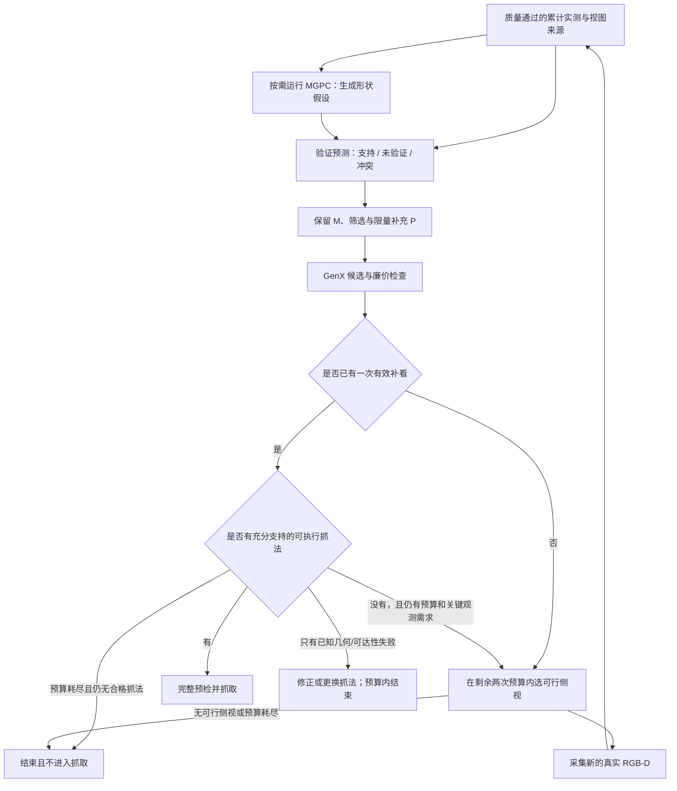

# T01 方案讨论：候选证据反馈 NBV 与跨视角局部厚度约束

日期：2026-11-05。[专题入口](ACTIVE_PERCEPTION.md)；已有机制和历史证据见 [首轮核查](ACTIVE_PERCEPTION_AUDIT_20261105.md)。

**实现更新（2026-11-09）：** 本轮已按用户授权接入 `--active-grasp-feedback` 可选分支，并完成软件测试与缓存数据回放。实际范围/参数及未验证部分见 [实现记录](ACTIVE_PERCEPTION_IMPLEMENTATION_20261109.md)。本文保留方案演进过程中的“待实现”等历史措辞，以最新实现记录为当前状态；默认旧分支保留，未运行硬件。

**协议更新（2026-11-09，用户已确认）：中心后必须至少获得一次有效侧视观测，最多两次侧视运动/采集尝试。** 中心已有候选也不能零补看直接抓；失败也占尝试次数，两次仍无有效侧视则不进入抓取。第一次有效补看后才判断是否可停止，第二次按剩余证据需求决定。协议已作为可选分支实现；早先单次离线试点保留为数据受限的机制验证，完整真机预算未验证。

用户已确认表示目标：相机实测表面应保留，预测仅补充未见部分并注明来源。本轮进一步提出“MGPC→GenX→候选拒绝→观察被预测的部位→重新融合/预测”，以及用同一物体其他视角参考厚度。本文件记录对这些假设的质疑和建议，**不是已实现算法或实验结论**；未改变运行代码、相机配置或外参，未操作硬件。

## 1. 两个不能成立的直接推论

**候选被拒绝，不等于预测太厚或形状错误。** 拒绝是某项检查的输出，不是对根因的鉴别。尤其不能拿当前实测几何检查的失败，反推未见部分一定预测错误；也不能把同一错误候选的多种姿态变体当作独立证据。

| 拒绝/状态 | 它实际说明什么 | 首选处理；何时值得补看 |
| --- | --- | --- |
| 实测接触点不足、某侧接触深入量不够 | 当前实测不能支持这项接触；也可能候选位置/推进不合适 | 定位具体指面接触区域；未观察且抓法有希望时请求观测。已充分观察为空时优先换抓法 |
| 实测局部跨度超过物理开口 | 按当前实测和姿态，该部位无法容纳在开口内 | 换位置/开合方向；只有实测可信度或配准存疑时再查证，不默认缩小预测 |
| 夹爪 CAD 碰桌/碰已知障碍 | 当前夹爪姿态/开口/推进与环境不相容 | 修正姿态/深度或规划；明确障碍不因再看一次而消失。环境证据缺失/冲突时另行观察 |
| IK/完整路径失败 | 端点或路线在当前求解预算下未找到解 | 换姿态/规划；不能直接归为形状错误。仅当未知几何影响路线判断时交给感知 |
| 未预检、超时、候选预算耗尽 | 尚未计算完/未检查 | 记录 unresolved；不能当作物理不可行或模型错误 |
| P 与有效实测深度的自由空间相冲突 | 该预测或某项观测/位姿可能有错 | 可靠观测已足够时先排除相应 P；跨视图观测自相矛盾时先检查传感/配准。只有局部且决策相关的未决冲突值得补看 |

当前源码依据：`grasp_candidates.py` 的 `physical_aperture_variants`/`physical_aperture_reason`，`grasp_planner.py` 的 `workflow_preflight_reason`，以及 `graspgenx_integration.py` 的 contact/CAD 检查。后者明确写有 `width_source=fixed_nero_opening_*mm_not_model_prediction`：**GenX 的宽度字段是所选夹爪资产的固定开口，不是它估计出的香蕉厚度。** 需要另算候选局部的几何厚度。

**同物体/同材质，不等于局部厚度、截面或刚度相同。** 物体也未必由单一材料构成。即使香蕉表皮材质近似，尖端与中部外形仍不同；同一截面换观察方向，投影宽度也可不同。可用于迁移的是有条件的几何规律，例如局部连续性、近圆截面或已验证对称性，不能把材质相同当作均匀厚度的依据。视觉外表也不能确定内部壁厚、摩擦或夹持后的形变。

## 2. 推荐的触发逻辑：检查抓取依赖的未决证据

不等到全部候选拒绝后才启动感知，也不对每次拒绝都补拍。首次补看按 11 月 9 日要求必需，候选证据决定看哪里；第一次有效补看之后，证据/收益才决定是否再补看。一个尚未被拒绝的候选也可能依赖错误的隐藏面；反过来，许多拒绝与增加观测无关。

对少量方向/位置不同、较有希望的候选，为左右指预期接触带和局部接近区域记录：

- 哪些由可靠实测支持；来自哪些视图。
- 哪些仅由 P 支持，目前不可验证。
- 哪些与有效观测冲突；冲突来自何视图、何射线。
- 若这些未决几何得到不同验证结果，是否会改变抓法的可行性或排序。

先做硬件/CAD 和廉价可达性筛查，避免相机追逐明显无法执行的抓法。缺接触观测的候选可以进入 `needs_observation` 列表，**不能把它改成通过实测接触或允许执行**。预算未检查则留为 `unresolved`。

建议的视角效用原型：

```text
视角价值 = 能观察到的抓取关键未决区域
         × 观察结果可能改变抓取决策的程度
         × 预计有效深度/可见性
         - 中心往返运动、计算和重复观察代价
```

这是待验证的启发式效用，不是已校准的期望成功率或信息熵。多个相似候选共享同一区域时去重/封顶，避免仅因 GenX 采样出很多近似姿态就反复追同一部位。保留独立于 P 的实测覆盖回退；首次即使已有候选也选择一次可行侧视验证接触区/独立覆盖。至少一次有效补看后，存在已充分支持且全路线通过的抓法才可结束观察；已经可靠判错、又不影响替代抓法的预测不应引发第二次观察。

## 3. 实测保留、预测融合与深度验证

“保留实测”指保留来源和可追溯证据，不能把每个原始深度离群点永久冻结为真值。先用现有深度质量、配准和多视图支持处理实测；拒绝/降权原因仍保存。

分别保存累计实测 M、预测 P 和 P 的验证状态。若构造给 GenX 的混合点云 H，使用质量通过的 M，再增加去重、未与可靠证据冲突的 P；用体素/采样配额防止 8192 个预测点压过实测点。**不能只做 M∪P 原样拼接**，否则仍可能出现双层表面和预测密度主导。

当前 GenX 请求保存 XYZ，没有输入已验证/预测来源通道。第一版来源标签只能用于外部筛选、重排和 NBV；不会因为另存了标签，就让现成网络自动学会按可信度理解点。若以后把来源条件送入网络，需要另行设计输入与训练。

将预测点投到保存的相机位姿和有效对齐深度上。对可信像素，比较预测深度 z 与实测 D，并使用由深度重复性/配准误差决定的容差：

| 相对深度关系 | 可得结论 |
| --- | --- |
| z 接近 D，且有同物体/表面对应支持 | 支持这处外表面；仍记录误差与来源 |
| z 显著小于 D，即预测位于可靠深度返回之前 | 预测占用了该观测的自由空间，是冲突候选；需排除边界、坏深度和位姿不一致 |
| z 大于 D | 被前方表面遮挡；不能据此判预测错误或正确 |
| 深度无效/像素越界/对应不可靠 | 未知，不当作自由空间 |

仅仅“距 M 很远”不等于错误或未见表面；仅仅在分割 mask 外也不足以删点。支持与自由空间冲突若同时出现，先检查观测/配准一致性，不能盲目把新测量与旧预测平均到中间位置。



新观测后先更新 M 并清除失效的候选/规划结论，再验证旧 P；只在新增几何足够或关键假设发生变化时重跑 MGPC/GenX，避免每帧冷启动大模型。旧 P 不能混入下一轮 M 冒充新增观测。继续保留当前回中心协议，观察成本按实际往返计。

## 4. 其他视角怎样约束“厚度”

此处厚度定义为**某候选接触截面沿夹爪闭合方向的外形跨度**，不是表皮/容器壁厚，也不是网络/资产开口字段。

同一物体的新视图要先经相机位姿/配准到共同坐标，再在同一局部空间区域、同一开合轴下比较。只有这样才是“同一处厚度”的约束：一个视图补出左侧，另一视图补出右侧，可共同确定该截面边界。两幅图里的像素宽度不能直接平均；只看见单侧时，实测跨度也不能冒充完整厚度。

按证据强度排序：

1. **同一截面、同一方向的两侧有效实测边界**：最直接；保留测量容差。
2. 同一物体其他视角的有效深度/轮廓：约束可用外形和自由空间，但遮挡与深度缺失仍是未知。
3. 邻近截面的厚度连续性、已验证的局部对称/截面模型：作为有条件的软约束，遇到弯曲、尖端、凹陷、柄部时允许失效。
4. 类别或材质相似：不能单独确定局部厚度，不设成硬上限。

有足够的可靠观测时，优先让实测约束取代相应预测；证据不足时保留一组可能边界/未知标记，不为让候选通过而强行把 P 缩薄。若后来观测证明该处确实太厚，正确动作可以是换夹持位置，而不是继续补拍直到能抓。

## 5. 工期受限下的最小验证

第一阶段不训练网络，做外部证据层和一轮选视角。先选三类例子：接触区真缺观测、预测与可靠深度确有局部冲突、几何已经清楚但候选碰桌/IK 失败。前两类检查是否能定位和更新；第三类检查会不会误触发无用观察。也检查“原检查通过但依赖未验证 P”的情况，避免只解决假拒绝而漏掉错误接受。

离线首个试点只回放一个可行侧视角，检验：定位区域是否被有效深度观察到、旧预测得到支持还是证伪、厚度约束是否收紧、候选是否合理保留/替换、额外耗时是多少。在线方案为至少一次有效侧视、最多两次尝试，不能把离线单次回放当作完整协议验证。侧视角不能提前进入策略；D/H 现成 P 已含 side1，须重新生成 P(center)。目前仅有一个实际侧视角的数据，不能证明其他未采集候选视角的真实收益或 NBV 最优。

后续保持相机、观察/候选/路径预算一致，比较实测＋现有 NBV、混合表示＋现有 NBV、同一混合表示＋证据反馈 NBV。可用离线“只按拒绝触发”的版本作误触发负对照，不能用增加计算或观察次数混淆闭环收益。记录真实保持、全流程时间、有效验证比例、误触发/重复观察；设置最大新增视图和总时间，无法观察的背面/底面允许保留未知并换抓法或结束。

## 6. 相关工作与本方案边界

- [Arruda 等，IROS 2016](https://arxiv.org/abs/1708.04185)：候选抓姿引导接触位置附近的观察，随后检查接近路径。说明“围绕抓取接触区主动观察”本身已有先例。
- [Pred-NBV，IROS 2023](https://arxiv.org/abs/2304.11465)：利用形状预测、信息收益和控制代价选视角，目标主要是物体重建。说明“补全引导 NBV”本身也不能直接算本项目新增贡献。
- [Breyer 等，2022](https://arxiv.org/abs/2207.10543)：持续更新重建和抓姿，在继续观察与执行之间决策。

本轮建议研究的具体问题是：**真实夹爪约束下，哪些候选的未决几何确实值得补看；新观测能否证伪/支持这些假设，并以更小总开销获得可靠抓取。** 这些是拟验证问题，尚不能认定为独立创新点或效果结论。材质均匀不作为本方案的成立前提。

## 7. 新旧候选如何比较，怎样避免一直观察（后续讨论）

用户追问：新观测后 GenX 产生新候选，是否需与旧候选比较，会不会不断追逐新抓法。确有这种风险。建议保留有限的候选记忆，并且把“复核已有抓法”放在“重新生成”之前。以下仍为待实现方案。

### 7.1 先检验本次观察原本想回答的问题

每次观察保存目标候选/候选族、需要验证的左右接触区域、观察前的证据状态和期望解决的问题。新 RGB-D 到来后先更新质量通过的实测与预测验证状态，再在新证据下复核原候选：

1. 原候选得到足够支持且完整路径通过：停止感知，进入正常抓取确认/执行流程，不必再次运行 GenX。
2. 原候选与可靠观测冲突或新几何证明其不合适：保留拒绝原因，再评估其他候选，必要时重新生成。
3. 新图没有有效深度、仍被遮挡或配准失败：记为未解决，不能算验证成功或预测错误；该次运动/观察仍消耗预算，不能因未接受而无限重试。

第一种比较是 **同一个抓姿在旧/新观测下，证据如何变化**。这比仅比较两次 GenX 首名分数，更能说明本次补看是否有用。若候选经过修正产生新姿态，应另记子候选，避免把姿态修改收益归为观测验证原姿态的收益。

### 7.2 新生成的候选作为补充，旧候选不因网络未再次输出而消失

保存少量位置/方向不同的旧候选；新生成后合并、去重，并在**同一份最新实测/场景与机械臂状态**下重新检查所有参与最终选择的候选。新输入未重新输出旧姿态，不是旧姿态失效的证据；旧候选若已被新实测否定，也不能因过去高分继续使用。

匹配使用共同参考下的实际 Nero TCP 位置、接近方向、夹爪闭合轴及局部接触区域，不用输出序号一一对应。几何上相似的平行夹爪对称姿态可用于合并观察需求；相机和整臂不一定对称，最终路径仍分别验证。参考坐标或桌面注册更新时，必须先统一候选及其证据的坐标；物体发生未跟踪移动/变形时旧记录不能直接复用。

旧的接触通过标志、规划通过标志和路径缓存带观测/场景/状态版本；条件变化后重新检查，不能保留旧 `passed` 直接执行。现有 `grasp_planner.py` 已有重新标注时清除旧 `workflow_preflight_*` 的逻辑，但尚无本方案的跨轮候选记忆/匹配。

最终比较实测接触支持、局部冲突、CAD/环境间隙、完整路线及代价；GenX 原始分数可以作辅助，不能用两轮分数升高证明几何更准或真实成功概率升高。当前 worker 虽设随机种子，输入变化后固定种子也不保证候选编号和姿态相同。

### 7.3 明确退出条件

- **成功停止：** 中心后至少已有一次有效侧视观测，且有足够实测支持、当前完整路线通过的抓法。中心单视图即便已有抓法也不能直接执行；无需看完整物体，也不要求两轮网络输出完全一致。
- **无收益停止：** 至少一次有效补看后，原疑问已解决，或剩余区域不可观测；没有能改变抓取决定的新增观测目标时，换抓法/结束。尚无有效侧视又无可行观察动作时，只能失败退出。新候选出现不能重启观察。
- **预算停止：** 中心后最多两次侧视运动/采集尝试，无效采集也占次数，不因接受视图不足自动增加第三次；同时约束累计模型调用与总墙钟时间，具体时间阈值由推理/规划测时确定。对已访问/无效区域去重。
- **失败结束：** 预算耗尽仍无有效侧视，或没有满足执行条件的抓法，报告失败或请求人工处理，不强行选择。接受/融合视图数与尝试次数分别记录。

本轮只更新设计记录，没有实现候选记忆、停止判据或执行闭环，也未新增算法/真机测试。
