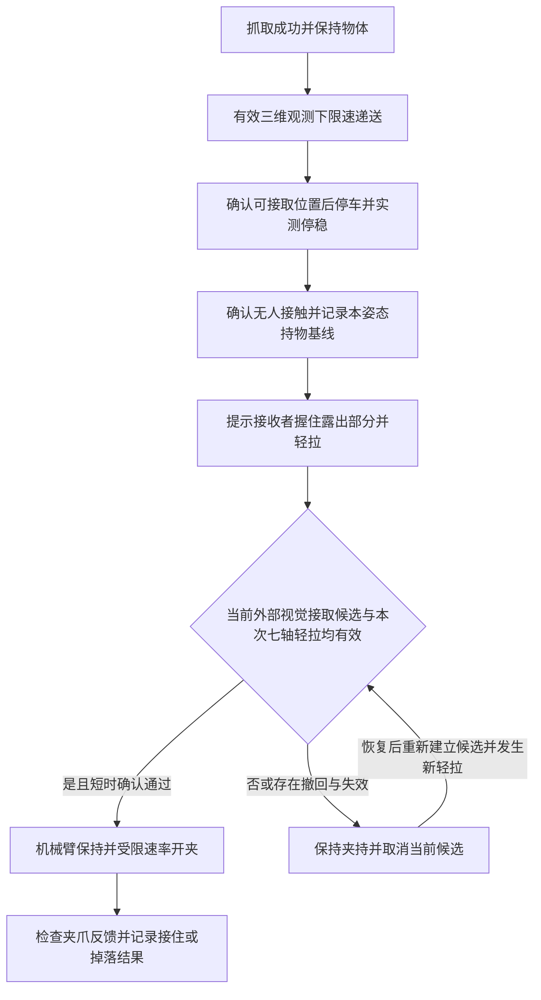

# T02：视觉＋七轴力矩时序的轻拉接取方案

日期：2026-11-09。[专题](HANDOVER.md)、[全部8次曲线](HANDOVER_BRIEF_20261106.md)。先完成文献/数据核查与方案；同日用户要求按简化流程改代码后，已接入显式fusion shadow/release、独立外部RGB观察、停稳/基线/新轻拉状态机、记录及离线小模型训练入口。**当前实现与限制见§9**；尚无真实同步数据训练出的模型或新真机交接验证，未操作相机/CAN/夹爪。

**最新停车规则见§9.5：** 针对近距必然遮挡，不再把腕部精确居中/人手静止1秒作为进入保持的前提；准备距离提前停车，shadow可S人工停车。早期段落中的旧参数按历史设计阅读，不作为当前入口指令。代码验证与真机效果分别记录。

**最新工作顺序：** 用户明确机械臂不能长期使用，且本轮可用一小时以上。先按[集中采集单](HANDOVER_COLLECTION_20261109.md)完成6个物理抓取批次并检查/备份，之后再离线标注、训练与状态机回放；当前不等待训练结果占用硬件。新增group/split、全手关键点、精确停车参考及代码/配置快照，只增强采集，不放宽控制或释放条件。离线影子数据不能证明真实松夹后接稳，仍需以后短时真机确认。

## 0. 用户已确认的首版范围

本轮用户明确接受：**先做“接收者握住后轻拉”的自动交接，再扩展“握住不拉”。** 控制手B不参与许可。视觉跟随递送仍保留；接触阶段静止保持，首轮限定一种物体、一个持物姿态及接取区域。不是预先宣称已自动判定承重或可覆盖任意人/物体/姿态。

推荐主线：**七轴反馈时序识别本次新的轻拉接取候选，视觉确认同一接收手正在物体区域接取并撤销撤回/失联资格，状态机决定何时开夹。** 不再以J4相对初始基线一直偏大、七轴求和/最大值或“多轴同时变大投票”作为唯一许可。

**同日针对腕部近距盲区的补充：** 用户确认原RealSense D435/D435i仍可用。建议增加固定外部观察视角：奥比负责原抓取/递送，外部D435负责接取区域中的手、物体与撤回观察，七轴负责交互动作。此处是建议接法，尚未连接或启用；详见§4.3。仅缺深度时仍可有2D，不能把3D接口返回None一律当成手消失；若二维也全丢，权重优化不能补出位置。

### 0.1 完整执行方案：先看这一节

以下将相机布局、停稳、基线、轻拉判断、开夹及验证串成一条执行链，是待实现的首版规格；§1–8保留文献、数据和工程依据。当前建议为**腕部负责接触前递送，固定外部相机负责静止接取观察，七轴时序负责本次轻拉候选**。首版不是交接阶段双视角同时融合；W/E/WE保留为论文对照。

**检测目标与适用范围。** 目标是在一种物体、一个持物/呈现姿态、一名接收者的限定试点中，让接收者握住露出部分后轻拉，机器人自动开夹。检测的是“本次接取轻拉动作与当前视觉接取候选一致”，不是直接测得握持力、人体承重比例或保证任意握法均已接稳。另一只控制手不参与许可；握住不拉单独标记，首版允许等待。

**硬件与标定。** 保留腕部Orbbec及现有抓取/递送链；D435/D435i固定于交接区侧前方或斜上方，优先看清露出物体和握物手指；七轴全部记录。外部视觉只在自己的图像中判断手与接取区的关系，暂不做相机到基座外参。外部相机不参与运动控制；深度可信时可作同相机相对关系的补充，RGB-only判别不强制要求深度。移动机位、末端或物体后必须重新确认图像ROI；固定ROI不能继承到任意新姿态。



**各阶段具体做什么。**

| 阶段 | 操作与进入下一步的条件 |
| --- | --- |
| 抓取/递送 | 保留已有抓取和接触前视觉伺服。新鲜三维观测确认到达可接取区后冻结跟随目标，由人完成最后一段伸手。首版限制呈现姿态，到位后在外部图像确认本轮ROI；不要求无外参地把全局像素转换成基座坐标 |
| 停稳/建基线 | 以真实位置变化、未被getter清零的原始速度及反馈新鲜性核验停稳。提示人暂不触碰，明确确认未接触后记录约3–5秒作为候选基线段，检查波动/趋势；不稳定就不进入接取判断。若提前接触，取消本轮并重新确认未接触，不能自动把接触归零 |
| 等待接取 | 基线有效后提示人握住并轻拉。外部图像检查本轮接收手靠近物体露出部分、持续可见、无撤回；七轴维护因果历史窗口。基线冻结，不在拉拽过程中滑动更新 |
| 候选确认 | 同一只手的当前视觉候选、本次新的轻拉模式和有效保持/反馈须同时成立。确认期间持续检查，丢检、撤回、时标失效或模式改变立即取消。不能“先触发再等倒计时结束” |
| 开夹/结束 | 使用唯一夹爪命令所有者，按经过实测的开口/速度约束逐步张开，机械臂保持。开口反馈确认后记录结果；不能仅因已发出open命令就标交接成功。开夹后的力矩分布改变，不继续套用开夹前模型 |

递送途中腕部深度丢失时，受控保持并等待恢复；此时不能因“已经停住”便自动进入释放阶段。无可信到位观测、不知道是否已接触或基线未就绪时，均不能用全局相机里有一只手来补齐资格。首版不要求接触后继续追手，也不新增未经标定的全局XYZ伺服。

**外部视觉的最小算法。** 在末端停稳后人工框选露出物体的接取ROI，或复用可用的物体检测定位；第一轮优先人工确认，减少物体局部遮挡下的额外误差。使用现有MediaPipe二维关键点及置信/时龄信息，检查约定接收手与ROI的图像接近关系、持续出现和撤回。有足够关键点时，可加入手指弯曲和指尖分布特征，但当前工程并没有“已握稳”视觉分类器，不能将普通手检测包装成握持检测。所有距离均为图像关系，不写成厘米距离。

外部握物视角是否能保住关键点，必须先拿真实握物测试；如果仍整只手丢检，先调整机位/呈现姿态。只有另有局部视觉数据与验证时才扩展ROI分类器，不能直接把“局部像素变化”替换成握稳。二维重叠可能只是前后投影重合，特别采集手在物体前方/后方悬停、张掌靠近及推碰的负例。

**七轴怎样参与，不预设固定百分比。** 固定基线下逐轴计算偏差；以过去约0.5–1秒窗口提取有符号中位偏差、最大绝对偏差、前后短段变化和趋势。用小型正则化线性/逻辑回归分类器学习关节组合，输出轻拉、碰推、无交互、撤回/残余等动作分数。先与相同数据上的简单规则比较；七轴、单J2、去J4六轴也用同一留出会话比较，不能先认定七轴必胜或J4必须删除。具体轴、窗口与阈值仅由训练/验证试次选择。

这些分数描述动作，不能命名为承重概率。已有J4无人接触也持续偏大、松手后仍有偏移，J2部分拉段强响应较短，因此“幅值超过阈值持续几秒”只保留为对照。确认时长0.2–0.5秒仅列为待验证候选，不代表已经可以开夹，也不要求力矩整段握持期间一直变大。

**释放组合。** 第一版先使用以下条件同时成立的规则：

```text
已在接取位置停稳 + 未接触基线有效 + 当前夹持/控制模式/反馈有效
+ 当前同一接收手的视觉接取候选
+ 当前会话内新发生的轻拉候选
+ 二者时间相合、短时确认通过且无撤回
→ 允许开始开夹
```

七轴内部的组合系数可先学习，视觉与力矩之间先不写死30%/70%。取得同步数据后，再用同一批留出试次比较AND与正则化分数融合；后者只有提高整次交接表现才保留。视觉全失、明显撤回或反馈失效均是取消条件，不能被更大的力矩分数抵消。

**缺失与异常。**

| 情况 | 首版处理 |
| --- | --- |
| 接取阶段腕部丢深度，但外部二维接取证据有效 | 不继续腕部三维跟随；已完成停稳/基线前提时，可继续外部视觉＋七轴判断 |
| 两路均无可用接收手证据，或外部帧冻结/身份不明 | 保持夹持、取消候选；不能只靠旧手位置/旧轻拉放行 |
| 手撤回、短碰、拉过后松手但力矩偏移持续 | 保持；当前会话内残余不建立新轻拉资格。恢复后需重新形成接取候选及新动作，不能恢复旧倒计时 |
| 控制模式、机器人姿态或夹持状态改变 | 本轮基线失效，取消许可，重新确认条件 |
| 开夹过程中出现异常 | 停止新增开口指令并保持机械臂，不自动夹回；部分张开后已无法保证继续持物，单独记录为中断，不伪报成功 |

**最小验证顺序。** 先完成D435真实握物可见性测试，再接同步记录和影子判断，最后才接自动开夹。影子阶段机器人只保持，界面记录“若启用将释放”的时刻。用无接触、短碰/推、握住轻拉、轻拉后完全松手及残余、握住不拉、视觉缺失六类各约6次作为可分性试点；后两类动作与视觉有效性分别标注。特别记录短拉后立即松手、手仍在图像ROI但已不接触的反例，避免把可见性和峰值误当稳握。

训练和调参按整次试验/持物会话划分，不随机打散相邻窗口；在另一批未参与调参的会话验证。采集与拟部署使用同一保持模式。记录两路帧/时标、二维关键点和深度有效性、七轴反馈/q/原始dq/逐轴时标、控制与夹爪状态、独立动作事件；不能用力矩阈值生成自己的真值，承重未测就标unknown。

功能对照先比较单J2规则、七轴时序、仅外部视觉、外部视觉AND七轴，再比较分数融合；布局对照比较同七轴下W/E/WE。报告整试次提前误许可、检出/等待、撤回后残余误触发和拒判比例；自动开夹后另报真实接住/掉落、误释放和完整交接成功率。有限试点零误许可不等于证明通用可靠，36次也不是统计结论。

**实现状态。** 本节为全流程规格；同日后续已按§9接入首版。主CLI仍拒绝直接启用YAML的global_camera；新增独立外部观察数据流通过`--fusion-handover`使用，由现有单一控制所有者接收判据。旧手势与距离自动开夹代码保留，在新模式中绕开。真实同步训练、回放与受控闭环效果仍待验证。

### 0.2 19:04实采后的下一步与首版力矩模型

用户询问接下去做什么、训练哪种模型。本次明确为**七轴相对基线的短窗口特征＋L2正则化逻辑回归二分类器**，识别“本次新的轻拉动作候选”。对应现有`tools/train_handover_pull.py`及`handoff/fusion_handover.py`，不是已训练完成的模型，也不将输出解释为人体承重/已接稳概率。

- **输入：** 最近约1秒内七轴反馈减本姿态未接触基线；每轴提取带符号中位差、绝对峰值、前后半窗口中位差变化、斜率，共28维。训练集计算标准化参数，模型学习特征系数，并以正则化限制小样本过拟合；不是要求多个关节同时越阈值，也不是把七轴直接求和。
- **标签：** 正类为独立标注的握住后轻拉；负类分别覆盖明确无接触、短碰/推、轻拉后完全松手及残余。握住不拉保持单独类别，本版不将它写成NO_CONTACT。物理拉力起点无法从录像单独确定的区间保留unknown；不能用力矩峰值自生成真值。
- **现有缺口：** 18:04三次动作的P/U有时间差；19:04第二段P期间触发姿态守卫，后续为失效记录。录像能帮助校正可见接触/撤手，但不能独立给出精确受力时刻。训练前需核对可确认片段、排除不确定边界及横跨标签转换的1秒窗口；故障后样本不作有效接取训练。现有加载器尚未提供独立区间标注/整窗口边界剔除，这项数据准备要先补，不能直接把现有P/U状态喂入。
- **采集顺序：** 先核对姿态守卫与轻拉时小位移的适用边界，保留异常停止许可，不因需要正例就放宽门限；记录准确hold_q/漂移有助复核。固定香蕉/持物姿态/同MIT模式，补短碰/推、长时不碰、拉后松手残余等反例，并取得独立动作标签；保留握住不拉和视觉缺失试点。每次独立持物会话重建基线，训练/调参/最终测试会话分开。
- **对照与选择：** 全七轴、单J2、去J4以及简单阈值使用相同划分。只有训练/调参会话用于选择轴、正则强度、阈值及确认时间，最终测试不再用于挑方案。按整次动作报告误候选、漏检、等待和拒判，并回放视觉/撤回/残余/姿态守卫；当前逐窗口分类统计不能代替交接成功率。
- **部署：** 模型先在shadow中输出分数，不开夹。当前同一接收手的视觉候选AND本次新轻拉AND状态有效/短时确认，共同形成许可。第一版优化的是七轴特征的组合；相机作独立条件，暂不学习“相机30%＋力矩70%”。模型无法识别时先检查数据可分性，再决定是否需要更复杂时序模型。

现有文献的CNN＋视觉融合可作结构参考，但本机先选小模型是针对当前样本量和工期的工程选择；不能宣称已达到文献效果。[直接相关论文](https://arxiv.org/abs/2210.15085)、[逻辑回归与正则化原理](https://scikit-learn.org/stable/modules/linear_model.html#logistic-regression)。本次仅核对与明确计划，未训练真实模型、调守卫或启动硬件。

## 1. 最接近的原文与能借鉴的部分

以下均核对研究论文原文/作者版本，检索日期2026-11-09；引用支持方法依据，不代表已在本机复现。

| 文献 | 与本题直接相关的方法 | 本项目借鉴与限制 |
| --- | --- | --- |
| Mohandes等，2022，[*Robot to Human Object Handover using Vision and Joint Torque Sensor Modalities*](https://arxiv.org/pdf/2210.15085)，§3.1–3.4、§4 | 七轴关节力矩的1秒时序用于CNN动作分类，与视觉指尖检测通过AND融合 | 最直接的结构基线：全轴时序＋视觉证据＋状态机。其硬件为Kinova关节力矩传感器，40 Hz；本机是电流换算反馈，历史有效约10 Hz，不能搬模型/阈值。原文§3.4谈点云而§5将深度列为未来工作，不证明近距深度稳定；动作类别文字也有不一致，按本机标签重定义 |
| Penzotti与Controzzi，2025，[*Enhancing Object Release Fluency…Using Proprioceptive and Exteroceptive Information*](https://link.springer.com/article/10.1007/s12369-025-01216-7)，§2、§3 | 区分运动/负载造成的力信号与人与物体的交互，做本体感受过滤和释放控制 | 支持将“递送中”和“停稳接取”分开；论文用腕部六维F/T、惯性辨识和动作测量，本机不能直接照搬，今天先固定姿态/控制模式 |
| Li、Shao、Hsu，2026预印本，[*Active Contact Sensing for Robust Robot-to-Human Object Handover*](https://arxiv.org/html/2605.04610v1)，§I、III–VI | 指出被动力信号可能混淆轻触与牢固握持；用腕部F/T、主动小动作和接触模型辨识 | 解释为什么“峰值＋时长”不自动等于握稳。主动探测需另验证硬件/控制，不作为今天默认动作，不向本机电流信号套用承重计算 |
| Marra等，2026预印本v2，[*Temporal Tactile Encoding and Compliance for Intent-Aware Robot-to-Human Bimanual Handover*](https://arxiv.org/html/2609.05282v2)，§III | RGB、触觉历史、本体信息及顺应控制联合，使用约一秒的因果触觉历史 | 借鉴“时间过程＋不同模态职责”及干扰动作对照；触觉阵列和VLA训练超出首版范围，不复现大模型 |

2013年Grigore等的作者论文[*Joint Action Understanding improves Robot-to-Human Object Handover*](https://elenacorinagrigore.com/papers/iros2013.pdf)检索到了HMM/意图分层摘要，但本次PDF打开失败；不依赖其未读取的实现细节。其他只检索到二手页面的视觉无关ML/SVM论文不作为本方案的关键证据。

“视觉＋多关节力矩”已有明确先例，不单独作为论文新颖性；本项目若形成贡献，应由本机缺失观测处理、受限场景时序判据及真实对照结果证明。

## 2. 本机数据说明应该改什么

- 当前仍为8份/6027条、10段键盘P标记。动作依据见[全量盘点](../artifacts/torque_all_runs_20261106/annotations.json)；3份无P动作未知，不作未接触负例。
- 已确认21:26拉前J4最大偏差0.034 N·m，拉时1.851，完全松手后1.981，松后>1 N·m仍连续8.495秒；21:02未碰时J4>1 N·m也持续8.733秒。
- 新增[七轴描述性比较](../artifacts/handover_fusion_plan_20261109/README.md)：核验全部原文件哈希，比较5份有动作确认记录的拉段/REST段峰值。21:26只有J2拉段峰值高于REST最大值，其他六轴并无此性质；不能预定必须3轴一起变大。该比较不是识别率、及时检出或最优关节选择。
- J2在若干拉段有强峰，但21:26超过0.6 N·m连续仅0.841秒；不是整段持续握持的稳定测量。J4有负例但仍可包含动作时序信息，先不永久删去。
- 旧数据没有同步视觉、独立握持/承重真值，缺原始电流与完整控制状态。因此旧数据用于回放、噪声/残余反例，不足以直接训练“可释放”模型。

**选择：七轴全采，首个小模型使用七轴，再与J2单轴、去J4六轴比较。** 不预先给J2/J4最大权重；不因“多轴”就认为可信度自动提高。各轴是同一机械链耦合反馈，不是七个独立投票器。

## 3. 拟议流程：两个证据同时成立才进入释放

```text
可信三维手部观测，限速视觉跟随递送
→ 确认物体已到可接取区，冻结跟随目标、实测停稳
→ 人尚未接触，建立本姿态/控制模式的持物基线
→ 接收手在物体可抓部位形成接取姿态，建立本次短期接取资格
→ 七轴过去窗口识别新的轻拉接取，与当前视觉证据时间相合
→ 无撤回/失效，候选在短确认窗口内成立
→ 机械臂保持、自动受限速率开夹、反馈确认结束
```

“停住”不能由丢检直接决定，仍沿用11月5日[跟随/停稳设计](HANDOVER_TRACKING_RELEASE_DESIGN_20261105.md)。首版由人完成最后一段伸手，不能在已经可能握住后继续追掌心。人若在停稳/建立基线前接触，保持并标unknown，不把接触状态重新学成未接触基线。

新的候选必须发生在本次资格建立/有效基线之后；历史大偏差不能自动刷新资格或无限期锁存。超过本次有效期、当前视觉明显撤回、反馈失效或状态复位，均取消候选，不累加零散超阈值时间。窗口内仍可能存在变化方向/持续时间歧义，必须用新负例验证，不能因“新事件”便宣称判稳。

## 4. 相机负责的内容：接近与接取证据，分别使用深度

### 4.1 递送阶段

当前`servo/hand_camera_center.py::feature_system`依赖Z与三维点。保持有效XYZ时跟随；丢深度时不能直接拿二维继续原三维平移控制，先受控保持。取物资格基于手与露出的物体区域，不能把旧TCP–掌心15 cm直接当通用物体距离。

### 4.2 停稳接取阶段

相机继续运行，分开保存2D结果和深度有效性。`HandTarget.detect()`返回None不等于没有RGB手，它可能只是三维深度门槛失败；现有`last_observation`/`last_observations`和`CameraHandObservation.landmarks_pixel`可提供二维输入。

建议观测：同一接收手与物体露出部位的图像关系、手形/接近动作、是否离开，以及各项质量/年龄。先在停稳帧确认实际物体ROI；手是否在图像中心不作为接稳证据。2D重叠和手形只作接取姿态候选，不等于真正接触或承重。

| 视觉状态 | 首版释放侧处理 |
| --- | --- |
| 新鲜2D＋可信3D | 使用当前空间/图像关系和七轴时序 |
| 深度失效，但同一只手的2D仍可信 | 在已停稳、已确认接取区的会话内，可用2D接取证据与七轴时序，不再要求持续XYZ；不能继续三维追手 |
| 部分指/手形还可见，整体MediaPipe失败 | 当前代码没有局部接取分类器。先检查呈现姿态能否改善可见性；若新增RGB ROI模型，需要独立局部接取数据，不能用光流/肤色变化直接当握稳 |
| 手的2D也完全丢失 | 最近接近历史可以标“曾到位”，首版自动释放默认拒判/保持。不得把视觉权重置0后让力矩自动变100%；要支持盲区释放，必须另做该模式正负例验证或改善视角 |
| 相机帧停滞或身份不确定 | 保持，禁止新释放 |

这意味着首版能容忍“缺深度”，尚不保证“手完全遮住仍自动释放”。这是可观察性的限制，不能由多关节权重补出不存在的图像信息。今天先限定能看到接取姿态的呈现关系；若握住时必然全丢2D，先修视角/局部视觉路径，不能将力矩峰值强行接入开夹。

### 4.3 推荐补充：复用D435/D435i作为固定外部观察相机

用户已确认旧D435/D435i可用。这个布局直接针对当前问题：手贴近夹爪，不代表手贴近固定外部相机的镜头；外部相机可从另一方向观察手指与露出的香蕉，减轻腕部近距离/物体遮挡。能否改善本机可见性仍需实采验证，不保证任意安装位置都有深度或手检测。

首版角色分配：

| 来源 | 任务 | 与当前控制的关系 |
| --- | --- | --- |
| 腕部Orbbec | 抓取定位、已有接触前视觉跟随 | 继续原控制链，深度失效时原跟随保持；不盲走 |
| 固定D435/D435i | 同一画面中观察接收手、夹爪/物体露出区域与撤回 | 先独立视觉证据/记录通道，不直接发机械臂或夹爪指令 |
| 七轴反馈 | 新轻拉与碰/推/残余模式识别 | 仍由唯一控制所有者读取/决策，视觉与反馈时间相合才许可 |

先把D435放到能看清手指与物体接触区域的侧前方或斜上方，角度要区别于腕相机。比较未接触、实际握住、轻拉、松手撤回时的二维可见性与深度支持，而非只看张掌。不要为了覆盖整个房间把手拍得过小；场景相机在本任务中应优先看清交接区域。

分两步接入，避免同时扩大控制和标定范围：

1. **当前优先：外部视觉＋力矩判断。** 在静止接取阶段使用D435图像中手与物体的相对关系；若两者深度可信，可在同一相机坐标系检查相对空间关系。仅做图像/同相机相对关系的判别，不要求先把点变到机器人基座，不做两相机点云融合。二维重叠仍只作候选，不证明接触/承重。先验证该视角确实能看到握取，再接入同步影子决策。
2. **若要由外部XYZ继续视觉伺服：** 需要固定相机到机器人基座的eye-to-hand外参`T_base_global_camera`及独立验证，再用它转换外部相机XYZ；旧腕部eye-in-hand外参不能复用。不能把外部坐标直接传给现有腕相机投影控制器。若仅外部相机还能看到而腕相机丢3D，第一步模式中机械臂仍保持，后续再实现经过验证的全局跟随/目标切换。

工程核查：当前`cameras/options.py`仍拒绝`global_camera.enabled=true`，不能只改YAML启用。后续实现（§9）新增独立`FusionObserver`进程，复用`RealSenseCamera`的serial/RGB-only能力并在该进程做二维检测；不持有CAN。仅接通外部视觉＋七轴的首版，不包含跨相机身份匹配、双视角同时融合或全局XYZ控制。首轮固定单接收者/约定接收手，不把两视角的左右手标签直接等同于跨相机身份。记录每相机独立serial/帧号与接收monotonic时间，不直接比较两个设备硬件时钟。

相关布局先例：[Wang等2026，Robust Human-to-Robot Handover System Under Adverse Lighting](https://pmc.ncbi.nlm.nih.gov/articles/PMC13113077/)采用腕部与固定场景相机的双路径。它研究人递给机器人及光照适应，仅支持双视角布局的参考，不证明本机机器人递人释放已可靠。该布局建议是结合本机近距/遮挡证据作出的推断。

#### 4.3.1 当前接取观察可以暂不做基座外参标定

用户进一步明确：外部相机只看手是否在机械臂末端准备接取。**在这一用途下，可以暂不做外部相机到机器人基座的eye-to-hand外参。** 判断依据是同一张新鲜图像中的手、夹爪/所持物体区域及其相对运动，不需要知道手在机器人基座下的XYZ。

最小实现先固定相机与交接姿态：到位停稳后，在图像中确认物体露出部分/末端的ROI，再检测接收手进入、停留、接取姿态和撤回。ROI可以人工框选一次或由物体检测获取；当前food5模型不等于已有夹爪检测器。固定ROI只在相机和该交接姿态保持不变时有效，后续末端变位必须图像重定位或重新确认，不能拿机器人FK无外参投影到相机里。

“先不标定”仅指不新增基座外参：二维输入不产生米制距离；若使用D435深度反投影，仍用该设备内参、深度尺度及RGB/深度对齐。若同相机内手和物体都有可信深度，可比较它们在该相机坐标下的相对距离；这仍不是机器人基座坐标。未来用于全局XYZ跟随或跨相机三维配准时再做相应外参。

手出现在末端区域只建立接取候选，画面重叠也可能前后分离，不能单独触发松夹；必须与本次轻拉时序、保持/反馈有效性组合。随后§9已实现人工R确认ROI和新模式；未改变共同配置，判据效果仍待真实数据验证。

### 4.4 腕部单相机与腕部＋固定相机：论文意义与公平比较

用户进一步询问两种相机布局对期刊论文的区别。以下为比较建议；首版外部观察代码见§9，双视角同时融合及布局对照尚未实现，未启动新相机。比较默认保持相同七轴力矩输入、物体/呈现姿态、轻拉任务范围及释放状态机；相机数量不自动决定论文创新或投稿层次。

| 布局 | 潜在研究/应用价值 | 需要报告的边界 |
| --- | --- | --- |
| 仅腕部视觉＋七轴 | 硬件较少、无需固定外部视角；可研究有限观测下的交接 | 近距、物体/夹爪遮挡及运动模糊时是否还能获得接取证据；拒判/等待不能隐藏为成功 |
| 腕部＋固定外部视觉＋同一七轴 | 可能改善接取区域的可观察性、撤回检测及单源失效时的覆盖 | 固定机位依赖、计算/时延、跨源时间与身份关联；使用共同三维几何或外部视觉控制时还需外参验证 |

必须区分三种方法描述：

1. 腕部负责抓取/递送，外部负责停稳接取：是分阶段传感器分工，属于系统双相机，不自动等于交接阶段的双视角融合。
2. 交接时仅选可用的一路图像：是选择/切换策略，应说明选择规则、缺失与恢复条件。
3. 交接时联合两路当前证据：才适合研究多视角融合；需处理质量、时龄、同一接收手和相互矛盾，不能仅把分数相加或当作独立投票。

“腕部视觉＋关节力矩”已有2022文献先例，腕部＋场景双路径也已有2026人递机器人文献（见§1及§4.3）；两种布局都不是新颖性的充分条件。新增相机若只是让手更容易看见，其主要贡献是工程可观察性改善；若有新的缺失/冲突时序机制，且相对简单切换和单源有收益，再讨论独立方法贡献。看见手或二维重叠仍不证明已承重。

建议最小对照：

| 组别 | 交接判断使用的数据 | 能回答什么 |
| --- | --- | --- |
| W | 腕部＋七轴 | 现有腕部视觉条件下的表现 |
| E | 固定外部＋同一七轴 | 换观察位置本身的收益 |
| WE | 两路视觉＋同一七轴 | 两路是否有超出外部单源的互补收益 |

如主张新融合机制，在WE内再比较简单选择/切换与拟议机制。若WE与E相当，优先采用更简单且符合部署需求的交接判据，不声称融合有额外收益；腕相机仍可用于原抓取与递送。

测试覆盖正常可见、握取时腕部近距/遮挡、外部视角遮挡、短碰/推与松手撤回。握住不拉沿用扩展标签，不要求轻拉首版将其识别为正例。报告整次交接成功、提前误许可/实际误释放、漏检、延迟、拒判/覆盖率及视觉证据失效时长，而非只报逐帧手检出率。

可先同步记录两路视频及七轴，在同一批独立标注试次中离线屏蔽输入比较判断；按整试次/会话留出，避免相邻窗口泄漏。相机选择若改变运动或呈现姿态，离线回放不能替代各策略闭环验证。仅使用各相机内的图像或局部相对关系时，不强制先做双相机三维融合；共享坐标下融合三维点或外部XYZ驱动机器人时另需标定。

当前建议优先实测固定外部视角能否改善真实握物时的可见性，并保留W/E/WE对照；收益尚未测定，不因增加相机便升级论文贡献。原MGPC/NBV/GenX及完整交接目标均保持。

## 5. 力矩侧：七轴、双时间尺度、小模型

### 5.1 记录与基线

全部七轴记录，不强制全部都有响应。基线取**最终停稳、同物体、同夹持/控制状态、确认未触碰**的段；接触后冻结。初始5秒可作采集起点，需检查该段趋势/波动，不能自动认定稳定。

同时记录：原始电流（若SDK可读）、换算力矩、q、原始dq、各轴原始时间戳、读取monotonic时间、控制模式、参考目标、夹爪开口/力反馈。电流与其线性换算力矩不是两种独立证据，保留电流是为核查。

源码复核发现：安装的V112驱动继承V111的`get_motor_states()`，该getter会将共享`velocity`置0。不能在MIT所有者旁直接复用现有只读记录器getter。集成记录应沿用`FeedbackHealthMonitor.read()`的直接parser快照思路，复制原始字段并核验逐轴时标，不能把0速度当停稳证据；不修改SDK或另启控制发送线程。

### 5.2 因果特征

以实际时间维护约0.5–1.0秒过去窗口作为候选，另保留1–2秒背景历史；历史有效约10 Hz时一秒只有约10个有效样本。具体长度由数据比较，不冒充40 Hz论文带宽，不靠插值补出新证据。

每轴保留以下4类小特征，七轴共28维：

1. 固定基线偏差的窗口中位数（保留正负号，持续作用时仍有信号）。
2. 窗口内最大绝对偏差（幅度线索，不单独决定释放）。
3. 最近短段中位数相对之前短段中位数的变化（新的变化线索，不自适应吞掉握持）。
4. 过去窗口斜率/趋势（描述慢斜坡、突变后恢复等过程）。

幅度与变化同时使用；不只差分，也不只固定初始差。标准化、截幅、噪声尺度只从训练试次拟合并冻结；不能把5秒微小噪声当跨阶段所有噪声，需包含无人触碰及松后背景。缺失反馈不填成0，不用重复帧累计确认；断档重建窗口。

### 5.3 首个模型及关节筛选

首个模型用**正则化逻辑回归/线性分类器**，输出`轻拉接取 / 短碰推 / 无交互 / 撤回或残余`的动作候选分数。不把输出命名为已校准承重概率。先比较规则与这个小模型；小数据不直接训练2022论文的CNN或2026 VLA。

同日首版实现进一步收敛为二分类：`TAKE_PULL`与已独立标记的`NO_CONTACT/BUMP_PUSH/POST_RELEASE`负例；其余动作类别标签仍保存，`HOLD_NO_PULL`不混作无接触。先检验是否存在足够区分信息，再考虑上述多分类扩展。代码只提供拟合/加载入口，没有利用旧日志或合成数据生成供真机使用的模型。

比较同一批试次上的：J2单轴、全七轴、去J4六轴。按整段试次/持物会话划分，参数选择只用训练/验证组；若再筛2–4个关节，必须在训练组内选择、用未参与选择的会话复核，不能按全数据峰值挑完再报效果。

模型需要**专门看松手后偏移**作为负例。多轴只有组合模式更可分时才有收益；若关键反例无法区分，输出未知，不能只加关节/加网络继续声称可释放。

## 6. 融合：先做证据AND，再评估可学习权重

首个闭环采用可解释组合，降低调参范围：

```text
允许开始开夹 = 本次处于已停稳的接取阶段
              AND 基线、夹持状态、逐轴反馈有效
              AND 同一接收手的当前视觉接取候选可信
              AND 本次新的轻拉动作候选可信
              AND 二者时间相合、没有撤回/矛盾
              AND 短确认窗口通过
```

确认时长先将0.2–0.5秒列为离线候选，而不是固定等3秒或5秒。它不是安全认证参数；数据若表明需要更长等待或根本不可分，就相应报告。不能把一次高分变成不看当前状态的倒计时。

拿到同步标签以后，再比较轻量分数融合：`s = sigmoid(b + w_tau·f_tau + w_v·f_v)`。视觉/反馈缺失、明显撤回、基线/模式失效仍在模型外直接取消，不能由任意高力矩分数抵消。`w`和门槛根据整试次误许可、检出、延迟、拒判/覆盖率选择；不能直接加权像素和N·m，也不先写死视觉30%/力矩70%。

短时完全遮挡的条件性历史融合可作后续对照，本首版不默认放行。旧相机历史不能冒充实时观测，“同一次手曾到过”不能保证后来仍握着。

开夹期间保持机械臂，原夹爪句柄限速/限指令领先反馈开口；异常不再新增开口、不自动夹回。开夹后的负载分配改变，不能继续把开夹前的力矩模型当同一分布。慢开不替代开夹前证据。

## 7. 今天怎样收敛成可验证闭环

### 7.1 先补最关键缺口

当前8份旧日志不能训练融合：没有同步视觉，动作主要是拉/松，未覆盖碰/推和握住不拉。下一步需在同一数据记录里保存RGB/深度状态、全七轴原始时标和人工事件；先以影子输出显示`保持/接取候选/将释放`，不发开夹。

先确认最终拟部署是持续MIT保持还是退出后的设备位置保持。旧数据来自退出后采集协议，不能直接搬阈值到MIT。建议集成闭环复用MIT单一所有者，今天的采样也在同一模式做；不为观察曲线随意切模式或修改固件。

### 7.2 最小对照动作

| 场景 | 标签与首版预期 |
| --- | --- |
| 手离开或手在旁边，完全没碰 | `NO_CONTACT`；保持 |
| 短碰/推一下，随后离开 | `BUMP_PUSH`；保持，残余作为负例 |
| 握住露出部分，再轻拉 | `TAKE_PULL`动作正例；影子许可候选，随后受控验证实际接取结果 |
| 拉过后完全松手，继续录至少15–30秒 | `WITHDRAW/POST_RELEASE`；保持，禁止被旧偏移重新许可 |
| 握住但不拉 | 单独`HOLD_NO_PULL`；本版等待，不当无接触训练，后续扩展 |
| 接取附近遮挡/手全丢，含未触碰负例 | `VISION_MISSING`及实际动作分开标；首版拒判，单列覆盖率 |

建议先6类各6次（36次）作可分性试点，再在新持物会话单独采留出对照；次数是工作量起点，不是统计可靠性保证。P/R不足以描述6类动作，应增加事件标签或每类单独文件，不把“握住不拉”错误标成无接触REST。操作者与参考视频确认动作，接触/承重/是否允许释放分开；无载荷真值时`support_verified=unknown`。

所有方法用相同试次对比：单J2/旧阈值、七轴时序、仅视觉、视觉AND七轴；再看软融合是否有额外收益。相邻窗口不能随机分到训练/测试。以整次试验计提前误许可、接取检出、从独立动作标签到候选的延迟、拒判与等待；不把一直保持作为“零误放成功”。

### 7.3 接开夹前的判断

必须先在未参与调参的会话中检验未触碰、短碰、撤回和残余场景，同时确认正常轻拉能检出。若能区分，再在相同物体/姿态范围做受控自动释放验证，记录真实掉落/接住/撤回结果。有限试点0误许可不等于误释放概率为0，不能直接写作已解决通用交接。

今天能争取完成的是这个受限协议下的采集、影子判断与受控闭环；是否能实际完成取决于新数据可分性和接取视觉可见性，不预先承诺在当前盲区和残余现象下直接可靠开夹。自然握住不拉、任意姿态/物体与完全盲区释放保留为后续目标。

## 8. 当前源码落点与本轮完成项

- `targets/mediapipe_hand_landmarker.py`：已有二维观测，即使无深度也可返回；原有整体手检测不是局部手指握取分类器。
- `targets/hand_target.py`：当前3D输出门槛与2D存在性要分开，提取接收手2D需要独立通道，不能只检查`detect()`是否None。
- `servo_delivery.py`：现有手势持物/保持机制可参考，但不能同时运行B手开夹与新融合。非手势、非follow-only旧分支会按距离直接开夹，不能仅删`--gesture-handover`启用新方案。
- `control_backends/force_ctrl/feedback_health.py::FeedbackHealthMonitor.read()`：可参考逐轴新鲜快照；新记录还需保存电流及控制/夹爪状态。
- 同日后续已实现现有`--gesture-handover`/`--servo-follow-only`与新增`--fusion-handover {shadow,release}`互斥；一个模式独占夹爪命令，见§9。

方案阶段完成：复核8份数据和读取链、检索并阅读4篇主要论文原文、重算七轴描述性证据、记录用户接受轻拉首版。该阶段未改运行控制；同日后续用户授权的代码实现如下。

## 9. 按简化流程完成的首版代码（2026-11-09）

用户授权“先按照这个逻辑改代码”。已实现：抓取持物接续→原腕部有效三维跟随→接触前冻结实际姿态→实测停稳→人工确认无人接触并记录稳定基线→外部二维候选＋七轴本次新轻拉→短确认→影子许可或受限开夹。未更改运行相机YAML、腕部外参、MIT控制律、固件或启用默认自动释放。

| 文件 | 本次职责 |
| --- | --- |
| [fusion_handover.py](../handoff/fusion_handover.py) | 纯状态机、28维因果特征、线性动作分数；未接触基线冻结、低分重新武装后才能接收新轻拉；重复反馈不累计确认，撤回/失联取消候选 |
| [fusion_observer.py](../handoff/fusion_observer.py) | 无CAN的独立D435 RGB-only进程；外部接收手侧别独立指定，接取ROI、关键点近邻候选、人工事件与录像；没有“视觉握稳”模型 |
| [fusion_servo.py](../handoff/fusion_servo.py) | 单一MIT/夹爪所有者适配；直接parser快照、原始dq/可选current、状态与开口反馈核验；限速/限领先量开夹，异常锁定不夹回 |
| [fusion_recording.py](../handoff/fusion_recording.py) | 有界异步JSONL及腕部RGB记录；保留独立时标，磁盘错误/队列满撤销许可 |
| [fusion_cli.py](../handoff/fusion_cli.py) | shadow/release显式选择，旧手势/follow-only互斥，序列号/模型窗口/同MIT模式与模拟开口校验 |
| [train_handover_pull.py](../tools/train_handover_pull.py) | 读取整会话标签记录，拟合正则化二分类；训练/留出不得重叠或复制，可选J2/七轴/去J4。输出为动作统计，不是交接成功率 |
| [servo_delivery.py](../servo_delivery.py)、[共享CLI](../real_nero_grasp/servo_cli.py)、[持物交接](../handoff/grasp_to_servo_handoff.py) | 接入原抓取/递送入口；新模式绕过旧距离开夹/后退，持物切换沿用抓取末次命令与现有夹爪句柄 |

两项约束：`shadow`无模型时只采集，连虚拟释放候选也不产生；加载模型的shadow产生`WOULD_RELEASE`但不执行交接开夹，视觉失效可撤销并要求新轻拉。`release`必须显式加载与当前特征窗口一致、记录为同MIT保持模式的模型；这只是软件前置检查，不代表模型已通过真机验证。

操作：停稳并显示`FUSION_WAIT_BASELINE`→R确认/框选物体露出区域→双手离开并确认无人接触后B采基线→按P/T/U/H/N给实际动作标记。按键标签不进入释放判据，另一只控制手也不参与。开夹中取消/失联只停止新增开口，不自动夹回。完整参数及数据位置见[测试命令顶部](../HRI_TEST_COMMANDS.md)。

当前试点默认：准备距离TCP–掌心15 cm、有效三维接收手静止1秒、实测臂停稳0.5秒、基线3秒、七轴基线std及前后变化门限0.1 N·m、过去1秒特征、短确认0.3秒、开夹5秒；沿用原伺服85 mm/0.5上限及反馈领先5 mm约束。它们均未因本次软件测试而成为验证后的真机释放参数。

外部相机只用RGB，RGB-only路径不再错误地要求色彩内参畸变为零；深度反投影路径原有畸变限制仍保留。两路时标用host monotonic，未实现硬件曝光同步；静止阶段腕部3D检测停用，原始RGB仍采样保存，历史检测显式标`detection_matches_frame=false`，不冒充当前检测。

验证包括纯状态机、真实SDK调用边界的模拟、开口速率/反馈领先量、旧模式回归、帧/反馈重复与失效、原始velocity不被改写、模型拟合/序列化往返、共享CLI和原退出流程；均未调用相机/机器人硬件。旧兼容测试的退出码单测补隔离了已存在的日志/相机预检依赖，断言与运行代码保持不变。

最终相关回归431 passed、2条既有SLSQP中间步裁剪警告；共享CLI及11份源码语法检查通过。命令、范围及源码哈希见[代码验证记录](../artifacts/handover_fusion_implementation_20261109/README.md)。

下一步：D435真实握物可见性→相同MIT模式同步正反例影子采集→独立会话模型/状态机验证→受控自动开夹结果。当前没有真实数据训练模型、WE双视角算法、承重真值、握住不拉识别或实际自动交接成功率；§0.1中的实验目标仍须逐项完成。

### 9.1 现场设备与完整采集命令更新

用户已连接两台相机，并更正全局型号为D457。本轮只读确认腕部Gemini 335 `CP0T963000S4`，全局SDK枚举名称为RealSense D455、序列号`234222300443`；实物声明与SDK名称分别保存，不据SDK名称覆盖用户更正。

独立外部RGB读取现支持D435/D455/D457名称，按序列号选择；D455/D457未扩展到主抓取的米制深度路径。外部窗口新增每只手的实际MediaPipe侧别，便于核查`--fusion-receiver-side`。新增完整入口[collect_handover_shadow.sh](../scripts/collect_handover_shadow.sh)，参数/操作见[测试命令T02](../HRI_TEST_COMMANDS.md)。

沿用§7.3曾成功的单视角、no-MGPC、GenX/原保护组合，显式把`sept01_joint_refined_candidate`同时传给抓取与腕部跟随；不修改YAML/外参，不混入T01新分支。入口固定shadow且不加载力矩模型；实际抓取和递送后，R圈物体露出区域、确认无人接触再B采基线，P/T/U/H/N标动作。跟随目标15cm，准备停车17cm，避免渐近目标但始终不能越过同值门槛；仍是待现场验证的TCP–掌心试点范围。

双相机/抓取流程尚未实际运行；助手仅设备枚举与离线检查。当前日志基础目录`logs/handover_fusion_20261109/orbbec_d457_shadow`，主流程还会嵌套本次运行目录，不写死旧会话路径。

### 9.2 首次现场启动：USB 2链路不提供原模式

用户提交`2026-11-09_16-34-18_328224_p317827`日志：已到初始关节位并张爪，腕部相机选择1280×720@30失败；1280×720仅列出MJPG 6/10/15fps。程序按idle退出，未进入抓取、全局观察或融合数据采集。本轮不是交接识别失败。

助手只读sysfs及`lsusb -t`确认：奥比Gemini335 `CP0T963000S4`位于`1-3.1`、全局相机位于`1-3.3`，均480M/USB2，父Hub`1-3`也为480M；CAN适配器同在该Hub的端口2。该链路状态与原高分辨率模式缺失一致，线/Hub/上行口的具体哪一环降级尚未隔离。不能概括成两路已起流导致超带宽，因为全局流此时尚未启动。

保留既有分辨率/帧率及外参/遮罩，先恢复相机USB3链路，避免更改采集几何。新增[只读USB检查](../tools/check_handover_usb.py)，集成到完整入口、在任何机械臂初始化前执行，奥比缺失或速率不足5000M就退出；全局RGB链路只报告，不无条件强制USB3。用户重接后先检查USB和仅相机30帧，再跑采集；不要拔掉同Hub的CAN或整只Hub。助手未启动流或操作机械臂。

同轮后续只读检查已恢复：奥比2-1、全局2-8均5000M；SDK再次确认全局选流序列号仍为234222300443，sysfs另一序列号238143111084不替换SDK值。32项相关离线测试通过；USB恢复不等于起流已通过，须由用户相机30帧检查及完整流程验证。详见[故障记录](../artifacts/handover_usb_failure_20261109/README.md)。

随后用户完成仅相机30帧复测：PID319826输出第1/30帧，RGB1280×720@30、原生深度1280×800@30，软件D2C与共同去畸变、noise_only/holes_off，输出对齐深度720×1280；整图有效86.8%、中位0.567m。原腕部模式已可起流；未据此推断手部深度成功率或全局融合效果。相同PID/内容重复粘贴只作为一份证据。下一步直接同入口shadow完整流程采集。

### 9.3 can0恢复后自遮罩失配：仅T02入口使用当前固定试验遮罩

16:43用户先遇`Device is DOWN`/enable超时，助手只读确认can0为DOWN/STOPPED、RX/TX=0；用户运行`sudo ip link set can0 up type can bitrate 1000000`后，16:45启动/初始位/张爪及奥比起流均正常，故不修改控制器或使能超时参数。

16:45记录`2026-11-09_16-45-00_512003_p320382`在目标检测前被旧遮罩拒绝：core=0.915、silhouette=0.854、outer=0.079。开口99.768mm与标定100mm一致，serial/分辨率/内参一致；图像确认旧轮廓局部落到桌面。用户确认只换USB接口，没有调整相机或支架；轮廓差异原因尚未唯一确定，不将其直接写成手眼外参失效或物体检测失败。

本轮经工具授权只开启腕部相机，新增[capture_self_mask_reference.py](../scripts/capture_self_mask_reference.py)采4张间隔约1秒的真实RGB-D，目录`logs/orbbec_self_mask_20261109/2026-11-09_16-52-11_955558`；未连接CAN、测量/修改夹爪开口、使能或移动机械臂。开口仍基于用户最后99.768mm反馈及当前空爪图像，采集工具显式记录声明值，不冒充新硬件测量。

新增离线[rebuild_orbbec_finger_mask.py](../tools/rebuild_orbbec_finger_mask.py)：既有人工审阅的两夹指ROI范围内量取中性黑轮廓，离线13px形态开运算排除细线分支，固定8px包络，三帧稳定交集提供验证区域；不是运行时搜索/扩张或自动对齐。第四张及原失败图仅回放，未参与轮廓集合运算；开发时已查看并选择算法细节，因此不将其写成独立盲测或统计泛化验证。固定门限0.995/0.970/0.150、颜色门限、内参和模式均保持原值。

新试验文件`config/orbbec_self_mask_20261109_100mm_reference_trial.json`回放5帧均core/silhouette=1.000、outer≈0.034，指定上部场景与外侧电线探测区掩膜像素均0。原失败图复核通过，T02采集脚本显式指定新文件；公共YAML、旧遮罩、手眼外参及其他专题入口不变。当前姿态校验不证明后续所有姿态都适用，原逐帧保护继续生效。

42项相关测试通过，完整入口＋safe wrapper参数与生产CLI校验通过且未构造机械臂后端。详见[复现/叠图/回放及限制](../artifacts/orbbec_self_mask_20261109_reference/README.md)。下一步原shadow入口，由用户验证完整抓取/递送及同步采集；自动交接效果仍未验证。

### 9.4 16:59外物进入外侧检查带

新遮罩已加载，core=1.000、silhouette=0.9998318通过，outer=0.2479829失败。保存图显示右夹指后方新增竖直金属条。左侧外侧带104/4583中性黑（2.27%），右侧1863/3349（55.63%）；金属条所在区域占全部外侧黑像素86.48%，详见[诊断图与统计](../artifacts/orbbec_self_mask_20261109_outer_obstacle/README.md)。不把这个结果写成新夹指核心失配，也不把相邻金属条并入自身掩膜。

当前outer守卫不能仅凭中性黑区分夹指位移与相邻外物；本受限T02试点先让外物与夹指在画面中分离，不改相机支架或0.150门限，再原入口复测。若外物不可移动，后续需另做保留外物点云的校验机制与对照，不能靠扩大遮罩抹掉。此轮只离线读取保存数据，未改运行代码/配置或启动硬件；目标检测/抓取及融合采集仍未开始。

### 9.5 近距遮挡前停车，静止阶段由全局观察

17:03会话已有原始双源记录，但4818条均FOLLOW_RECEIVER，未确认ROI或建立基线。用户明确腕部靠近后会被物体遮手，旧连续1秒/精确居中/人手静止要求不适合本机；不能让静止接取阶段继续依赖同一条腕部可见性链。

已接入以下修改，仅T02新模式生效：

1. 自动准备停车用至少3个新鲜可信3D观测、跨度≥0.15秒，间隔≤0.25秒，相邻基座位置跳变≤4cm；不要求手静止。图像仅粗略在中心区域（像素误差≤短边20%），不再沿用<12px精确居中门槛。脚本跟随目标25cm/准备停车28cm；这是新的试点范围，不是已测定遮挡边界或物体表面距离。
2. 一旦满足准备停车，立即冻结实测姿态，之后仍由七轴真实反馈判断停稳；静止阶段只用全局当前接取证据，腕部可完全遮挡。丢检不产生到位证据、不外推XYZ或继续盲走，fusion失联时立即暂停目标运动。
3. shadow新增全局窗口S人工停车。即使腕部不见手，也可按操作者对当前呈现位置的选择冻结实际姿态；仅在既有MIT已接入且原始反馈有效时接受新鲜按键，旧按键/故障/初始接入/非shadow均不接受。不操作夹爪，也不自动建基线，后续仍需真实停稳、R圈ROI、确认未接触后B。source在记录中标为manual_shadow，不能算作自动递送成功；release不允许该人工捷径。
4. 新增`bash scripts/collect_handover_shadow.sh Left --held`：上个程序退出且机器人仍稳定持物时，使用既有main的`--phase servo`路径，跳过初始位/张爪/抓取。仍会接入MIT保持及跟随，不是只读；不能有另一控制程序同时持有机械臂。

停车资格、机械臂停稳、视觉接取、轻拉候选与释放许可仍是不同阶段。即使S停车，当前无模型的shadow仍只记录，不能开夹。当前图像/深度失效处理、未接触基线和外部视觉取消条件未作为高力矩分数的可抵消项。

新增回归覆盖短段移动手能触发准备停车、XYZ跳变/丢检不能伪造到位、粗图像居中、manual S的新鲜性/模式/反馈限制、冻结先于移动参考及不发夹爪命令。296项相关回归通过、2条既有SLSQP中间步裁剪警告；Left/Right×完整/持物4组入口经safe wrapper与生产CLI验证通过。未调用相机、CAN或启动真机；效果待用户复测。详见[修正记录](../artifacts/handover_parking_revision_20261109/README.md)。
